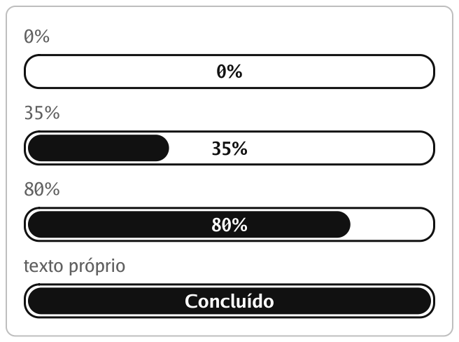
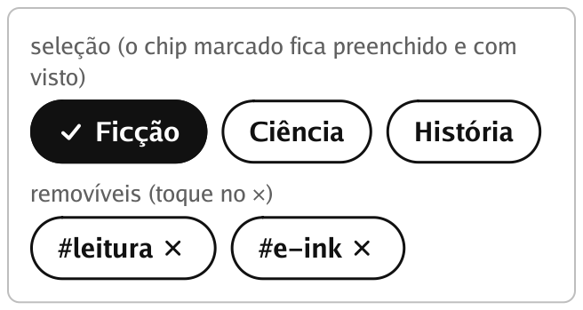
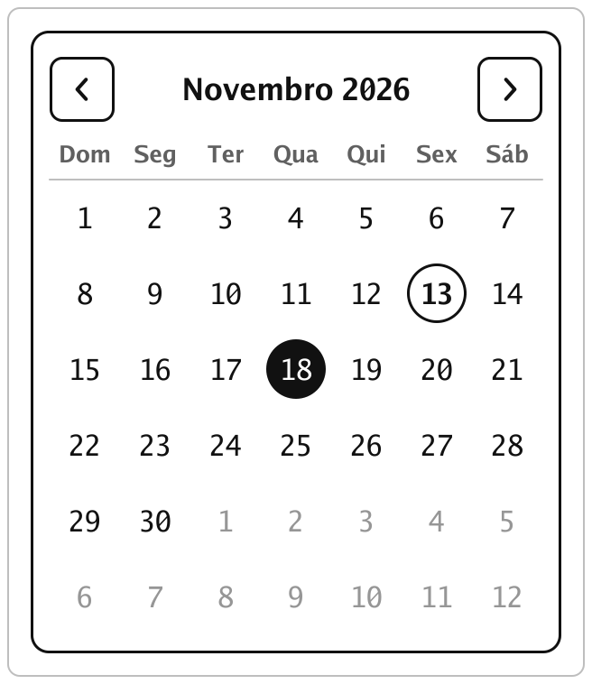
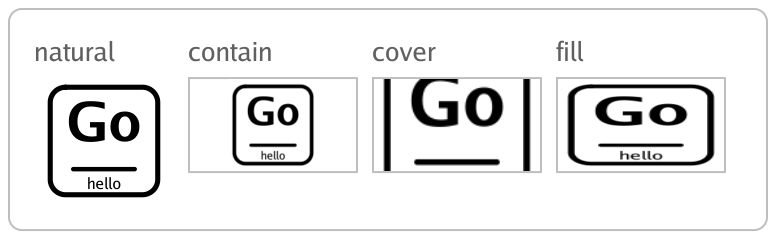
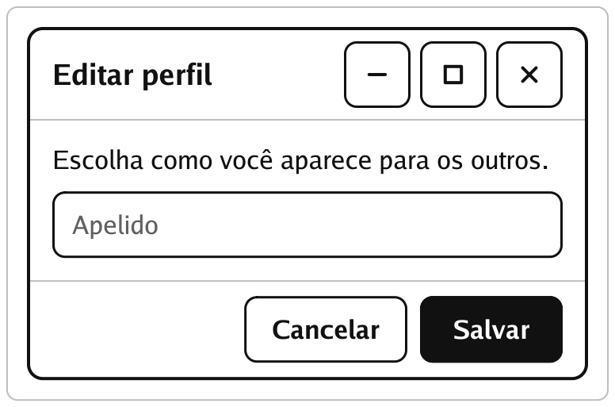

# go-pocketbook-base

[](https://github.com/elias-chacon/go-pocketbook-base/actions/workflows/ci.yml)
[](https://github.com/elias-chacon/go-pocketbook-base/actions/workflows/ci.yml)
[](https://github.com/elias-chacon/go-pocketbook-base/issues)
[](https://github.com/elias-chacon/go-pocketbook-base/releases/latest)
[](https://github.com/elias-chacon/go-pocketbook-base/commits/main)

Base para criar **aplicativos para PocketBook (e-readers Linux ARM) em Go**, com uma
biblioteca de componentes visuais desenhada do zero em gráficos vetoriais
([`fogleman/gg`](https://github.com/fogleman/gg)), ícone que se registra sozinho e build
reproduzível em Docker. Faça um fork para começar novos apps. Otimizada para um hardware limitado com no máximo 1G de ram.

O app de exemplo (`apps/hello`, o blueprint de todo app do ecossistema) é uma vitrine com todos os componentes, em 4 páginas
(**Entradas**, **Escolhas**, **Dados**, **Calendário**) navegadas por uma barra de menus.

> Versão atual: ver [`.version`](.version) · `MAJOR.MINOR.BUILD` (veja [Versionamento](#versionamento)).

## Instalação rápida (usuário final)

Conecte o PocketBook ao computador por USB (modo *Link com PC*) e execute no seu sistema. O instalador acha o leitor, copia os
aplicativos (o Launcher e os outros) e coloca os ícones na tela inicial. Detalhes e avisos do sistema: [capítulo 16](docs/pt-br/16-instalador.md).

**Windows (PowerShell)**

```powershell
Invoke-WebRequest https://github.com/elias-chacon/go-pocketbook-base/releases/latest/download/pbgo-installer_windows_amd64.zip -OutFile pbgo-installer.zip
Expand-Archive pbgo-installer.zip -DestinationPath pbgo-installer -Force
.\pbgo-installer\pbgo-installer.exe
```

**Linux**

```sh
curl -fsSL https://github.com/elias-chacon/go-pocketbook-base/releases/latest/download/pbgo-installer_linux_amd64.tar.gz | tar xz && ./pbgo-installer
```

**macOS (Intel / Apple silicon)**

```sh
arch=$(uname -m); [ "$arch" = x86_64 ] && arch=amd64
curl -fsSL https://github.com/elias-chacon/go-pocketbook-base/releases/latest/download/pbgo-installer_darwin_${arch}.tar.gz | tar xz && ./pbgo-installer
```

Ou baixe o arquivo do seu sistema na página de [Releases](https://github.com/elias-chacon/go-pocketbook-base/releases/latest) e dê dois cliques.

## Os apps

| App | O que faz | Estado |
|---|---|---|
| **Launcher** (`apps/launcher`) | a tela inicial dos apps: grade, busca, instalar do catálogo online, configurações | testado no aparelho |
| **Hello Go** (`apps/hello`) | vitrine de todos os componentes; é o blueprint de todo app | testado no aparelho |
| **E-mail** (`apps/mail`) | pastas, leitura página a página, responder, encaminhar, escrever, apagar, busca, leitura offline (IMAP com senha de app) | compila e passa nos testes; **não testado no aparelho** |
| **Tarefas** (`apps/tasks`) | Meu dia, Importante, Planejado, Atrasadas; adicionar, concluir, editar; sem conta | compila e passa nos testes; **não testado no aparelho** |
| **Calendário** (`apps/calendar`) | mês com pontos nos dias com eventos, agenda do dia, criar e editar eventos; sem conta | compila e passa nos testes; **não testado no aparelho** |

Guia de uso, o que falta e o que foi verificado: [capítulo 23](docs/pt-br/23-apps-de-produtividade.md). Todos estão na Release e aparecem no catálogo do Launcher.

## Documentação completa

|                  |                                                                                                                                                                                                                                                                               |
| ---------------- | ----------------------------------------------------------------------------------------------------------------------------------------------------------------------------------------------------------------------------------------------------------------------------- |
| 🇧🇷 **Português** | [docs/pt-br](docs/pt-br/README.md): [primeiros passos](docs/pt-br/01-primeiros-passos.md) · [instalação](docs/pt-br/02-instalacao.md) · [build](docs/pt-br/03-build-e-versionamento.md) · [componentes](docs/pt-br/06-componentes.md) · [receitas](docs/pt-br/08-receitas.md) |
| 🇬🇧 **English**   | [docs/en](docs/en/README.md): [getting started](docs/en/01-getting-started.md) · [installation](docs/en/02-installation.md) · [build](docs/en/03-build-and-versioning.md) · [components](docs/en/06-components.md) · [recipes](docs/en/08-recipes.md)                         |

Guia passo a passo, referência de todos os componentes (com o desenho de cada um), receitas de telas completas, como criar
componentes próprios, testes e solução de problemas. Checklist código das páginas vem de [`examples/`](examples) (testado).

## Sumário

- [Requisitos](#requisitos) · [Tasks](#tasks) · [Backlog](#backlog)
- [Versionamento](#versionamento)
- [Arquitetura](#arquitetura)
- [Componentes](#componentes)
- [Desenvolvimento](#desenvolvimento) · [Build e instalação](#build-e-instalação) · [Qualidade (Sonar)](#qualidade-sonar)
- [Notas do aparelho](#notas-do-aparelho-pb741)

## Requisitos

### Funcionais

| ID    | Requisito                                                                                                                                                                                                                                                                            |
| ----- | ------------------------------------------------------------------------------------------------------------------------------------------------------------------------------------------------------------------------------------------------------------------------------------ |
| RF-01 | Cada elemento visual é um **objeto com propriedades parecidas com as do JavaScript** (`ID`, `ClassName`, `Style`, `Hidden`, `Disabled`, `Value`, `Checked`, `OnClick`, `OnChange`…), para que no futuro as telas sejam descritas em **HTML** e formatadas com **CSS**.               |
| RF-02 | Layout com **painel flex** (direction, wrap, grow, gap, justify, align) e **grid** (colunas px/`fr`, span, gap).                                                                                                                                                                     |
| RF-03 | Componentes: botão, combo-box, check-box, radio-button, switch, menu bar, input texto, input numérico (máscara, `stepUp`/`stepDown`), input de busca (botão de lupa), text-area, data-table, gauge/progress-bar, slider de tamanho configurável, chips, calendário, card e dropdown, modal centralizada ou fullscreen com opção de mostrar botoes ok, cancelar ou nenhum e botoes de maximizar, minimizar e fechar ou nenhum. |
| RF-04 | **O toque cai exatamente sobre o elemento desenhado** (desenho e toque usam as mesmas coordenadas) e os alvos têm tamanho mínimo confortável.                                                                                                                                        |
| RF-05 | Entrada de texto usa o **teclado do sistema** do aparelho (numérico para campos numéricos).                                                                                                                                                                                          |
| RF-06 | Design pensado para e-ink: alto contraste, bordas nítidas, sem animação, alvos de toque grandes.                                                                                                                                                                                     |
| RF-07 | O app se **instala sozinho** (ícone e entrada no desktop) na primeira execução.                                                                                                                                                                                                      |
| RF-08 | Versionamento em `.version` (começa em `1.0.0`): o build incrementa o **BUILD**, tarefa concluída incrementa o **MINOR**, grande mudança incrementa o **MAJOR**.                                                                                                                     |
| RF-09 | **i18n reutilizável** (`internal/localization/i18n`): todo app é escrito em **pt-BR** e cai automaticamente para **en** (chave → idioma atual → en → pt-BR → a própria chave). |
| RF-10 | **App Launcher e plugins**: os apps filhos vivem em `./apps/` (o `hello` é o blueprint) e seguem o mesmo contrato de empacotamento; o Launcher lista instalados, busca e baixa do GitHub (Releases) os disponíveis, executa os apps e tem configurações persistentes (grid, idioma, fundo). |

### Não funcionais

| ID     | Requisito                                                                               |
| ------ | --------------------------------------------------------------------------------------- |
| RNF-01 | SOLID aplicado com pragmatismo, código limpo, DRY e KISS.                               |
| RNF-02 | Análise estática no **SonarQube local** (`scripts/sonar.ps1`), sem code smells abertos. |
| RNF-03 | Compatível com **Go 1.17** (toolchain do SDK do PocketBook): sem generics.              |
| RNF-04 | Lógica de UI testável no PC, sem aparelho (`go test ./...`, `cmd/preview`).             |
| RNF-05 | A UI escala para qualquer resolução (referência: 1404 px de largura, PB741).            |
| RNF-06 | A UI deve ser otimizada para rodar em um hardware de 1g ram                             |
| RNF-07 | Evite antipatterns, pastas desorganizadas, dupicação de código                          |
| RNF-08 | Organize as pastas separando os projetos e dominios                                     |


## Tasks

Legenda: `[x]` concluída · `[ ]` pendente. Ao concluir uma task, o MINOR é incrementado
(`make task-done` ou `go run ./tools/bumpversion minor`).

**Base**

- [x] T01 Versionamento: `.version`, `tools/bumpversion`, BUILD a cada build, versão no binário e no rodapé
- [x] T02 Camada vetorial `gfx`: canvas escalável, fontes, texto com reticências, formas, ícones
- [x] T03 Modelo DOM: `Base` (ID, ClassName, Hidden, Disabled, OnClick), árvore, `GetElementByID`, `QuerySelectorAll`
- [x] T04 `Style` estilo CSS (box model border-box, cores, fonte, borda, raio)
- [x] T05 Layout **flex** (direction, wrap, grow, gap, justify-content, align-items)
- [x] T06 Layout **grid** (colunas px/`fr`, span, gap, linhas automáticas)
- [x] T07 Eventos de toque: down/move/up/click, captura, bubbling com `StopPropagation`, desabilitado/oculto
- [x] T08 Popups (overlay) e teclado do sistema (`OpenKeyboard`, numérico)

**Componentes**

- [x] T09 Painel flex (`NewPanel`, `NewRow`, `NewColumn`)
- [x] T10 Grid (`NewGrid`)
- [x] T11 Botão (primário, secundário, fantasma, só ícone)
- [x] T12 Combo-box
- [x] T13 Check-box
- [x] T14 Radio-button (grupo por `Name`)
- [x] T15 Menu bar (itens diretos e submenus)
- [x] T16 Input texto (e senha)
- [x] T17 Input numérico com máscara, `StepUp`/`StepDown`, min/max, decimais, prefixo/sufixo
- [x] T18 Input de busca com lupa e limpar
- [x] T19 Text-area
- [x] T20 Data-table (ordenação, seleção, paginação)
- [x] T21 Gauge e progress-bar
- [x] T22 Slider com tamanho configurável (largura, altura e botão)
- [x] T23 Chips (múltiplos, exclusivos, removíveis)
- [x] T24 Switch
- [x] T25 Calendário (pt-BR/en, navegação de mês, hoje, seleção)
- [x] T26 Card
- [x] T27 Dropdown

**Entrega e qualidade**

- [x] T28 Tela de demonstração com todos os componentes (4 páginas) e rodapé com o último toque
- [x] T29 Testes de toque: centro de cada elemento interativo, tamanho mínimo, sem estouro de tela
- [x] T30 Integração com o Sonar local (`sonar-project.properties`, `scripts/sonar.ps1`) e cobertura
- [x] T31 README com requisitos e tasks
- [x] T32 Slide button com 3 posições (esquerda · centro · direita) na demo e teste de encaixe
- [x] T33 Documentação de cada componente no README, com o desenho gerado pelo código (`tools/docgen`)
- [x] T34 Exemplos de código testados (`examples/`) e `tools/docsync`, que mantém a documentação igual ao código
- [x] T35 Documentação completa em português (`docs/pt-br`) e inglês (`docs/en`): primeiros passos, instalação, build, componentes, receitas, componentes próprios, testes e solução de problemas

**Ajustes**

  - [x] T36 A aba de dados demora muito a abrir, talvez por que o componente data table esteja muito pesado, ao navegar nos itens do data table, também demora muito a abrir, o aparelho tem apenas 1G de ram, acredito que todos os componentes devam ser otimizados.
  - [x] T37 As abas devem ser carregadas e descarregadas de forma lazy para evitar o uso intenso da memória ram de 1g apenas. 
  - [x] T38 O botão "Sobre" não mostra nada. Se não temos componente de modal, crie um e coloque o conteudo do sobre nela e siga o padrão de layout já estabelecido - modal centralizada com botão ok.
  - [x] T39 O slide button, quando eu arrasto, não atualiza, ele deveria ser draggable também.
  - [x] T41 Componente de abas (`Tabs`) com política por aba: **lembrar** o estado dos campos (texto, número, paginação da tabela, data do calendário) num store compartilhado e leve, **recriar** do zero ou **manter** a árvore viva.
  - [x] T40 Se possível, ao invés de redesenhar a tela por completo seria interessante redesenhar apenas o componente que está recebendo a interação.

**Launcher e plugins** (RF-09, RF-10; decisões: binários via GitHub Releases, "Installed" = apps do ecossistema com manifesto em `applications/.pbgo/`, `widget.Image` autorizado)

- [x] T42 i18n reutilizável (`internal/localization/i18n`): pt-BR primário, fallback automático para en, JSON embutido
- [x] T43 `widget.Image` + `Canvas.DrawImage` (ícones BMP do grid e imagem de fundo)
- [x] T44 `./apps/`: mover o `hello` para `apps/hello` como blueprint (ciclo de vida, empacotamento, manifesto `app.json`) e migrá-lo para i18n
- [x] T49 Reorganização por domínios (DDD): contextos `kernel`, `toolkit`, `device`, `localization`, `platform` (domain · application · infrastructure) e `showcase`; `apps/` como raízes de composição; `examples/` por contexto; regra de dependência verificada por teste (`internal/architecture`). Feita antes do Launcher para que o código novo já nasça no lugar certo.
- [x] T45 Launcher: grid dos apps instalados (ícone + título) e execução do app filho, com retorno ao Launcher (`execve`, validado no aparelho). Cada app registra o próprio ícone e o `view.json` na primeira execução.
- [x] T46 Launcher: busca em tempo real com as seções `-- Installed --` e `-- Available --` (validada no aparelho: campo, teclado e ×). A porta `Catalog` ainda não tem adaptador: a seção *Disponíveis* diz que o catálogo não está configurado até a T47.
- [ ] T50 Instalador para o usuário final (`cmd/pbinstaller`, contexto `internal/installer`): executável em Go para Windows, Linux e macOS com ícone, que acha o leitor, copia os apps embutidos e registra os ícones; faz parte da release (`tools/release` + `.github/workflows/release.yml`, SHA256SUMS). **Validado no Windows com o leitor real (ícone do `.exe`, achar o leitor, copiar e registrar).** CI (`ci.yml`: vet, testes no Linux, cobertura e badges) e Release (`release.yml`: tag `v*` → todos os apps, instaladores e comandos de instalação para os 3 sistemas) são workflows separados, com badges no topo do README. Falta rodar os dois no GitHub (primeiro push/tag) e testar o instalador em Linux/macOS.
- [ ] T47 Launcher: catálogo do GitHub (assets `<id>.zip` + `catalog.json` da última Release, não a pasta `apps/`, já que o repositório só tem código-fonte), download e instalação com um clique. **Feito no código e nos testes (servidor HTTP de teste), com o ícone de cada app (`apps/<id>/icon.png`, publicado na Release e mostrado nas linhas de *Disponíveis*); falta validar no aparelho: Wi-Fi, DNS, certificados HTTPS e uma Release publicada.**
- [ ] T48 Launcher: configurações persistentes (tamanho dos ícones e da grade, idioma, imagem de fundo). **Feito no código e nos testes** (botão *Configurações* ou tecla Menu; preferências em `applications/.pbgo/launcher.json`; imagens em `applications/backgrounds`; o idioma é o compartilhado por todos os apps); falta validar no aparelho

**Apps de produtividade: e-mail, tarefas e calendário** (3 apps novos em `apps/`, integrados entre si; um contexto DDD por app, mais a fundação compartilhada)

Visão: `apps/mail` (cliente de e-mail com visual parecido com o Outlook), `apps/tasks` (lista de tarefas integrada ao e-mail) e `apps/calendar` (calendário com as funcionalidades do calendário da Microsoft, integrado ao e-mail e capaz de importar arquivos de calendário). Os três compartilham **contas** (credenciais e OAuth), um **armazenamento local** e **intents** (um app abre outro com dados, ex.: "criar tarefa a partir deste e-mail"). Como o leitor roda um app por vez (`execve`), a integração acontece pelos dados compartilhados em disco e pelas intents, não por processos em paralelo.

Critério de pronto de **cada app** (herdado das regras do projeto): segue o contrato de `apps/` (`app.json` em pt-BR e en, `icon.png`, `locales/`), entra na Release e no catálogo do Launcher, tem contexto próprio em `internal/` com as camadas DDD e regra de dependência, **usa os componentes que já existem** (`internal/toolkit/widget`); se faltar um, ele é criado **no toolkit, compartilhado por todos os apps** (nunca dentro de um app), com testes, exemplo em `examples/components` e documentação em `docs/components` (veja a T56), testes, documentação em `docs/en` e `docs/pt-br`, Sonar com 0 smells e validação no aparelho.

*Fase 0: fundação compartilhada (antes dos apps)*

- [x] T51 Decisões de arquitetura ([capítulo 17](docs/pt-br/17-decisoes-apps-de-produtividade.md)): SQLite em Go puro (`modernc.org/sqlite`), `go-imap` v1, `net/smtp` + XOAUTH2, `go-message`, `go-ical` + `rrule-go`, `go-webdav`, Graph por HTTP/JSON, EWS próprio, OAuth por código de dispositivo, **offline-first**, tokens cifrados. As bibliotecas foram compiladas de verdade no SDK (Go 1.17, ARM); o `go-smtp` e o `go-imap` v2 não compilam e ficaram de fora. **Valem até você vetá-las**; falta rodar o SQLite em ARM no aparelho (primeiro passo da T54)
- [ ] T52 Contexto `accounts` ([capítulo 18](docs/pt-br/18-contas-e-segredos.md)): modelo de conta (provedor, protocolos, servidores), presets de provedores e armazenamento no leitor. **Feito:** domínio, casos de uso e armazenamento, com testes. **Falta:** as telas de cadastro de conta reutilizáveis pelos três apps (dependem dos componentes da T56)
- [ ] T53 OAuth2 por **código de dispositivo** (RFC 8628, adequado a um e-reader sem navegador: o leitor mostra o código e o endereço, e você autoriza no celular) para a Microsoft (Outlook.com e Microsoft 365), com renovação de tokens; **senha de app** para Google, iCloud e Fastmail (o fluxo por dispositivo do Google não permite Gmail nem Calendar). **Feito:** o cliente do fluxo (começar, esperar com `slow_down`, negar, expirar, cancelar, renovar) e a configuração da Microsoft, testados contra um servidor de teste. **Falta:** a tela que mostra o código, e **depende de você:** registrar o aplicativo OAuth (client ID) na Microsoft (Entra ID), como cliente público
- [ ] T54 Armazenamento local ([capítulo 22](docs/pt-br/22-armazenamento-local.md)): `internal/storage`, SQLite em Go puro com migrações por módulo, apagar uma conta (a porta `Eraser` da T52) e verificação de integridade, testado e compilado no SDK Go 1.17/ARM. Verificado em **ARMv7 emulado** (`scripts/arm-test.ps1`). **Falta:** rodar no aparelho de verdade, com o volume FAT (primeira coisa a validar quando um app o usar), e as tabelas de cada contexto (cache de mensagens, eventos, tarefas e a fila de operações offline)
- [x] T55 **Intents** entre apps ([capítulo 13](docs/pt-br/13-apps-e-o-contrato.md)): `env.Send(app, "app.acao", dados)` abre outro app com dados (`PBGO_INTENT`, limitada a 48 KB), o app aberto declara no `app.json` o que trata (`intents`), e ao sair o leitor **volta para quem pediu** (e não para o Launcher), sem a intent no ambiente. Testado; falta validar o `execve` entre dois apps no aparelho
- [ ] T56 (parcial: **`Pager` e `TextPager` feitos**, capítulo 6; faltam a grade de agenda e, se preciso, outros) Componentes de UI que os apps exigem e ainda não existem: **rolagem** e lista virtualizada (B04), leitor de texto formatado (HTML simples), grade de calendário, árvore de pastas. Regra do projeto: os apps **reutilizam** os componentes existentes e, se faltar algum, ele nasce no `internal/toolkit/widget` como componente **compartilhado** (genérico, sem nada de e-mail, tarefa ou calendário), com testes, exemplo, documentação e a regra de acerto de toque, e só então os apps o usam. Antes de criar, verificar se um componente existente (ou a composição de alguns) já resolve
- [x] T57 Segurança e privacidade: cofre com AES-256-GCM e PIN opcional (PBKDF2), arquivos 0600, `Secret` que nunca se imprime (testado), conexões sempre protegidas (a validação recusa texto puro), apagar a conta apaga o segredo e, pela porta `Eraser`, os dados locais. O `Eraser` real chega com o store (T54). O cofre sem PIN não é um cofre de verdade (o leitor não tem *keystore*) e os apps devem dizer isso

*App de e-mail (`apps/mail`, contexto `internal/mail`)*

- [ ] T58 Mail ([capítulo 19](docs/pt-br/19-email-dominio-e-mime.md)): domínio (mensagem, pasta, rascunho, responder e encaminhar), leitor e escritor de MIME (partes, codificações, charset, HTML → texto, anexos). **Feito e testado**, e compilado no SDK Go 1.17/ARM. O cache offline de mensagens também está feito (`sqlstore`: páginas sem corpo, busca sem acento, pastas com contagens), testado com um banco em memória. **Falta:** a sincronização que o preenche (T59/T60) e a tela (T62)
- [ ] T59 Mail: **IMAP + SMTP** (login por senha de app ou OAuth2 com XOAUTH2), sincronização de pastas e mensagens, envio, rascunhos e anexos. **Feito:** `imapmail` (pastas com papéis, cabeçalhos recentes, mensagem inteira, lida/não lida, apagar para a Lixeira, envio com cópia em Enviados), `smtpsend` e `xoauth2`, testados contra servidores de mentira (IMAP em memória do go-imap, SMTP mínimo). **Falta:** conferir com um provedor de verdade, a tela de login (T52) e os rascunhos/anexos no servidor
- [ ] T60 Mail: **Microsoft Graph** (Outlook.com e Microsoft 365) por OAuth2, mesmo modelo de domínio. **Feito:** a porta `Backend`, o caso de uso `Sync` (traz pastas e as 50 mais novas, abre do cache, marca, apaga) e o cliente `graph`, testado contra um servidor HTTP de mentira. **Falta:** conferir com o serviço de verdade (depende do client ID da T53), o envio com Cco e a fila de operações offline
- [ ] T61 Mail: **Exchange local** (EWS), para servidores que não usam Microsoft 365
- [ ] T62 Mail (**primeira tela pronta**: `apps/mail` lista pastas e mensagens do cache, lê página a página, marca não lida, apaga, busca e sincroniza; login compartilhado em `internal/accounts/presentation`; também **escreve, responde e encaminha** (sem Cco); sinaliza mensagens; **falta** abrir anexos, rascunhos e testar no aparelho): interface parecida com o **Outlook** adaptada ao e-ink e à tela retrato (pastas, lista de mensagens, leitura, responder/encaminhar, nova mensagem, busca, marcar/sinalizar, anexos), usando os componentes existentes

*App de tarefas (`apps/tasks`, contexto `internal/tasks`)*

- [ ] T63 Tasks: domínio (listas, tarefas, passos, prazo, prioridade, repetição, lembretes) e interface no estilo do Microsoft To Do / tarefas do Outlook (Meu Dia, Importante, Planejado, listas). **Feito o domínio** ([capítulo 21](docs/pt-br/21-tarefas-dominio.md)): visões, concluir com repetição (a próxima conta a partir de hoje se foi com atraso), passos e contagens, testado. O cache de tarefas também está feito (`sqlstore`, testado com a conclusão de uma tarefa que se repete). **Primeira tela pronta:** `apps/tasks` (visões com contagem, adicionar, concluir, editar título/notas/importante/Meu dia/prazo, apagar; sem conta, guardado no leitor). Tem **etapas** (passos) no editor. Tem **listas** (criar, filtrar, apagar). Repete tarefas. **Falta:** lembretes na tela e testar no aparelho. A interface
- [ ] T64 Tasks: sincronização com o **Microsoft To Do** (Graph), **CalDAV** (VTODO) e Google Tasks
- [ ] T65 Tasks ↔ e-mail: criar tarefa a partir de um e-mail, e-mail sinalizado vira tarefa, abrir o e-mail de origem da tarefa (intents da T55)

*App de calendário (`apps/calendar`, contexto `internal/calendar`)*

- [x] T66 Calendar ([capítulo 20](docs/pt-br/20-calendario-dominio-e-icalendar.md)): domínio (eventos, recorrência RRULE que mantém a hora local no horário de verão, fusos IANA e nomes do Windows do Outlook, lembretes, participantes, alterações de uma só aparição) e **iCalendar** (leitura e escrita de `.ics`, com avisos em vez de perder eventos), com **importação e exportação**. Testado com arquivos no estilo do Outlook e do Google, e compilado no SDK Go 1.17/ARM. O cache de eventos também está feito (`sqlstore`: `Between` pronto para o `Expand`, com as alterações de uma só aparição). A tela fica para a T67
- [ ] T67 Calendar (**primeira tela pronta**: `apps/calendar` mostra o mês com pontos nos dias com eventos, a agenda do dia e um formulário de evento, sem conta; repete eventos (dia, semana, mês, ano); guarda lembretes (ainda não tocam); **falta** dia/semana/semana útil, tocar os lembretes e testar no aparelho): interface no estilo do **calendário do Outlook** (dia, semana de trabalho, semana, mês, agenda, vários calendários, criar/editar/excluir, recorrência, lembretes, fuso horário)
- [ ] T68 Calendar: sincronização por **CalDAV/WebDAV** (iCloud, Nextcloud, Fastmail…), **Google Calendar** e **Microsoft Graph** (OAuth2), e **Exchange local** (EWS)
- [ ] T69 Calendar ↔ e-mail: convites e respostas (iTIP/iMIP: aceitar, recusar, talvez), criar evento a partir de um e-mail, e abrir o e-mail de um convite
- [ ] T70 Calendar: importar `.ics` de um anexo de e-mail, da pasta do leitor ou de uma assinatura por endereço (`webcal`), sem duplicar eventos

Ordem sugerida: T51 → T52/T53/T54 → T57 → T55 → T58/T59/T62 (primeiro e-mail ponta a ponta, com IMAP) → T66/T67 (calendário local com `.ics`) → T63 (tarefas locais) → sincronizações (T60, T64, T68) → integrações entre apps (T65, T69, T70) → Exchange local (T61). Cada fase termina com validação no aparelho.

**Bugs**

## Backlog

Ideias para próximas versões (ainda **não** feitas):

- [ ] B01 Parser de **HTML** que gera a árvore de elementos (`<div>`, `<button>`, `<input type=…>`…)
- [ ] B02 Parser de **CSS** (seletores por tag, `.classe`, `#id`; cascata e herança)
- [x] B03 Atualização parcial da tela (`PartialUpdate`) para interações mais rápidas (feita na T40)
- [ ] B04 Container com rolagem (scroll) e `overflow`
- [ ] B05 Tratar rotação (`EVT_ORIENTATION`)
- [x] B06 Diálogo/modal (feito na T38; o toast não foi necessário)
- [x] B07 Abas (feitas na T41; a navegação por pilha de telas ainda não existe)
- [x] B08 Slide-to-confirm (feito na T32 e na T39)
- [x] B09 Log de depuração fora do caminho normal: o log (`applications/<id>.log`) grava só **erros**; o rastro de eventos e passos só com o modo detalhado (arquivo `applications/.pbgo/debug` no leitor, ou `PBGO_DEBUG=1`), e o log recomeça quando passa de 64 KB
- [ ] B10 (CAL) Especificar um app de calendário parecido com o google calendar usando go-pocketbook-base integrado e sincronizado com google, outlook, apple, importação e exportação de arquivos ical. **Incorporado às tarefas T66 a T70** (app de calendário, junto com e-mail e tarefas)

## Versionamento

Formato `MAJOR.MINOR.BUILD`, guardado em [`.version`](.version) (começa em `1.0.0`):

| Quando             | O que sobe                             | Como                                    |
| ------------------ | -------------------------------------- | --------------------------------------- |
| Cada **build**     | `BUILD`                                | automático em `build.ps1` / `make dist` |
| **Task concluída** | `MINOR` (e `BUILD` volta a 0)          | `make task-done`                        |
| **Grande mudança** | `MAJOR` (`MINOR` e `BUILD` voltam a 0) | `make major`                            |

```sh
go run ./tools/bumpversion build   # 1.2.3 -> 1.2.4
go run ./tools/bumpversion minor   # 1.2.4 -> 1.3.0
go run ./tools/bumpversion major   # 1.3.0 -> 2.0.0
```

A versão é gravada no binário por `-ldflags -X …/internal/kernel/version.Value` e aparece no rodapé do app.

## Arquitetura

O código segue **DDD**: contextos delimitados, cada um com suas camadas, e uma regra de dependência
(`internal/architecture`, verificada por teste). Detalhes em [docs/pt-br/14-arquitetura.md](docs/pt-br/14-arquitetura.md).

```
apps/<id>                    raízes de composição: um app por pasta (hello é o blueprint)
internal/
  kernel/                    núcleo compartilhado: geom (Rect, Point…), version (MAJOR.MINOR.BUILD)
  toolkit/                   biblioteca de UI: widget (Document, componentes, layout, toque), gfx (desenho vetorial)
  device/                    o leitor: inkview (binding cgo), desktop (ícone na tela inicial)
  localization/i18n          pt-BR primário, fallback en (JSON embutido)
  platform/                  o que é um app:
    domain                     Manifest, InstalledApp, Settings e as portas (AppRegistry, SettingsStore, …)
    application                casos de uso: Runtime (ciclo de vida), FirstRun (registro na 1ª execução)
    infrastructure             adaptadores: jsonfiles (arquivos JSON), reader (InkView, teclado, desktop)
    platform.go                fachada/raiz de composição: o único import de um app
  launcher/                  o App Launcher: domain (Tile, Grid), application (Home), infrastructure (processlauncher), presentation (telas)
  installer/                 o instalador para pessoas (Windows, Linux, macOS)
  accounts/                  contas, cofre AES-GCM e a tela de login compartilhada
  storage/                   o banco SQLite compartilhado (migrações por módulo)
  mail/ calendar/ tasks/     os contextos dos apps de produtividade: domain · application · infrastructure · presentation
  showcase/                  o conteúdo do app hello (vitrine de componentes)
  architecture/              o mapa e a regra de dependência, como código e teste
examples/                    amostras testadas da documentação, por contexto:
  components/ recipes/ custom/ translation/ harness/
cmd/preview                  renderiza as páginas da demo em PNG (sem aparelho)
tools/                       bumpversion, docgen (imagens), docsync (blocos de código da doc)
```

Decisões (SOLID/KISS/DRY, sem exageros):

- **Interfaces pequenas**: `Widget` (`Elem`, `Measure`, `Paint`), `PointerHandler`, `Keyboard`. O
  teclado é injetado (`FakeKeyboard` em testes/preview, InkView no aparelho): o código de UI não
  conhece o hardware.
- **Um motor de layout** (`layout.go`) para todos: *block* é um flex em coluna; o `Document` só
  chama `layoutWidget`. Cada componente só implementa `Measure` e `Paint`.
- **DRY**: `ComboBox`, `Dropdown` e `MenuBar` reusam o mesmo popup (`menuList`); `Input` usa
  "adornos" (botões laterais) para − / +, lupa e limpar; `paintBox` desenha fundo/borda de todos.
- **Coordenadas em "pixels de design"** (largura de referência 1404). O `Canvas` converte para a
  tela real, e o toque é convertido de volta: desenho e toque usam o mesmo espaço.
- Elementos com propriedades à la JS; **estilos** em `Style` (nomes do CSS), prontos para um
  futuro parser de CSS.

## Componentes

Cada componente abaixo tem o **desenho real** que a biblioteca produz (as imagens são geradas
pelo próprio código: `go run ./tools/docgen`, arquivos em [`docs/components`](docs/components)),
uma explicação, um exemplo e o comportamento ao toque.

### Conceitos comuns

Checklist elemento embute `Base`, que dá as propriedades de um elemento DOM:

| JavaScript                          | Go                              | Observação                                                                                   |
| ----------------------------------- | ------------------------------- | -------------------------------------------------------------------------------------------- |
| `id` · `className`                  | `ID` · `ClassName`              | `Document.GetElementByID(id)` e `QuerySelectorAll(className)`                                |
| `hidden` · `disabled`               | `Hidden` · `Disabled`           | oculto some do layout e do toque; desabilitado fica "apagado" e **não recebe toque**         |
| `onclick`                           | `OnClick`                       | borbulha para os ancestrais, como no navegador; `e.StopPropagation()` interrompe             |
| `onchange` · `oninput`              | `OnChange` · `OnInput` (slider) | `func(e *widget.Event)`; `e.Target` é o elemento                                             |
| `style`                             | `Style`                         | nomes do CSS: `Display`, `FlexDirection`, `Gap`, `Padding`, `Margin`, `Width`, `Background`… |
| `appendChild` · `removeChild`       | `AppendChild` · `RemoveChild`   | também `ClearChildren()`                                                                     |
| `value` · `checked` · `textContent` | `Value` · `Checked` · `Text`    | conforme o componente                                                                        |
| `stepUp()` · `stepDown()`           | `StepUp()` · `StepDown()`       | no input numérico                                                                            |

Medidas em **pixels de design** (largura de referência 1404 px, a do PB741); a biblioteca escala
para a tela real. O modelo de caixa é o `border-box` do CSS (`Width`/`Height` incluem borda e padding).
`Px(n)`, `Pct(n)` ou vazio (auto) formam um `Length`.

O toque **sempre cai onde o elemento está desenhado**: o desenho e o toque usam as mesmas
coordenadas (`Base.Bounds`), e os testes tocam o centro de cada elemento interativo.

---

### Painel flex


O contêiner básico (`<div>`). `NewPanel` empilha os filhos na vertical; `NewRow` e `NewColumn`
criam um **flexbox** em linha ou coluna já com o espaçamento (`gap`). O layout segue o CSS:

- `FlexDirection` (`Row`/`Column`) · `FlexWrap` (quebra de linha) · `Gap`
- `JustifyContent`: `JustifyStart`, `JustifyCenter`, `JustifyEnd`, `JustifySpaceBetween`, `JustifySpaceAround`
- `AlignItems`: `AlignStretch` (padrão, estica), `AlignStart`, `AlignCenter`, `AlignEnd`
- `FlexGrow` (no **filho**): divide o espaço que sobra

```go
row := widget.NewRow(12, a, b, c)                    // flex em linha, gap 12
row.Style.JustifyContent = widget.JustifySpaceBetween
grow.Style.FlexGrow = 1                              // este filho ocupa o resto
```

### Grid


Colunas fixas (`PxTrack`) ou flexíveis (`FrTrack`, como `1fr`); as linhas se ajustam ao item mais
alto. Um filho pode ocupar várias colunas com `Style.GridColumnSpan`.

```go
g := widget.NewGrid(12, []widget.Track{widget.FrTrack(1), widget.FrTrack(1), widget.PxTrack(120)},
    a, b, c, wide, last)
wide.Style.GridColumnSpan = 2
```

### Texto (Label)


Texto estático (`<span>`/`<p>`) que **quebra linha sozinho** na largura disponível e respeita `\n`.
Ajuste com `Style.FontSize`, `Bold`, `Color` e `TextAlign`.

```go
l := widget.NewLabel("Título")
l.Style.FontSize, l.Style.Bold = widget.FontTitle, true
```

### Botão


Três pesos visuais: **primário** (preenchido), **secundário** (contorno, padrão) e **fantasma**
(só texto). Pode ter ícone (`Icon`) ou ser só ícone (`NewIconButton`). Desabilitado fica cinza e
ignora o toque. Altura mínima de 84 px (alvo de toque confortável).

```go
b := widget.NewButton("Salvar")
b.SetVariant(widget.VariantPrimary)   // Primary | Secondary | Ghost
b.Icon = gfx.IconSearch
b.OnClick = func(e *widget.Event) { /* ... */ }
```

### Check-box, radio-button e switch


Controles de liga/desliga com rótulo; **a linha inteira é a área de toque**, não só o desenho.

- **Check-box** (`NewCheckbox`): independente; cada toque alterna `Checked`.
- **Radio-button** (`NewRadio(label, name, value)`): radios com o mesmo `name` são **exclusivos**; tocar no
  já marcado não faz nada.
- **Switch** (`NewSwitch`): interruptor ligado/desligado.

```go
cb := widget.NewCheckbox("Receber e-mails", true)
cb.OnChange = func(e *widget.Event) { fmt.Println(cb.Checked) }
plano := widget.NewRadio("Pro", "plano", "pro")   // e outros radios com o nome "plano"
```

### Combo-box


Campo que guarda **uma opção** de uma lista (`<select>`). Ao tocar, abre a lista logo abaixo (ou
acima, se faltar espaço) com a opção atual destacada; tocar numa opção a escolhe e fecha. Tocar fora
só fecha a lista, sem acionar o que está por baixo.

```go
cb := widget.NewComboBox("Selecione a cidade",
    widget.Option{Label: "São Paulo", Value: "sp"}, widget.Option{Label: "Curitiba", Value: "cwb"})
cb.OnChange = func(e *widget.Event) { fmt.Println(cb.Value()) }   // SetValue("sp") também existe
```

### Dropdown


Botão que abre um **menu de ações** (não guarda valor). Cada item tem `Label`, `Icon`, `OnSelect`,
pode estar `Disabled` ou ser um `Separator`.

```go
dd := widget.NewDropdown("Ações",
    widget.MenuItem{Label: "Duplicar", Icon: gfx.IconPlus, OnSelect: duplicar},
    widget.MenuItem{Separator: true},
    widget.MenuItem{Label: "Excluir", OnSelect: excluir})
```

### Menu bar


Barra de menus no topo da tela. Cada `Menu` ou executa `OnSelect` direto (como trocar de página) ou
abre um submenu com `Items`. `Selected` desenha o item atual preenchido.

```go
bar := widget.NewMenuBar(
    &widget.Menu{Label: "Entradas", Selected: true, OnSelect: func() { mostrar(0) }},
    &widget.Menu{Label: "Mais", Items: []widget.MenuItem{{Label: "Sair", OnSelect: sair}}})
```

### Abas (Tabs)

Barra de menus com páginas. Só a página atual fica na memória (o aparelho tem 1 GB); por aba, `Mode` escolhe o que fazer
com a página ao sair: `TabRemember` (padrão) descarta a árvore mas **guarda o estado** dos campos num `Store` (alguns
bytes) e o devolve ao voltar; `TabRebuild` recomeça do zero; `TabKeepAlive` mantém a árvore viva. São lembrados texto e
número, check/radio/switch, combo, slider, chips, dia e mês do calendário e página/ordenação/seleção da tabela, **para
elementos com `ID`** (senhas nunca). `Store` é uma interface: dá para guardar em arquivo. Detalhes em
[docs/pt-br](docs/pt-br/06-componentes.md).

```go
tabs := widget.NewTabs(nil,
    &widget.Tab{Title: "Entradas", Build: entradas},                      // lembra (padrão)
    &widget.Tab{Title: "Dados", Build: dados, Mode: widget.TabKeepAlive}) // mantém a árvore
```

### Input (texto, senha, numérico, máscara e busca)


Um só componente, vários `Type`s. Tocar no campo abre o **teclado do sistema** (numérico nos campos
numéricos); os botões laterais agem direto, sem teclado.

| Tipo     | Como criar                                   | Extras                                                                                                                   |
| -------- | -------------------------------------------- | ------------------------------------------------------------------------------------------------------------------------ |
| texto    | `NewInput(placeholder)`                      | `Value`, `Placeholder`, `MaxLength`, `ReadOnly`                                                                          |
| senha    | `in.Type = widget.TypePassword`              | mostra `•••`                                                                                                             |
| numérico | `NewNumberInput(valor, casasDecimais)`       | botões **−** e **+**, `Min`, `Max`, `Step`, `Prefix`, `Suffix`, `DecimalSeparator`, `StepUp()`, `StepDown()`, `Number()` |
| máscara  | `NewMaskedInput("(00) 00000-0000", digitos)` | `0` e `#` = um dígito, o resto é literal; `Value` guarda só os dígitos                                                   |
| busca    | `NewSearchInput(placeholder)`                | botão de **lupa** (`OnSubmit`) e **limpar (×)** quando há texto                                                          |

```go
qty := widget.NewNumberInput(1, 0)
qty.Min, qty.Max = 0, 99
qty.OnChange = func(e *widget.Event) { fmt.Println(qty.Number()) }

busca := widget.NewSearchInput("Buscar livros…")
busca.OnSubmit = func(e *widget.Event) { buscar(busca.Value) }   // lupa ou OK no teclado
```

### Text-area


Campo de várias linhas (`<textarea>`) com altura de `Rows` linhas; o texto **quebra linha** e aceita
`\n`. Tocar abre o teclado do sistema.

```go
ta := widget.NewTextArea("Observações…", 4)
ta.OnChange = func(e *widget.Event) { fmt.Println(ta.Value) }
```

### Data-table


Tabela **paginada**: toque no cabeçalho de uma coluna `Sortable` para ordenar (de novo inverte; números
são comparados como números), toque numa linha para selecioná-la (fica preenchida) e use as setas do
rodapé para trocar de página. `Selected` é sempre o índice na lista original, mesmo ordenada.

```go
t := widget.NewTable(5,
    widget.TableColumn{Title: "Livro", Flex: 3, Sortable: true},
    widget.TableColumn{Title: "Págs", Flex: 1, Align: gfx.AlignEnd, Sortable: true})
t.Rows = [][]string{{"Dom Casmurro", "256"}, {"Vidas Secas", "176"}}
t.OnSelect = func(e *widget.Event) { fmt.Println(t.Rows[t.Selected]) }
```

### Progress bar



Barra de progresso (`<progress>`) com o percentual escrito dentro; o texto **inverte de cor** onde o
preenchimento passa por baixo dele. `Text` substitui o percentual.

```go
p := widget.NewProgress(35)   // 0..100
p.Value = 60
```

### Gauge


Medidor semicircular (velocímetro) com o valor no centro, os limites nas pontas e um rótulo.

```go
g := widget.NewGauge(0, 240, 135, " km/h")
g.Label = "Velocidade"
```

### Slider (slide button)


Uma **barra com um botão que desliza**. Toque em qualquer ponto ou arraste o botão; `OnInput` dispara
enquanto arrasta e `OnChange` ao soltar. O `Step` faz o botão **encaixar**: com `Step 50` de 0 a 100
ele só para na esquerda, no centro e na direita (`O============`, `======O======`, `============O`).
O **tamanho é configurável**: largura/altura da caixa (`Style.Width/Height`) e o botão (`ThumbSize`).
A área de toque tem no mínimo 64 px, mesmo com botão pequeno.

```go
s := widget.NewSlider(0, 100, 50, 50)   // min, max, passo, valor: 3 posições, começa no centro
s.Style.Width, s.ThumbSize = widget.Px(420), 84
s.OnChange = func(e *widget.Event) { fmt.Println(s.Value) }
```

### Chips



Cápsulas compactas. Num `ChipGroup` com várias linhas (quebra automática), a seleção pode ser
**múltipla** ou **exclusiva** (`NewChipGroup(true, ...)`: um por vez, como radio). Com `Closable`, o
`×` remove o chip (ou chama `OnClose`).

```go
g := widget.NewChipGroup(false)               // true = exclusivo
c := widget.NewChip("Ficção")
c.OnChange = func(e *widget.Event) { fmt.Println(g.SelectedLabels()) }
g.AppendChild(c)
```

### Calendário



Um mês por vez. As setas trocam de mês, tocar num dia o seleciona (preenchido) e tocar num dia do
mês vizinho (cinza) também navega até ele. O dia de hoje ganha um anel. Os nomes vêm de `Locale`
(`LocalePTBR` ou `LocaleEN`).

```go
cal := widget.NewCalendar(time.Now())
cal.Locale = widget.LocalePTBR
cal.OnChange = func(e *widget.Event) { fmt.Println(cal.Selected) }
```

### Imagem



Bitmap (``) com tamanho natural (1 pixel = 1 px de design), `Fit` (`FitContain`, `FitCover`, `FitFill`) e toque
(`OnClick` faz dele um bloco de ícone). `gfx.LoadImage(caminho, maxW, maxH)` lê PNG/JPEG/GIF/BMP e **reduz** fotos grandes (o
leitor tem 1 GB); `gfx.Resize` escala uma vez para o tamanho final. Para uma imagem atrás de um elemento inteiro:
`Style.BackgroundImage` + `BackgroundSize`.

```go
logo := widget.NewImage(icone)
logo.Fit = gfx.FitCover
pagina.Style.BackgroundImage = papelDeParede
```

### Modal



Diálogo **acima da página**, centralizado, com barra de título, corpo e rodapé; enquanto aberto recebe todos os toques.
Rodapé: OK (padrão), OK e Cancelar ou nenhum; barra de título: fechar, maximizar e minimizar (ou nenhum). Maximizar vira
**tela cheia**; minimizar reduz à barra de título no rodapé da tela e libera a página. A tecla Voltar cancela
(`doc.HandleBack()`; no PB741, que não tem Voltar, são as teclas esquerda e Menu). O botão "Sobre" do app de exemplo usa uma modal com OK; "Modal (opções)" mostra todas as opções.

```go
m := widget.NewModal("Editar perfil", widget.NewLabel("Escolha seu apelido"), apelido)
m.SetButtons(widget.ModalOKCancel)
m.SetControls(widget.ModalClose | widget.ModalMaximize | widget.ModalMinimize)
m.OnOK = func(e *widget.Event) { salvar(apelido.Value) }
m.Open(doc)
```

### Card


Superfície com borda e cantos arredondados que agrupa conteúdo relacionado: título, subtítulo
opcional e o que mais você incluir (texto, campos, botões, tabelas…). É um painel em coluna.

```go
c := widget.NewCard("Título", "Subtítulo", widget.NewLabel("Corpo"), widget.NewRow(14, ok, depois))
```

## Desenvolvimento

```sh
go test ./...                        # testes (layout, componentes, toque, demo, versão)
go run ./cmd/preview                 # gera preview-0..3.png no tamanho do PB741
go run ./cmd/preview -page 2 -w 758 -h 1024   # uma página, outra resolução
go run ./tools/docgen                # regenera docs/components/*.png (desenhos do README)
```

## Build e instalação

Precisa de Docker (a imagem traz o SDK do PocketBook e o Go 1.17 corrigido).

```sh
make dist          # Linux/macOS/WSL
.\build.ps1        # Windows (Docker Desktop ou Docker dentro do WSL)
```

Gera `dist/applications/hello.app` (arquivo único) e **incrementa o BUILD**.

**Instalar = copiar um arquivo.** Copie `hello.app` para `<aparelho>/applications/` (ou
`.\scripts\install.ps1 -Drive F:`) e abra pela lista de Aplicativos. Na **primeira execução** o app:

1. gera os ícones (normal e focado, 128×128 BMP de 8 bits) em `applications/icons/`;
2. registra a entrada `U_hello` em `system/profiles/default/config/desktop/view.json` (o
   `system/config` é um link para essa pasta) e a chave no grupo `@General`, com **backup**
   (`view.json.bak-<hora>`), validação do JSON e troca atômica; é idempotente e corrige entradas
   antigas com caminho relativo.

O ícone aparece quando o desktop recarrega a configuração (por exemplo, ao tirar o cabo USB).

## Qualidade (Sonar)

Com um SonarQube local em `http://localhost:9000` e um token em `SONAR_GLOBAL_TOKEN`:

```powershell
.\scripts\sonar.ps1      # Windows: testes com cobertura + scanner (Docker no WSL)
```

```sh
scripts/sonar.sh         # Linux/WSL
```

A configuração está em [`sonar-project.properties`](sonar-project.properties).

## Notas do aparelho (PB741)

Desenvolvido e testado em um **PocketBook PB741-N-WW** (InkPad Color 2): 7,8", 1404×1872, canvas de
24 bits, firmware 6.x.

- Com o painel do sistema ligado (padrão), o InkView reserva 137 px e desloca o canvas; o app chama
  `inkview.DisablePanel()` no início para a tela inteira ser do app.
- **Teclas:** o PB741 tem Home, esquerda (página anterior), direita (página seguinte) e Menu, e **não tem Voltar**. O Home fecha o app pelo sistema; no app de exemplo, esquerda e Menu fecham popup/modal (`inkview.IsBackKey`), e esquerda/direita trocam de aba quando nada está aberto.
- O `path` de `U_<app>` no `view.json` precisa ser **absoluto**; ícones podem ser relativos.
- Desempenho (medido no PB741, tela cheia): a conversão RGBA→cinza com `draw.Draw` levava 2,7 s por frame e o `Clip` do `gg` alocava 10 MB por texto; uma tela completa leva ~1,5 s (desenho vetorial) + ~0,1 s de blit, mas `Document.Update` repinta só o que mudou: um toque pequeno custa 0,1–0,4 s e uma tabela ~0,6 s. O custo fixo da detecção de mudança é ~0,1 s (layout + retrato dos elementos).
- O app grava `applications/hello.log` (eventos) para depuração; remova a linha `DebugLog` em release.

## Licença

MIT
