# go-pocketbook-base

Base para criar **aplicativos para PocketBook (e-readers Linux ARM) em Go**, com uma
biblioteca de componentes visuais desenhada do zero em gráficos vetoriais
([`fogleman/gg`](https://github.com/fogleman/gg)), ícone que se registra sozinho e build
reproduzível em Docker. Faça um fork para começar novos apps.

O app de exemplo (`cmd/hello`) é uma vitrine com todos os componentes, em 4 páginas
(**Entradas**, **Escolhas**, **Dados**, **Calendário**) navegadas por uma barra de menus.

> Versão atual: ver [`.version`](.version) · `MAJOR.MINOR.BUILD` (veja [Versionamento](#versionamento)).

## Sumário

- [Requisitos](#requisitos) · [Tasks](#tasks) · [Backlog](#backlog)
- [Versionamento](#versionamento)
- [Arquitetura](#arquitetura)
- [Componentes](#componentes)
- [Desenvolvimento](#desenvolvimento) · [Build e instalação](#build-e-instalação) · [Qualidade (Sonar)](#qualidade-sonar)
- [Notas do aparelho](#notas-do-aparelho-pb741)

## Requisitos

### Funcionais

| ID | Requisito |
|---|---|
| RF-01 | Cada elemento visual é um **objeto com propriedades parecidas com as do JavaScript** (`ID`, `ClassName`, `Style`, `Hidden`, `Disabled`, `Value`, `Checked`, `OnClick`, `OnChange`…), para que no futuro as telas sejam descritas em **HTML** e formatadas com **CSS**. |
| RF-02 | Layout com **painel flex** (direction, wrap, grow, gap, justify, align) e **grid** (colunas px/`fr`, span, gap). |
| RF-03 | Componentes: botão, combo-box, check-box, radio-button, switch, menu bar, input texto, input numérico (máscara, `stepUp`/`stepDown`), input de busca (botão de lupa), text-area, data-table, gauge/progress-bar, slider de tamanho configurável, chips, calendário, card e dropdown. |
| RF-04 | **O toque cai exatamente sobre o elemento desenhado** (desenho e toque usam as mesmas coordenadas) e os alvos têm tamanho mínimo confortável. |
| RF-05 | Entrada de texto usa o **teclado do sistema** do aparelho (numérico para campos numéricos). |
| RF-06 | Design pensado para e-ink: alto contraste, bordas nítidas, sem animação, alvos de toque grandes. |
| RF-07 | O app se **instala sozinho** (ícone e entrada no desktop) na primeira execução. |
| RF-08 | Versionamento em `.version` (começa em `1.0.0`): o build incrementa o **BUILD**, tarefa concluída incrementa o **MINOR**, grande mudança incrementa o **MAJOR**. |

### Não funcionais

| ID | Requisito |
|---|---|
| RNF-01 | SOLID aplicado com pragmatismo, código limpo, DRY e KISS. |
| RNF-02 | Análise estática no **SonarQube local** (`scripts/sonar.ps1`), sem code smells abertos. |
| RNF-03 | Compatível com **Go 1.17** (toolchain do SDK do PocketBook): sem generics. |
| RNF-04 | Lógica de UI testável no PC, sem aparelho (`go test ./...`, `cmd/preview`). |
| RNF-05 | A UI escala para qualquer resolução (referência: 1404 px de largura, PB741). |

## Tasks

Legenda: `[x]` concluída · `[ ]` pendente. Ao concluir uma task, o MINOR é incrementado
(`make task-done` ou `go run ./tools/bumpversion minor`).

**Base**

- [x] T01 Versionamento: `.version`, `tools/bumpversion`, BUILD a cada build, versão no binário e no rodapé
- [x] T02 Camada vetorial `gfx`: canvas escalável, fontes, texto com reticências, formas, ícones
- [x] T03 Modelo DOM: `Base` (ID, ClassName, Hidden, Disabled, OnClick), árvore, `GetElementByID`, `QuerySelectorAll`
- [x] T04 `Style` estilo CSS (box model border-box, cores, fonte, borda, raio)
- [x] T05 Layout **flex** (direction, wrap, grow, gap, justify-content, align-items)
- [x] T06 Layout **grid** (colunas px/`fr`, span, gap, linhas automáticas)
- [x] T07 Eventos de toque: down/move/up/click, captura, bubbling com `StopPropagation`, desabilitado/oculto
- [x] T08 Popups (overlay) e teclado do sistema (`OpenKeyboard`, numérico)

**Componentes**

- [x] T09 Painel flex (`NewPanel`, `NewRow`, `NewColumn`)
- [x] T10 Grid (`NewGrid`)
- [x] T11 Botão (primário, secundário, fantasma, só ícone)
- [x] T12 Combo-box
- [x] T13 Check-box
- [x] T14 Radio-button (grupo por `Name`)
- [x] T15 Menu bar (itens diretos e submenus)
- [x] T16 Input texto (e senha)
- [x] T17 Input numérico com máscara, `StepUp`/`StepDown`, min/max, decimais, prefixo/sufixo
- [x] T18 Input de busca com lupa e limpar
- [x] T19 Text-area
- [x] T20 Data-table (ordenação, seleção, paginação)
- [x] T21 Gauge e progress-bar
- [x] T22 Slider com tamanho configurável (largura, altura e botão)
- [x] T23 Chips (múltiplos, exclusivos, removíveis)
- [x] T24 Switch
- [x] T25 Calendário (pt-BR/en, navegação de mês, hoje, seleção)
- [x] T26 Card
- [x] T27 Dropdown

**Entrega e qualidade**

- [x] T28 Tela de demonstração com todos os componentes (4 páginas) e rodapé com o último toque
- [x] T29 Testes de toque: centro de cada elemento interativo, tamanho mínimo, sem estouro de tela
- [x] T30 Integração com o Sonar local (`sonar-project.properties`, `scripts/sonar.ps1`) e cobertura
- [x] T31 README com requisitos e tasks
- [x] T32 Slide button com 3 posições (esquerda · centro · direita) na demo e teste de encaixe
- [x] T33 Documentação de cada componente no README, com o desenho gerado pelo código (`tools/docgen`)
- [x] T34 Exemplos de código testados (`examples/`) e `tools/docsync`, que mantém a documentação igual ao código

## Backlog

Ideias para próximas versões (ainda **não** feitas):

- [ ] B01 Parser de **HTML** que gera a árvore de elementos (`<div>`, `<button>`, `<input type=…>`…)
- [ ] B02 Parser de **CSS** (seletores por tag, `.classe`, `#id`; cascata e herança)
- [ ] B03 Atualização parcial da tela (`PartialUpdate`) para interações mais rápidas
- [ ] B04 Container com rolagem (scroll) e `overflow`
- [ ] B05 Tratar rotação (`EVT_ORIENTATION`)
- [ ] B06 Diálogo/modal e toast
- [ ] B07 Abas (tabs) e navegação por pilha de telas
- [ ] B08 Slide-to-confirm (botão deslizante de confirmação)
- [ ] B09 Remover o log de eventos de depuração (`DebugLog`) em builds de release

## Versionamento

Formato `MAJOR.MINOR.BUILD`, guardado em [`.version`](.version) (começa em `1.0.0`):

| Quando | O que sobe | Como |
|---|---|---|
| Cada **build** | `BUILD` | automático em `build.ps1` / `make dist` |
| **Task concluída** | `MINOR` (e `BUILD` volta a 0) | `make task-done` |
| **Grande mudança** | `MAJOR` (`MINOR` e `BUILD` voltam a 0) | `make major` |

```sh
go run ./tools/bumpversion build   # 1.2.3 -> 1.2.4
go run ./tools/bumpversion minor   # 1.2.4 -> 1.3.0
go run ./tools/bumpversion major   # 1.3.0 -> 2.0.0
```

A versão é gravada no binário por `-ldflags -X …/internal/version.Value` e aparece no rodapé do app.

## Arquitetura

```
cmd/hello          app do aparelho: liga InkView ↔ widget.Document (toque, teclado, repaint)
cmd/preview        renderiza as páginas da demo em PNG (sem aparelho)
internal/demo      vitrine de componentes (compartilhada por hello, preview e testes)
internal/widget    componentes + layout flex/grid + despacho de toque (a biblioteca)
internal/gfx       desenho vetorial: Canvas, fontes, texto, ícones, cores
internal/geom      Rect, Point, Size, Insets
internal/inkview   binding cgo mínimo da libinkview (eventos, blit, teclado)
internal/install   auto-instalação (ícones + entrada no view.json do desktop)
internal/ui        ícone de lançamento
internal/version   MAJOR.MINOR.BUILD
tools/bumpversion  incrementa .version
tools/docgen        gera os desenhos de cada componente (docs/components/*.png)
tools/docsync       preenche os blocos de código de docs/ a partir de examples/ (e confere)
examples/          exemplos testados usados na documentação (telas completas, um por componente, app novo)
```

Decisões (SOLID/KISS/DRY, sem exageros):

- **Interfaces pequenas**: `Widget` (`Elem`, `Measure`, `Paint`), `PointerHandler`, `Keyboard`. O
  teclado é injetado (`FakeKeyboard` em testes/preview, InkView no aparelho): o código de UI não
  conhece o hardware.
- **Um motor de layout** (`layout.go`) para todos: *block* é um flex em coluna; o `Document` só
  chama `layoutWidget`. Cada componente só implementa `Measure` e `Paint`.
- **DRY**: `ComboBox`, `Dropdown` e `MenuBar` reusam o mesmo popup (`menuList`); `Input` usa
  "adornos" (botões laterais) para − / +, lupa e limpar; `paintBox` desenha fundo/borda de todos.
- **Coordenadas em "pixels de design"** (largura de referência 1404). O `Canvas` converte para a
  tela real, e o toque é convertido de volta: desenho e toque usam o mesmo espaço.
- Elementos com propriedades à la JS; **estilos** em `Style` (nomes do CSS), prontos para um
  futuro parser de CSS.

## Componentes

Cada componente abaixo tem o **desenho real** que a biblioteca produz (as imagens são geradas
pelo próprio código: `go run ./tools/docgen`, arquivos em [`docs/components`](docs/components)),
uma explicação, um exemplo e o comportamento ao toque.

### Conceitos comuns

Todo elemento embute `Base`, que dá as propriedades de um elemento DOM:

| JavaScript | Go | Observação |
|---|---|---|
| `id` · `className` | `ID` · `ClassName` | `Document.GetElementByID(id)` e `QuerySelectorAll(className)` |
| `hidden` · `disabled` | `Hidden` · `Disabled` | oculto some do layout e do toque; desabilitado fica "apagado" e **não recebe toque** |
| `onclick` | `OnClick` | borbulha para os ancestrais, como no navegador; `e.StopPropagation()` interrompe |
| `onchange` · `oninput` | `OnChange` · `OnInput` (slider) | `func(e *widget.Event)`; `e.Target` é o elemento |
| `style` | `Style` | nomes do CSS: `Display`, `FlexDirection`, `Gap`, `Padding`, `Margin`, `Width`, `Background`… |
| `appendChild` · `removeChild` | `AppendChild` · `RemoveChild` | também `ClearChildren()` |
| `value` · `checked` · `textContent` | `Value` · `Checked` · `Text` | conforme o componente |
| `stepUp()` · `stepDown()` | `StepUp()` · `StepDown()` | no input numérico |

Medidas em **pixels de design** (largura de referência 1404 px, a do PB741); a biblioteca escala
para a tela real. O modelo de caixa é o `border-box` do CSS (`Width`/`Height` incluem borda e padding).
`Px(n)`, `Pct(n)` ou vazio (auto) formam um `Length`.

O toque **sempre cai onde o elemento está desenhado**: o desenho e o toque usam as mesmas
coordenadas (`Base.Bounds`), e os testes tocam o centro de cada elemento interativo.

---

### Painel flex

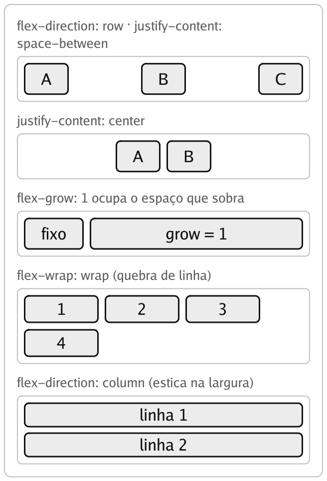

O contêiner básico (`<div>`). `NewPanel` empilha os filhos na vertical; `NewRow` e `NewColumn`
criam um **flexbox** em linha ou coluna já com o espaçamento (`gap`). O layout segue o CSS:

- `FlexDirection` (`Row`/`Column`) · `FlexWrap` (quebra de linha) · `Gap`
- `JustifyContent`: `JustifyStart`, `JustifyCenter`, `JustifyEnd`, `JustifySpaceBetween`, `JustifySpaceAround`
- `AlignItems`: `AlignStretch` (padrão, estica), `AlignStart`, `AlignCenter`, `AlignEnd`
- `FlexGrow` (no **filho**): divide o espaço que sobra

```go
row := widget.NewRow(12, a, b, c)                    // flex em linha, gap 12
row.Style.JustifyContent = widget.JustifySpaceBetween
grow.Style.FlexGrow = 1                              // este filho ocupa o resto
```

### Grid

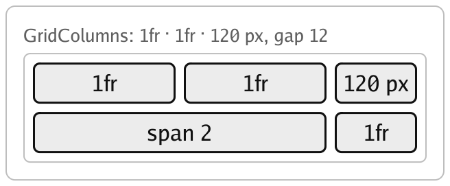

Colunas fixas (`PxTrack`) ou flexíveis (`FrTrack`, como `1fr`); as linhas se ajustam ao item mais
alto. Um filho pode ocupar várias colunas com `Style.GridColumnSpan`.

```go
g := widget.NewGrid(12, []widget.Track{widget.FrTrack(1), widget.FrTrack(1), widget.PxTrack(120)},
    a, b, c, wide, last)
wide.Style.GridColumnSpan = 2
```

### Texto (Label)

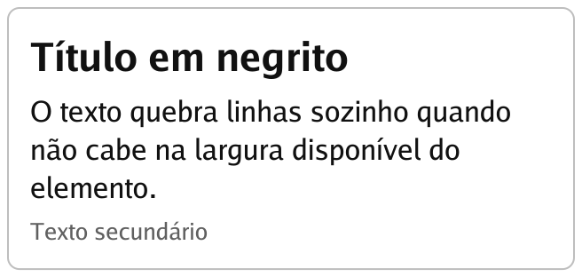

Texto estático (`<span>`/`<p>`) que **quebra linha sozinho** na largura disponível e respeita `\n`.
Ajuste com `Style.FontSize`, `Bold`, `Color` e `TextAlign`.

```go
l := widget.NewLabel("Título")
l.Style.FontSize, l.Style.Bold = widget.FontTitle, true
```

### Botão

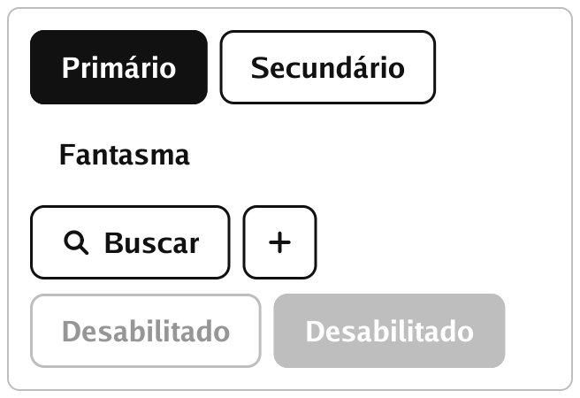

Três pesos visuais: **primário** (preenchido), **secundário** (contorno, padrão) e **fantasma**
(só texto). Pode ter ícone (`Icon`) ou ser só ícone (`NewIconButton`). Desabilitado fica cinza e
ignora o toque. Altura mínima de 84 px (alvo de toque confortável).

```go
b := widget.NewButton("Salvar")
b.SetVariant(widget.VariantPrimary)   // Primary | Secondary | Ghost
b.Icon = gfx.IconSearch
b.OnClick = func(e *widget.Event) { /* ... */ }
```

### Check-box, radio-button e switch

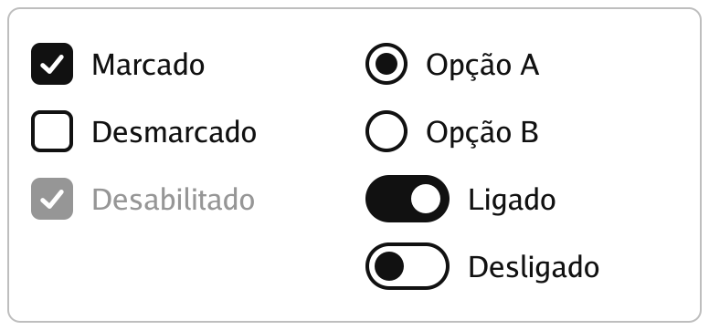

Controles de liga/desliga com rótulo; **a linha inteira é a área de toque**, não só o desenho.

- **Check-box** (`NewCheckbox`): independente; cada toque alterna `Checked`.
- **Radio-button** (`NewRadio(label, name, value)`): radios com o mesmo `name` são **exclusivos**; tocar no
  já marcado não faz nada.
- **Switch** (`NewSwitch`): interruptor ligado/desligado.

```go
cb := widget.NewCheckbox("Receber e-mails", true)
cb.OnChange = func(e *widget.Event) { fmt.Println(cb.Checked) }
plano := widget.NewRadio("Pro", "plano", "pro")   // e outros radios com o nome "plano"
```

### Combo-box

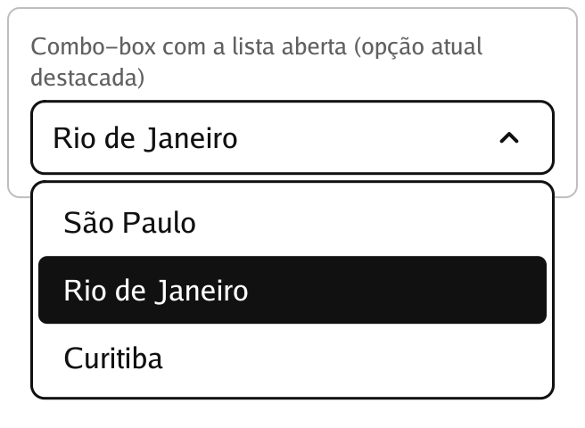

Campo que guarda **uma opção** de uma lista (`<select>`). Ao tocar, abre a lista logo abaixo (ou
acima, se faltar espaço) com a opção atual destacada; tocar numa opção a escolhe e fecha. Tocar fora
só fecha a lista, sem acionar o que está por baixo.

```go
cb := widget.NewComboBox("Selecione a cidade",
    widget.Option{Label: "São Paulo", Value: "sp"}, widget.Option{Label: "Curitiba", Value: "cwb"})
cb.OnChange = func(e *widget.Event) { fmt.Println(cb.Value()) }   // SetValue("sp") também existe
```

### Dropdown

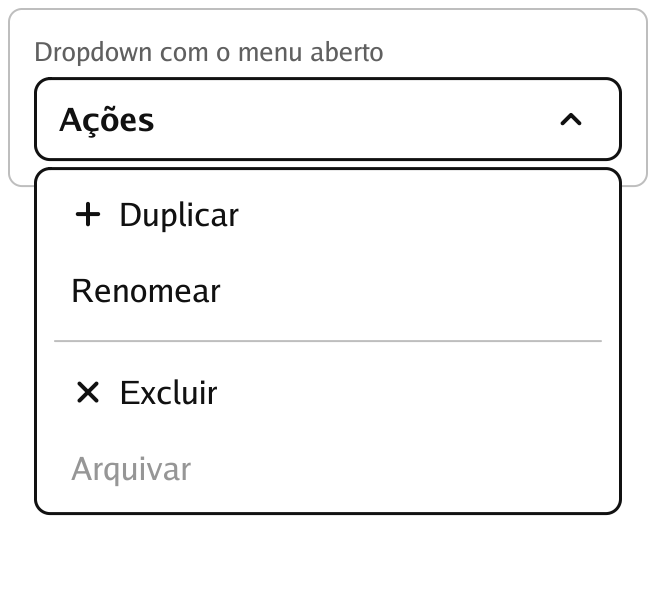

Botão que abre um **menu de ações** (não guarda valor). Cada item tem `Label`, `Icon`, `OnSelect`,
pode estar `Disabled` ou ser um `Separator`.

```go
dd := widget.NewDropdown("Ações",
    widget.MenuItem{Label: "Duplicar", Icon: gfx.IconPlus, OnSelect: duplicar},
    widget.MenuItem{Separator: true},
    widget.MenuItem{Label: "Excluir", OnSelect: excluir})
```

### Menu bar

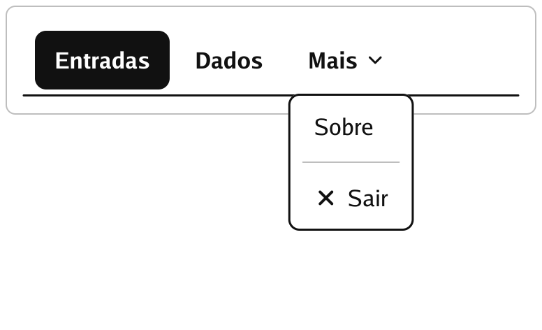

Barra de menus no topo da tela. Cada `Menu` ou executa `OnSelect` direto (como trocar de página) ou
abre um submenu com `Items`. `Selected` desenha o item atual preenchido.

```go
bar := widget.NewMenuBar(
    &widget.Menu{Label: "Entradas", Selected: true, OnSelect: func() { mostrar(0) }},
    &widget.Menu{Label: "Mais", Items: []widget.MenuItem{{Label: "Sair", OnSelect: sair}}})
```

### Input (texto, senha, numérico, máscara e busca)

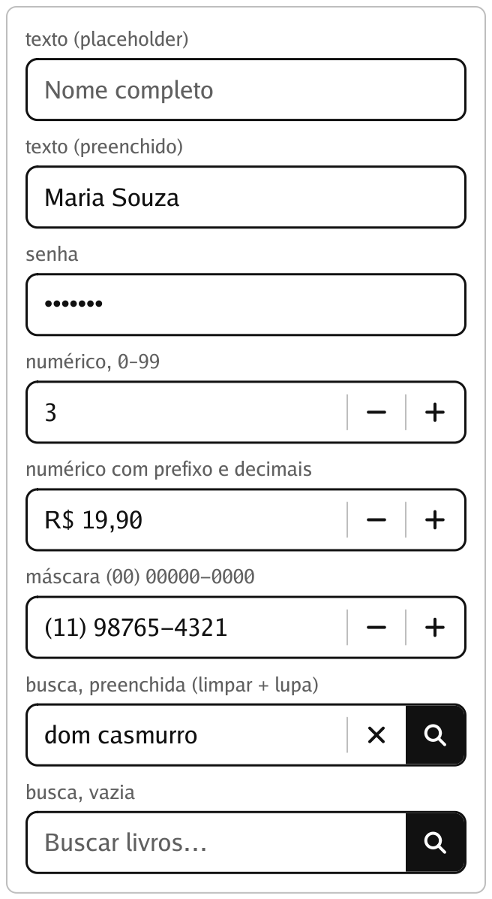

Um só componente, vários `Type`s. Tocar no campo abre o **teclado do sistema** (numérico nos campos
numéricos); os botões laterais agem direto, sem teclado.

| Tipo | Como criar | Extras |
|---|---|---|
| texto | `NewInput(placeholder)` | `Value`, `Placeholder`, `MaxLength`, `ReadOnly` |
| senha | `in.Type = widget.TypePassword` | mostra `•••` |
| numérico | `NewNumberInput(valor, casasDecimais)` | botões **−** e **+**, `Min`, `Max`, `Step`, `Prefix`, `Suffix`, `DecimalSeparator`, `StepUp()`, `StepDown()`, `Number()` |
| máscara | `NewMaskedInput("(00) 00000-0000", digitos)` | `0` e `#` = um dígito, o resto é literal; `Value` guarda só os dígitos |
| busca | `NewSearchInput(placeholder)` | botão de **lupa** (`OnSubmit`) e **limpar (×)** quando há texto |

```go
qty := widget.NewNumberInput(1, 0)
qty.Min, qty.Max = 0, 99
qty.OnChange = func(e *widget.Event) { fmt.Println(qty.Number()) }

busca := widget.NewSearchInput("Buscar livros…")
busca.OnSubmit = func(e *widget.Event) { buscar(busca.Value) }   // lupa ou OK no teclado
```

### Text-area

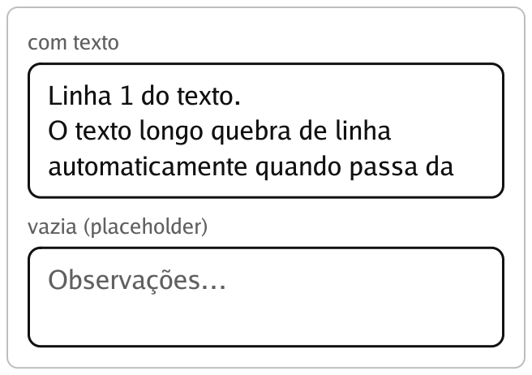

Campo de várias linhas (`<textarea>`) com altura de `Rows` linhas; o texto **quebra linha** e aceita
`\n`. Tocar abre o teclado do sistema.

```go
ta := widget.NewTextArea("Observações…", 4)
ta.OnChange = func(e *widget.Event) { fmt.Println(ta.Value) }
```

### Data-table

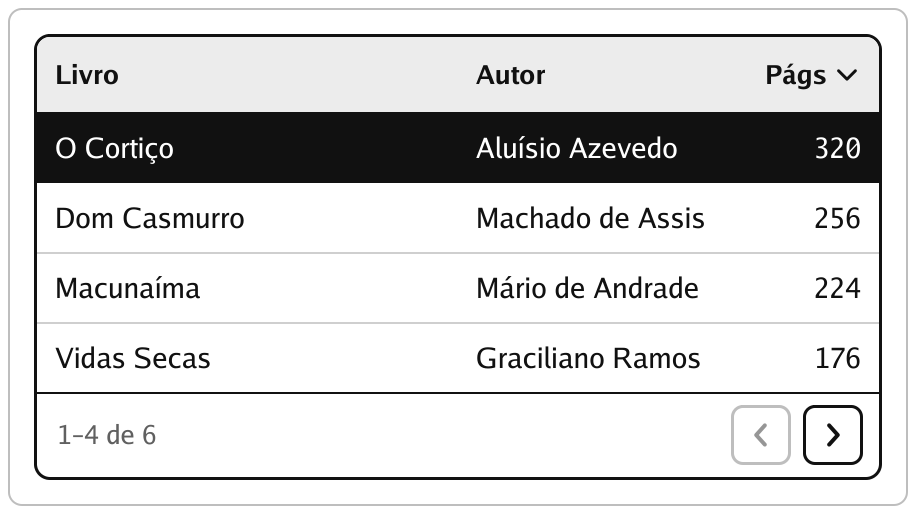

Tabela **paginada**: toque no cabeçalho de uma coluna `Sortable` para ordenar (de novo inverte; números
são comparados como números), toque numa linha para selecioná-la (fica preenchida) e use as setas do
rodapé para trocar de página. `Selected` é sempre o índice na lista original, mesmo ordenada.

```go
t := widget.NewTable(5,
    widget.TableColumn{Title: "Livro", Flex: 3, Sortable: true},
    widget.TableColumn{Title: "Págs", Flex: 1, Align: gfx.AlignEnd, Sortable: true})
t.Rows = [][]string{{"Dom Casmurro", "256"}, {"Vidas Secas", "176"}}
t.OnSelect = func(e *widget.Event) { fmt.Println(t.Rows[t.Selected]) }
```

### Progress bar


Barra de progresso (`<progress>`) com o percentual escrito dentro; o texto **inverte de cor** onde o
preenchimento passa por baixo dele. `Text` substitui o percentual.

```go
p := widget.NewProgress(35)   // 0..100
p.Value = 60
```

### Gauge

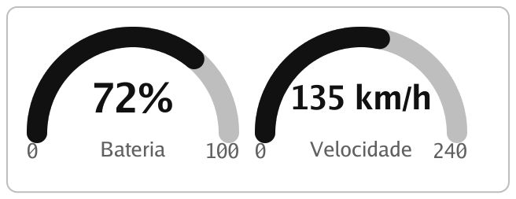

Medidor semicircular (velocímetro) com o valor no centro, os limites nas pontas e um rótulo.

```go
g := widget.NewGauge(0, 240, 135, " km/h")
g.Label = "Velocidade"
```

### Slider (slide button)

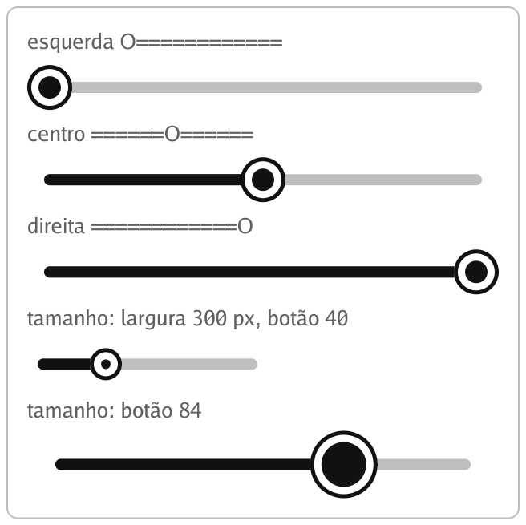

Uma **barra com um botão que desliza**. Toque em qualquer ponto ou arraste o botão; `OnInput` dispara
enquanto arrasta e `OnChange` ao soltar. O `Step` faz o botão **encaixar**: com `Step 50` de 0 a 100
ele só para na esquerda, no centro e na direita (`O============`, `======O======`, `============O`).
O **tamanho é configurável**: largura/altura da caixa (`Style.Width/Height`) e o botão (`ThumbSize`).
A área de toque tem no mínimo 64 px, mesmo com botão pequeno.

```go
s := widget.NewSlider(0, 100, 50, 50)   // min, max, passo, valor: 3 posições, começa no centro
s.Style.Width, s.ThumbSize = widget.Px(420), 84
s.OnChange = func(e *widget.Event) { fmt.Println(s.Value) }
```

### Chips


Cápsulas compactas. Num `ChipGroup` com várias linhas (quebra automática), a seleção pode ser
**múltipla** ou **exclusiva** (`NewChipGroup(true, ...)`: um por vez, como radio). Com `Closable`, o
`×` remove o chip (ou chama `OnClose`).

```go
g := widget.NewChipGroup(false)               // true = exclusivo
c := widget.NewChip("Ficção")
c.OnChange = func(e *widget.Event) { fmt.Println(g.SelectedLabels()) }
g.AppendChild(c)
```

### Calendário


Um mês por vez. As setas trocam de mês, tocar num dia o seleciona (preenchido) e tocar num dia do
mês vizinho (cinza) também navega até ele. O dia de hoje ganha um anel. Os nomes vêm de `Locale`
(`LocalePTBR` ou `LocaleEN`).

```go
cal := widget.NewCalendar(time.Now())
cal.Locale = widget.LocalePTBR
cal.OnChange = func(e *widget.Event) { fmt.Println(cal.Selected) }
```

### Card

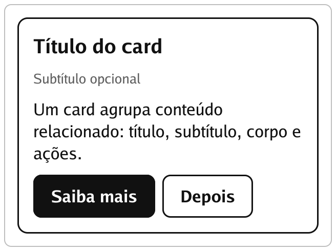

Superfície com borda e cantos arredondados que agrupa conteúdo relacionado: título, subtítulo
opcional e o que mais você incluir (texto, campos, botões, tabelas…). É um painel em coluna.

```go
c := widget.NewCard("Título", "Subtítulo", widget.NewLabel("Corpo"), widget.NewRow(14, ok, depois))
```

## Desenvolvimento

```sh
go test ./...                        # testes (layout, componentes, toque, demo, versão)
go run ./cmd/preview                 # gera preview-0..3.png no tamanho do PB741
go run ./cmd/preview -page 2 -w 758 -h 1024   # uma página, outra resolução
go run ./tools/docgen                # regenera docs/components/*.png (desenhos do README)
```

## Build e instalação

Precisa de Docker (a imagem traz o SDK do PocketBook e o Go 1.17 corrigido).

```sh
make dist          # Linux/macOS/WSL
.\build.ps1        # Windows (Docker Desktop ou Docker dentro do WSL)
```

Gera `dist/applications/hello.app` (arquivo único) e **incrementa o BUILD**.

**Instalar = copiar um arquivo.** Copie `hello.app` para `<aparelho>/applications/` (ou
`.\scripts\install.ps1 -Drive F:`) e abra pela lista de Aplicativos. Na **primeira execução** o app:

1. gera os ícones (normal e focado, 128×128 BMP de 8 bits) em `applications/icons/`;
2. registra a entrada `U_hello` em `system/profiles/default/config/desktop/view.json` (o
   `system/config` é um link para essa pasta) e a chave no grupo `@General`, com **backup**
   (`view.json.bak-<hora>`), validação do JSON e troca atômica; é idempotente e corrige entradas
   antigas com caminho relativo.

O ícone aparece quando o desktop recarrega a configuração (por exemplo, ao tirar o cabo USB).

## Qualidade (Sonar)

Com um SonarQube local em `http://localhost:9000` e um token em `SONAR_GLOBAL_TOKEN`:

```powershell
.\scripts\sonar.ps1      # Windows: testes com cobertura + scanner (Docker no WSL)
```
```sh
scripts/sonar.sh         # Linux/WSL
```

A configuração está em [`sonar-project.properties`](sonar-project.properties).

## Notas do aparelho (PB741)

Desenvolvido e testado em um **PocketBook PB741-N-WW** (InkPad Color 2): 7,8", 1404×1872, canvas de
24 bits, firmware 6.x.

- Com o painel do sistema ligado (padrão), o InkView reserva 137 px e desloca o canvas; o app chama
  `inkview.DisablePanel()` no início para a tela inteira ser do app.
- O `path` de `U_<app>` no `view.json` precisa ser **absoluto**; ícones podem ser relativos.
- O app grava `applications/hello.log` (eventos) para depuração; remova a linha `DebugLog` em release.

## Licença

MIT
