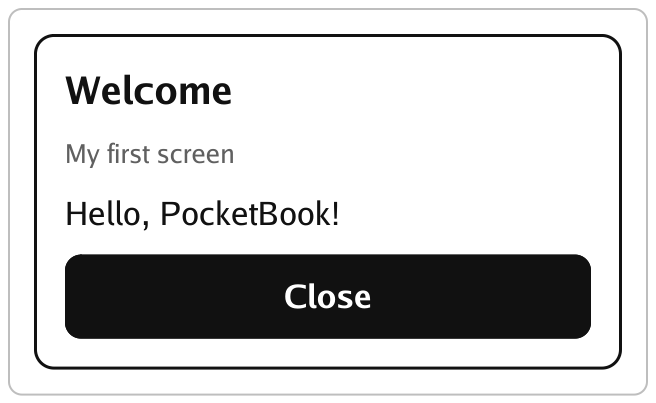

# 1. Getting started

[← Index](README.md) · [Next: Installation →](02-installation.md)

In a few minutes you will run the tests, see the demo as a picture, draw your first screen and learn how
to put it on the reader.

## What you need

| To… | You need |
|---|---|
| write and test code on your PC | **Go 1.17 or newer** and **Git** |
| build the app for the reader | **Docker** (the image brings the PocketBook SDK) |
| run on a device | a PocketBook with firmware 6.x (developed on a **PB741**, 1404×1872) |

You can do steps 1–4 without a device and without Docker.

## Step 1 — Get the code

```sh
git clone <your fork or this repository> go-pocketbook-base
cd go-pocketbook-base
```

Your app lives **inside this module** (that is how it can use the `internal/…` packages), so fork the
repository instead of importing it from another project.

## Step 2 — Run the tests

```sh
go test ./...
```

Everything must pass. The tests include the layout engine, every component, the touch behavior and all
the samples of this documentation.

## Step 3 — See the demo as a picture

```sh
go run ./cmd/preview
```

It writes `preview-0.png` … `preview-4.png`, one per page of the demo (Inputs, Choices, Data, Calendar, Account),
at the size of the PB741 screen. Use `-page 2` for a single page and `-w 758 -h 1024` for another
resolution.

## Step 4 — Draw your first screen

A screen is a tree of elements. This is the smallest useful one:

```go
// examples/recipes/hello.go
package recipes

import (
	"fmt"

	"go-pocketbook-base/internal/toolkit/widget"
)

// Hello is the smallest useful screen: a card with a message and a button.
func Hello(onClose func()) widget.Widget {
	message := widget.NewLabel("Hello, PocketBook!")

	closeButton := widget.NewButton("Close")
	closeButton.SetVariant(widget.VariantPrimary)
	closeButton.OnClick = func(e *widget.Event) {
		fmt.Println("button tapped at", e.X, e.Y)
		onClose()
	}

	return widget.NewCard("Welcome", "My first screen", message, closeButton)
}
```

`Screen` puts it in a padded page and returns a `Document`, which knows how to lay out, draw and receive
touch:

```go
// examples/harness/screen.go
package harness

import (
	"go-pocketbook-base/internal/kernel/geom"
	"go-pocketbook-base/internal/toolkit/widget"
)

// Screen puts content inside a padded page and returns a ready-to-render
// document for a width x height screen. kb is the keyboard used by input
// fields: on the device pass the InkView keyboard, in tests a FakeKeyboard.
func Screen(width, height int, kb widget.Keyboard, content widget.Widget) *widget.Document {
	doc := widget.NewDocument(width, height)
	doc.Keyboard = kb

	page := widget.NewColumn(0, content)
	page.Style.Padding = geom.All(28)
	page.Style.Background = widget.Paper

	doc.SetRoot(page)
	return doc
}
```

Render it to a PNG without any device:

```go
doc := harness.Screen(1404, 1872, nil, recipes.Hello(func() {}))
if err := harness.SavePNG(doc, "hello.png"); err != nil {
	log.Fatal(err)
}
```

```go
// examples/harness/preview.go
package harness

import (
	"image/png"
	"os"

	"go-pocketbook-base/internal/toolkit/widget"
)

// SavePNG renders the document and writes it to a PNG file: the quickest way
// to see a screen without a device.
func SavePNG(doc *widget.Document, path string) error {
	f, err := os.Create(path)
	if err != nil {
		return err
	}
	if err := png.Encode(f, doc.Render()); err != nil {
		f.Close()
		return err
	}
	return f.Close()
}
```



> The `nil` is the keyboard. Fields need one to type (see [Testing](10-testing.md) for a fake one);
> this screen has no fields.

## Step 5 — Run it on the reader

1. Copy the blueprint app and change the screen it shows:

   ```sh
   cp -r apps/hello apps/myapp
   ```

   In `apps/myapp` change `app.json` (the `id` must be `myapp`, the name of the folder), delete what you do not
   need of `hello.go` and build your own screen in `newHello`. The platform already forwards touch, the hardware keys
   and the system keyboard to your document, registers the icon on the first run and repaints only what changed
   (see [Apps and the contract](13-apps-and-the-contract.md)).

2. Build (needs Docker, see [Build and versioning](03-build-and-versioning.md)):

   ```powershell
   .\build.ps1 -App myapp      # Windows
   ```
   ```sh
   make dist APP=myapp         # Linux / macOS / WSL
   ```

3. Connect the reader by USB and copy `dist/applications/myapp.app` to its `applications/` folder (or
   run `.\scripts\install.ps1 -Drive F: -App myapp`). Open it from the **Applications** list.

4. On the first run the app installs its own icon. **Unplug the USB cable** and the icon appears in the
   home screen. Details in [Installation](02-installation.md).

## Where to go next

- Look at every component with its drawing: [Components](06-components.md).
- Copy a complete screen and adapt it: [Recipes](08-recipes.md).
- Understand what happens under the hood: [Concepts](04-concepts.md).

[← Index](README.md) · [Next: Installation →](02-installation.md)
