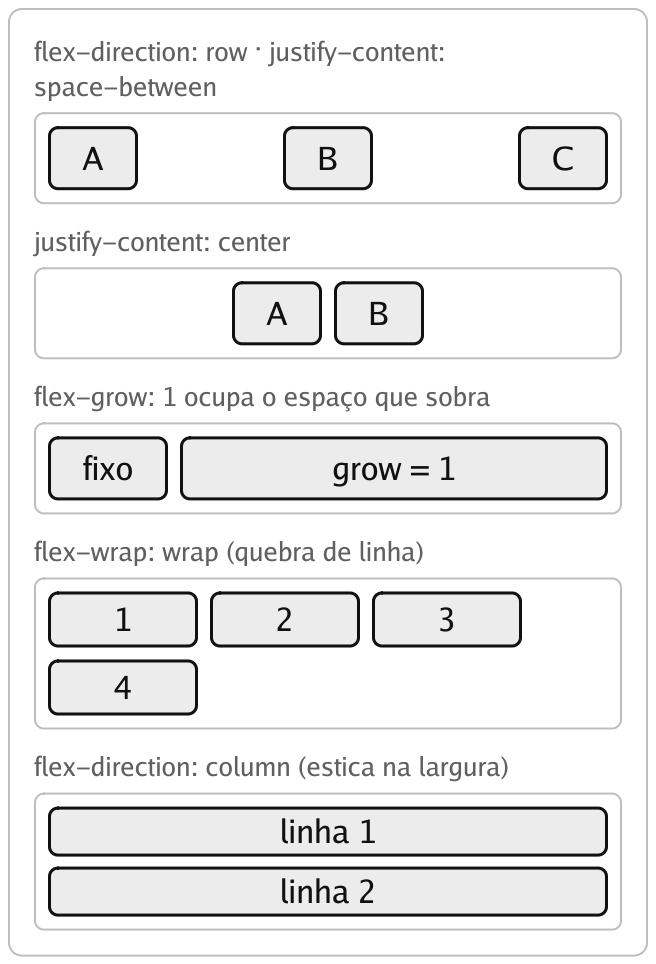
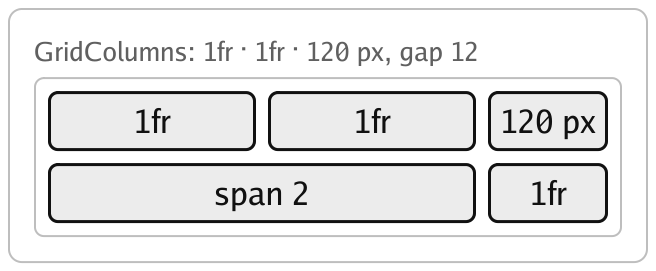

# 5. Layout

[← Concepts](04-concepts.md) · [Index](README.md) · [Next: Components →](06-components.md)

Layout works like CSS: you describe containers with a `Style` and the engine places the children. It
supports **flexbox** and **grid**, with the CSS *border-box* model (`Width`/`Height` include padding and
border).

## Style reference

Every element has `Style` (a `widget.Style`). The names are the CSS ones.

| Field | Values | CSS equivalent |
|---|---|---|
| `Display` | `DisplayBlock` (default), `DisplayFlex`, `DisplayGrid`, `DisplayNone` | `display` |
| `FlexDirection` | `Row`, `Column` | `flex-direction` |
| `FlexWrap` | `true` / `false` | `flex-wrap` |
| `JustifyContent` | `JustifyStart`, `JustifyCenter`, `JustifyEnd`, `JustifySpaceBetween`, `JustifySpaceAround` | `justify-content` |
| `AlignItems` | `AlignStretch` (default), `AlignStart`, `AlignCenter`, `AlignEnd` | `align-items` |
| `Gap` | pixels | `gap` |
| `FlexGrow` | number (on the **child**) | `flex-grow` |
| `GridColumns` | `[]Track` from `FrTrack(n)` and `PxTrack(n)` | `grid-template-columns` |
| `GridColumnSpan` | number of columns (on the **child**) | `grid-column: span n` |
| `Width`, `Height` | `Px(n)`, `Pct(n)` (width only) or empty = auto | `width`, `height` |
| `MinWidth`, `MinHeight` | pixels | `min-width`, `min-height` |
| `Padding`, `Margin` | `geom.All(n)`, `geom.XY(vertical, horizontal)` or `geom.Insets{Top, Right, Bottom, Left}` | `padding`, `margin` |
| `Background`, `Color`, `BorderColor` | `widget.Ink`, `Paper`, `Soft`, `Mid`, `Muted`, `Disabled`, `gfx.Gray(v)`, `gfx.RGB(r, g, b)`, `gfx.Hex("#222")` | `background`, `color`, `border-color` |
| `BackgroundImage`, `BackgroundSize` | an `image.Image`, `gfx.FitCover/FitContain/FitFill` | `background-image`, `background-size` |
| `BorderWidth`, `BorderRadius` | pixels | `border-width`, `border-radius` |
| `FontSize`, `Bold`, `TextAlign` | pixels, bool, `gfx.AlignStart/Center/End` | `font-size`, `font-weight`, `text-align` |

Theme sizes you can reuse: `widget.FontBody` (32), `FontSmall` (26), `FontTitle` (44), `Space` (20),
`ControlHeight` (84), `Radius` (16), `BorderThin` (3).

Colors are grayscale on e-ink; a colored value is converted to gray when drawn.

## Containers

You create containers with four helpers. They only differ in the `Style` they preset:

| Helper | Result |
|---|---|
| `widget.NewPanel(children...)` | block: children stacked vertically, stretched to the width |
| `widget.NewRow(gap, children...)` | flex row, children vertically centered |
| `widget.NewColumn(gap, children...)` | flex column, children stretched to the width |
| `widget.NewGrid(gap, columns, children...)` | grid with the given columns |
| `widget.NewCard(title, subtitle, children...)` | bordered, rounded column with a title (a panel) |

Because they are normal elements, you can change any `Style` field afterwards.

## Flexbox



A flex container places its children along the **main axis** (the row, or the column) and aligns them on
the **cross axis**. Free space on the main axis goes to children with `FlexGrow`; if nobody grows,
`JustifyContent` decides where the children sit.

Spread items with the free space between them:

```go
// examples/components/flex.go#FlexRow
// FlexRow spreads three items along a row with the free space between them.
func FlexRow() widget.Widget {
	row := widget.NewRow(12, widget.NewButton("A"), widget.NewButton("B"), widget.NewButton("C"))
	row.Style.JustifyContent = widget.JustifySpaceBetween
	return row
}
```

Let one child take what is left:

```go
// examples/components/flex.go#FlexGrow
// FlexGrow gives the leftover width to one child.
func FlexGrow() widget.Widget {
	fixed := widget.NewButton("Fixed")
	fill := widget.NewButton("Grows")
	fill.Style.FlexGrow = 1
	return widget.NewRow(12, fixed, fill)
}
```

Break into several lines when the children do not fit:

```go
// examples/components/flex.go#FlexWrap
// FlexWrap breaks the children into several lines when they do not fit.
func FlexWrap() widget.Widget {
	panel := widget.NewRow(12)
	panel.Style.FlexWrap = true
	panel.Style.AlignItems = widget.AlignStart
	for _, name := range []string{"one", "two", "three", "four", "five", "six"} {
		panel.AppendChild(widget.NewButton(name))
	}
	return panel
}
```

Stack vertically (children stretch to the column width unless you set `AlignItems`):

```go
// examples/components/flex.go#FlexColumn
// FlexColumn stacks the children; they stretch to the width of the column.
func FlexColumn() widget.Widget {
	return widget.NewColumn(12, widget.NewButton("First"), widget.NewButton("Second"))
}
```

Remember: `FlexGrow` goes on the **child**, `JustifyContent`/`AlignItems`/`Gap`/`FlexWrap` on the
**container**.

## Grid



Columns are fixed (`PxTrack`) or flexible (`FrTrack`, like `1fr`). Rows are created automatically and take
the height of their tallest cell; every child fills its cell (unless it has its own `Width`/`Height`).

```go
// examples/components/grid.go#GridLayout
// GridLayout uses three columns (1fr, 1fr and 120 px); one child spans two.
func GridLayout() widget.Widget {
	wide := widget.NewButton("spans two columns")
	wide.Style.GridColumnSpan = 2
	columns := []widget.Track{widget.FrTrack(1), widget.FrTrack(1), widget.PxTrack(120)}
	return widget.NewGrid(12, columns,
		widget.NewButton("1fr"), widget.NewButton("1fr"), widget.NewButton("120 px"), wide)
}
```

## Sizing rules

- **Auto** (empty `Width`/`Height`): a leaf element takes the size of its content (a label wraps at the
  available width); a container takes the size of its children.
- **`Px(n)`** is exact. **`Pct(n)`** is a percentage of the available width (not supported for height).
- In a **column** the children stretch to the full width (`AlignStretch`); in a **row** they stretch to the
  height of the tallest.
- `Padding` is inside the border, `Margin` is outside; both shrink or grow the box accordingly.
- `Hidden: true` or `Display: DisplayNone` removes the element from layout and touch.
- A control drawn smaller than 64 px still gets a 64 px touch area (the slider does this).

## Tips

- Put **screen-level spacing in a page container** (`Style.Padding`), not in every child.
- Prefer `FlexGrow` over fixed widths so the screen adapts to other resolutions.
- Cards inside a grid with `GridColumnSpan = 2` make easy two-column dashboards.
- Keep one page within the screen height: the library has no scrolling yet (see the backlog in the
  README). The demo's test fails if a page overflows.

Next: [Components →](06-components.md)
