# 6. Components

[← Layout](05-layout.md) · [Index](README.md) · [Next: Events and state →](07-events-and-state.md)

Every component below shows its **real drawing** (generated by the library itself with
`go run ./tools/docgen`), what it is for, its properties, how it reacts to touch and a working example.

**Quick index:** [Panel, Row, Column, Grid](05-layout.md) · [Label](#label) · [Button](#button) ·
[Check-box, radio, switch](#check-box-radio-button-and-switch) · [Combo-box](#combo-box) · [Dropdown](#dropdown) ·
[Menu bar](#menu-bar) · [Text input](#text-input-and-password) · [Number input](#number-input) ·
[Masked input](#masked-input) · [Search input](#search-input) · [Text area](#text-area) · [Data table](#data-table) ·
[Progress bar](#progress-bar) · [Gauge](#gauge) · [Slider](#slider-slide-button) · [Chips](#chips) ·
[Calendar](#calendar) · [Card](#card)

> **Properties common to all** (from `Base`): `ID`, `ClassName`, `Style`, `Hidden`, `Disabled`, `OnClick`,
> `AppendChild/RemoveChild`. A **disabled** element is drawn washed out and ignores touch. Callbacks
> receive a `*widget.Event` with `Target`, `X`, `Y` and `StopPropagation()`.

---

## Label

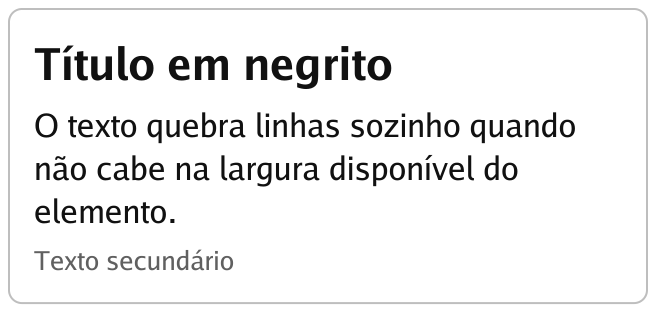

Static text (like `<span>` / `<p>`). It **wraps lines by itself** to the width it has and honors `\n`.

| | |
|---|---|
| Create | `widget.NewLabel(text)` |
| Properties | `Text`; `Style.FontSize`, `Bold`, `Color`, `TextAlign` |
| Touch | none (add `OnClick` if you want it to react) |

```go
// examples/components.go#LabelExample
// LabelExample shows a bold title and a muted paragraph that wraps by itself.
func LabelExample() widget.Widget {
	title := widget.NewLabel("A bold title")
	title.Style.FontSize, title.Style.Bold = widget.FontTitle, true
	note := widget.NewLabel("Long text wraps by itself inside the width it has available.")
	note.Style.Color = widget.Muted
	return widget.NewColumn(8, title, note)
}
```

## Button

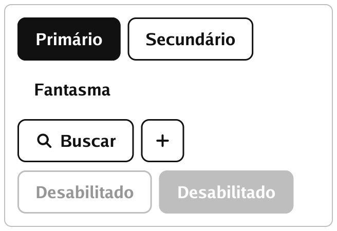

A tappable button. Three visual weights: **primary** (filled), **secondary** (outlined, the default) and
**ghost** (text only). It can carry an icon, or be a square icon-only button. At least 84 px tall.

| | |
|---|---|
| Create | `widget.NewButton(text)`, `widget.NewIconButton(icon)` |
| Properties | `Text`, `Icon` (`gfx.IconSearch`, `IconPlus`, `IconClose`, `IconCheck`, `IconMenu`, `IconCalendar`, chevrons…), `SetVariant(VariantPrimary / VariantSecondary / VariantGhost)`, `Disabled` |
| Events | `OnClick` |
| Touch | a tap runs `OnClick` |

```go
// examples/components.go#ButtonExample
// ButtonExample shows the variants, an icon, an icon-only and a disabled button.
func ButtonExample() widget.Widget {
	save := widget.NewButton("Save")
	save.SetVariant(widget.VariantPrimary)
	save.OnClick = func(e *widget.Event) { fmt.Println("saved") }

	search := widget.NewButton("Search")
	search.Icon = gfx.IconSearch

	add := widget.NewIconButton(gfx.IconPlus)

	off := widget.NewButton("Unavailable")
	off.Disabled = true // greyed out, ignores touch

	return widget.NewRow(12, save, search, add, off)
}
```

## Check-box, radio-button and switch

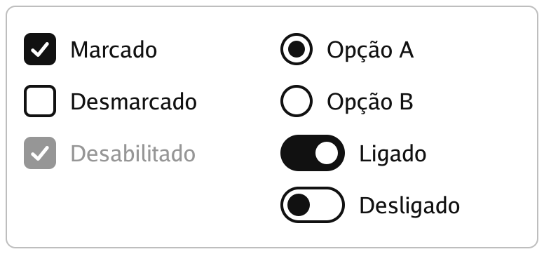

On/off controls with a label. **The whole row is the touch area**, not just the little square.

- **Check-box** — independent; each tap flips `Checked`.
- **Radio-button** — radios with the same `Name` form a group: choosing one clears the others. Tapping the
  one already chosen does nothing.
- **Switch** — an on/off slider-style switch.

| | |
|---|---|
| Create | `widget.NewCheckbox(label, checked)`, `widget.NewRadio(label, group, value)`, `widget.NewSwitch(label, on)` |
| Properties | `Label`, `Checked`, `Name` (radio group), `Value`, `Kind` |
| Events | `OnChange` (`e.Target.(*widget.Toggle)` gives the control) |

```go
// examples/components.go#ToggleExample
// ToggleExample shows a check-box, two radio buttons of one group and a switch.
func ToggleExample() widget.Widget {
	news := widget.NewCheckbox("Send me the news", true)
	news.OnChange = func(e *widget.Event) { fmt.Println("news:", news.Checked) }

	free := widget.NewRadio("Free", "plan", "free") // same name = same group
	pro := widget.NewRadio("Pro", "plan", "pro")
	pro.Checked = true
	for _, r := range []*widget.Toggle{free, pro} {
		r.OnChange = func(e *widget.Event) {
			t := e.Target.(*widget.Toggle)
			fmt.Println("plan:", t.Value)
		}
	}

	wifi := widget.NewSwitch("Wi-Fi", true)
	return widget.NewColumn(4, news, free, pro, wifi)
}
```

## Combo-box

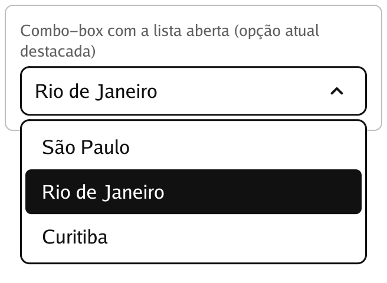

A field that keeps **one option** from a list (like `<select>`). Tapping it opens the list below (or above
when there is no room) with the current option highlighted; tapping an option chooses it and closes the list.
A tap outside the list just closes it.

| | |
|---|---|
| Create | `widget.NewComboBox(placeholder, options...)` with `widget.Option{Label, Value}` |
| Properties | `Options`, `Index` (-1 = none), `Placeholder`; `Value()`, `SetValue(v)` |
| Events | `OnChange` |

```go
// examples/components.go#ComboBoxExample
// ComboBoxExample keeps one option from a list.
func ComboBoxExample() widget.Widget {
	city := widget.NewComboBox("Choose a city",
		widget.Option{Label: "São Paulo", Value: "sp"},
		widget.Option{Label: "Rio de Janeiro", Value: "rj"},
		widget.Option{Label: "Curitiba", Value: "cwb"})
	city.OnChange = func(e *widget.Event) { fmt.Println("city:", city.Value()) }
	return city
}
```

## Dropdown

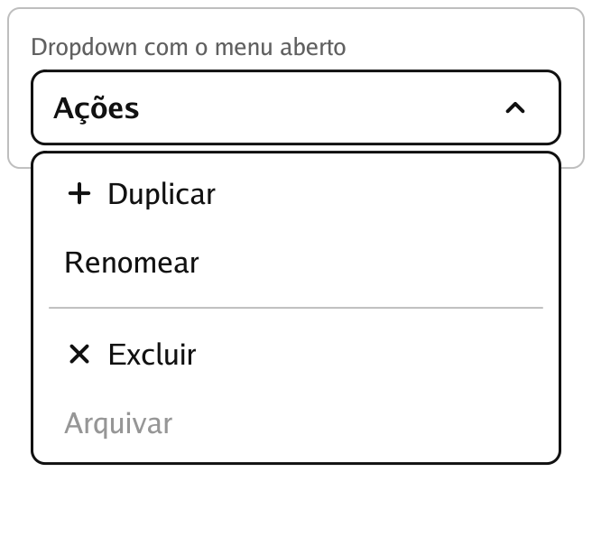

A button that opens a **menu of actions**. Unlike the combo-box it does not keep a value: each item runs its
own `OnSelect`. Items can have an icon, be disabled, or be a separator line.

| | |
|---|---|
| Create | `widget.NewDropdown(text, items...)` with `widget.MenuItem` |
| `MenuItem` | `Label`, `Icon`, `Disabled`, `Separator`, `OnSelect func()` |
| Properties | `Text`, `Items`, `Chosen` (the last picked) |
| Events | `OnSelect` on the dropdown (after the item's own) |

```go
// examples/components.go#DropdownExample
// DropdownExample opens a menu of actions.
func DropdownExample() widget.Widget {
	return widget.NewDropdown("Actions",
		widget.MenuItem{Label: "Duplicate", Icon: gfx.IconPlus, OnSelect: func() { fmt.Println("duplicate") }},
		widget.MenuItem{Label: "Rename", OnSelect: func() { fmt.Println("rename") }},
		widget.MenuItem{Separator: true},
		widget.MenuItem{Label: "Delete", Icon: gfx.IconClose, OnSelect: func() { fmt.Println("delete") }},
		widget.MenuItem{Label: "Archive", Disabled: true})
}
```

## Menu bar

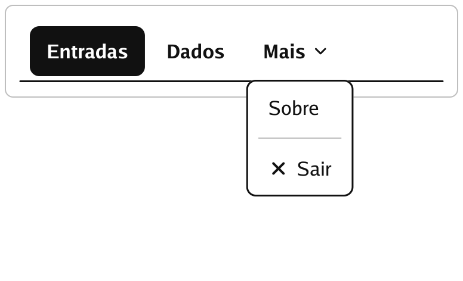

The bar of menus at the top of a screen. Each `Menu` either runs `OnSelect` directly (for example to change
page) or opens a sub-menu with `Items`. `Selected` draws the current one filled.

| | |
|---|---|
| Create | `widget.NewMenuBar(menus...)` with `&widget.Menu{...}` |
| `Menu` | `Label`, `Items []MenuItem`, `OnSelect func()`, `Selected bool` |
| Methods | `MenuRect(i)` — the touch rectangle of menu `i` |

```go
// examples/components.go#MenuBarExample
// MenuBarExample has a direct item and a menu with a sub-menu.
func MenuBarExample() widget.Widget {
	return widget.NewMenuBar(
		&widget.Menu{Label: "Home", Selected: true, OnSelect: func() { fmt.Println("home") }},
		&widget.Menu{Label: "More", Items: []widget.MenuItem{
			{Label: "About", OnSelect: func() { fmt.Println("about") }},
			{Separator: true},
			{Label: "Quit", Icon: gfx.IconClose, OnSelect: func() { fmt.Println("quit") }},
		}})
}
```

## Tabs

A menu bar of pages plus the area that shows the current one. Only the current page is in memory (the reader
has 1 GB of RAM); what happens to the others is a **per-tab choice**:

| `Mode` | What it does | Memory |
|---|---|---|
| `TabRemember` (default) | drops the page but keeps the **state** of its elements and puts it back when the page is rebuilt | a few bytes per element |
| `TabRebuild` | drops the page and its state: it starts fresh every time | none |
| `TabKeepAlive` | keeps the whole page tree (use it for pages that are expensive to build) | the whole page |

What is remembered (elements that implement `widget.Stateful`, **only if they have an `ID`**): the text of
`Input` and `TextArea` (never passwords), `Checked` of check-box, radio and switch, the combo-box choice, the
slider value, which chips are selected, the calendar's selected day and month, and the table's page, sort and
selection. *Data* (a table's `Rows`, a combo's `Options`) is not state: your `Build` function provides it again.

| | |
|---|---|
| Create | `widget.NewTabs(store, &widget.Tab{Title, Build, Mode}...)` — `store` may be `nil` (in-memory) |
| `Tab` | `Title`, `Build func() Widget`, `Mode`, `ID` (scopes the saved state), `Restored func()` (refresh labels derived from values) |
| Fields | `Bar` (the `MenuBar`: append extra menus to `Bar.Menus`), `Body` (style the padding here), `Store`, `OnChange` |
| Methods | `Show(i)`, `Current()`, `Page()`, `Count()`, `Save()` |
| Custom store | implement `widget.Store` (`Get`/`Set`) to keep the state in a file |
| Custom state | make your own element implement `Stateful` (`SaveState() string`, `LoadState(string)`) |

```go
// examples/navigation.go#NewPagedApp
// NewPagedApp builds a whole application: tabs that switch between the Login,
// Settings and Catalog pages. Only the current page lives in memory; what the
// user typed or chose is kept in the Tabs store and put back when the page is
// shown again (every element that must be remembered has an ID).
func NewPagedApp(width, height int, kb widget.Keyboard) *widget.Document {
	books := [][]string{
		{"Dom Casmurro", "Machado de Assis", "256"},
		{"Vidas Secas", "Graciliano Ramos", "176"},
		{"Iracema", "José de Alencar", "160"},
	}
	tabs := widget.NewTabs(nil,
		&widget.Tab{Title: "Login", Build: func() widget.Widget {
			f := NewLoginForm(func(string, bool) {})
			f.User.ID, f.Remember.ID = "user", "remember" // the password is never remembered
			return f.Root
		}},
		&widget.Tab{Title: "Settings", Build: func() widget.Widget {
			s := NewSettings()
			s.WiFi.ID, s.Brightness.ID, s.Language.ID, s.Topics.ID = "wifi", "brightness", "language", "topics"
			return s.Root
		}},
		// TabKeepAlive keeps the whole page (and its data) in memory instead.
		&widget.Tab{Title: "Catalog", Mode: widget.TabKeepAlive, Build: func() widget.Widget { return NewCatalog(books).Root }})
	tabs.Body.Style.Padding = geom.All(28) // the body already takes everything below the bar

	doc := widget.NewDocument(width, height)
	doc.Keyboard = kb
	doc.SetRoot(tabs)
	return doc
}
```

## Text input and password

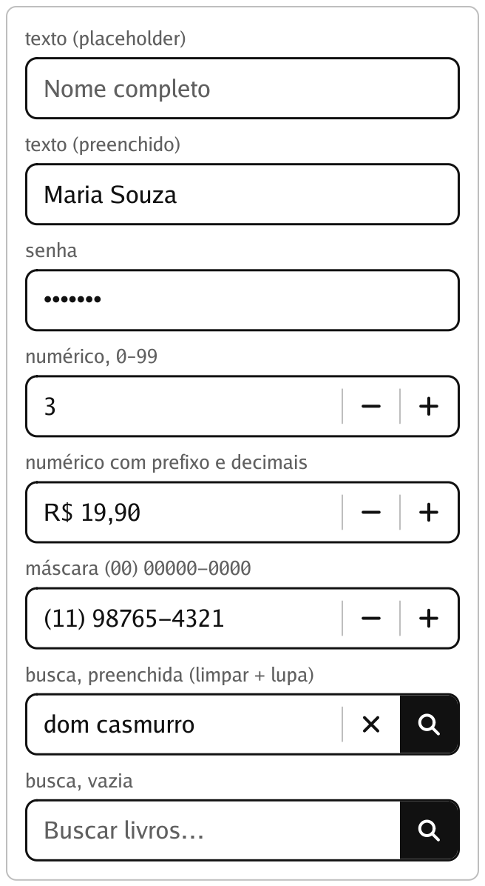

A single-line field. **Tapping it opens the system keyboard.** `Type = TypePassword` shows bullets. The text
is cut with "…" when it is too long to fit.

| | |
|---|---|
| Create | `widget.NewInput(placeholder)` |
| Properties | `Value`, `Placeholder`, `MaxLength`, `ReadOnly`, `Type` (`TypeText`, `TypePassword`) |
| Events | `OnChange` (after the keyboard confirms) |
| Touch | opens the keyboard (nothing if `ReadOnly`) |

```go
// examples/components.go#TextInputExample
// TextInputExample has a text field and a password field.
func TextInputExample() widget.Widget {
	name := widget.NewInput("Full name")
	name.MaxLength = 40
	name.OnChange = func(e *widget.Event) { fmt.Println("name:", name.Value) }

	password := widget.NewInput("Password")
	password.Type = widget.TypePassword // shown as bullets
	return widget.NewColumn(12, name, password)
}
```

## Number input

The same `Input` with `NewNumberInput`: the numeric keyboard, and **− / +** buttons at the right that change
the value without opening the keyboard. The number is kept between `Min` and `Max`, rounded to `Decimals`.

| | |
|---|---|
| Create | `widget.NewNumberInput(value, decimals)` |
| Properties | `Min`, `Max` (enforced when `Max > Min`), `Step`, `Decimals`, `Prefix`, `Suffix`, `DecimalSeparator`, `NoSteppers` |
| Methods | `StepUp()`, `StepDown()`, `Number()`, `SetNumber(v)` (like the web's `stepUp()`/`valueAsNumber`) |
| Events | `OnChange` (keyboard, − and +) |

```go
// examples/components.go#NumberInputExample
// NumberInputExample has − / + buttons, a range, decimals and a prefix.
func NumberInputExample() widget.Widget {
	quantity := widget.NewNumberInput(3, 0)
	quantity.Min, quantity.Max = 0, 99
	quantity.OnChange = func(e *widget.Event) { fmt.Println("quantity:", quantity.Number()) }

	price := widget.NewNumberInput(19.9, 2)
	price.Prefix, price.DecimalSeparator, price.Step = "R$ ", ",", 0.5
	return widget.NewColumn(12, quantity, price)
}
```

## Masked input

A numeric field that formats the digits with a **mask**: `0` and `#` stand for one digit; any other
character is a literal that is inserted for you. `Value` keeps only the digits; `Display()` is the formatted text.

| Mask | Digits | Shown |
|---|---|---|
| `(00) 00000-0000` | `11987654321` | `(11) 98765-4321` |
| `000.000.000-00` | `12345678901` | `123.456.789-01` |
| `00:00` | `0930` | `09:30` |

| | |
|---|---|
| Create | `widget.NewMaskedInput(mask, digits)` |
| Helpers | `widget.ApplyMask(mask, digits)`, `widget.OnlyDigits(s)`, `widget.MaskSlots(mask)`, `widget.TrimToMask(mask, digits)` |

```go
// examples/components.go#MaskedInputExample
// MaskedInputExample formats the typed digits with a mask.
func MaskedInputExample() widget.Widget {
	phone := widget.NewMaskedInput("(00) 00000-0000", "11987654321")
	phone.OnChange = func(e *widget.Event) {
		fmt.Println("shown:", phone.Display(), "digits:", phone.Value)
	}
	return phone
}
```

## Search input

A text field with a **magnifier** button (a filled square at the right) and a **clear (×)** button that appears
when there is text. The magnifier, and **OK on the keyboard**, fire `OnSubmit`.

| | |
|---|---|
| Create | `widget.NewSearchInput(placeholder)` |
| Events | `OnSubmit` (search), `OnChange` (typed or cleared) |

```go
// examples/components.go#SearchInputExample
// SearchInputExample has the magnifier and clear buttons.
func SearchInputExample() widget.Widget {
	search := widget.NewSearchInput("Search books…")
	search.OnSubmit = func(e *widget.Event) { fmt.Println("searching:", search.Value) }
	return search
}
```

## Text area

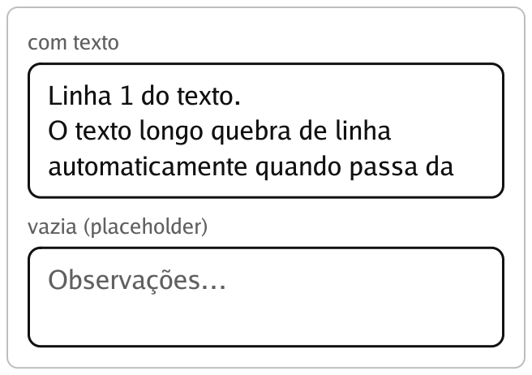

A multi-line field (`<textarea>`) that is `Rows` lines tall. The text wraps and keeps line breaks. Tapping
opens the system keyboard.

| | |
|---|---|
| Create | `widget.NewTextArea(placeholder, rows)` |
| Properties | `Value`, `Placeholder`, `Rows`, `MaxLength`, `ReadOnly` |
| Events | `OnChange` |

```go
// examples/components.go#TextAreaExample
// TextAreaExample is a multi-line field.
func TextAreaExample() widget.Widget {
	notes := widget.NewTextArea("Notes…", 4)
	notes.OnChange = func(e *widget.Event) { fmt.Println(len(notes.Value), "characters") }
	return notes
}
```

## Data table

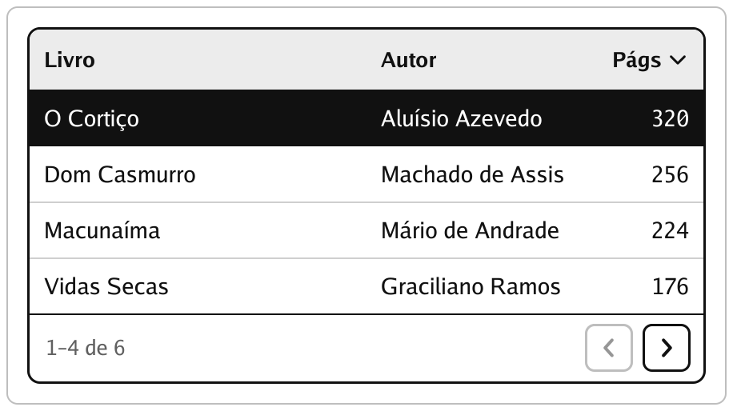

A **paged** table. Tap a header of a `Sortable` column to sort (tap again to reverse; numbers sort as
numbers). Tap a row to select it (it is drawn filled). The footer shows "from–to of total" and the arrows
change page. `Selected` is always the index in `Rows`, even when the table is sorted.

| | |
|---|---|
| Create | `widget.NewTable(pageSize, columns...)` |
| `TableColumn` | `Title`, `Flex` (width share), `Align`, `Sortable` |
| Properties | `Rows [][]string`, `PageSize`, `Page`, `Selected` (-1 = none), `SortCol`, `SortDesc`, `Summary func(from, to, total int) string` |
| Methods | `PageCount()` |
| Events | `OnSelect` |

```go
// examples/components.go#TableExample
// TableExample is a sortable, selectable, paged table.
func TableExample() widget.Widget {
	table := widget.NewTable(4,
		widget.TableColumn{Title: "Book", Flex: 3, Sortable: true},
		widget.TableColumn{Title: "Pages", Flex: 1, Align: gfx.AlignEnd, Sortable: true})
	table.Rows = [][]string{
		{"Dom Casmurro", "256"}, {"Vidas Secas", "176"}, {"Iracema", "160"},
		{"Macunaíma", "224"}, {"O Cortiço", "320"}, {"A Hora da Estrela", "88"},
	}
	table.OnSelect = func(e *widget.Event) {
		fmt.Println("selected:", table.Rows[table.Selected][0]) // Selected indexes Rows
	}
	return table
}
```

## Progress bar

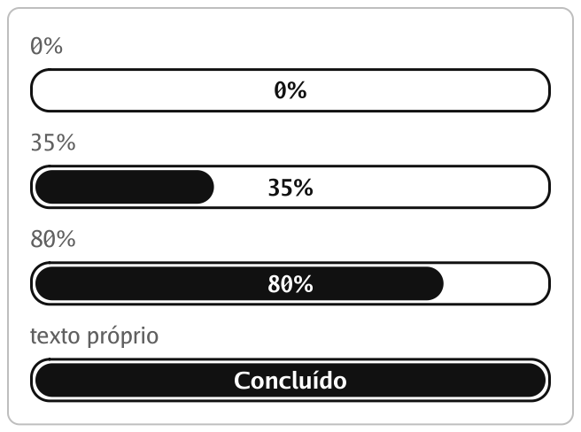

A progress bar with the percentage written inside; the text **inverts its color** where the fill passes under
it. Set `Text` to show your own words.

| | |
|---|---|
| Create | `widget.NewProgress(value)` |
| Properties | `Value`, `Min`, `Max` (0–100 by default), `Text` |

```go
// examples/components.go#ProgressExample
// ProgressExample is a progress bar; change Value and the bar follows.
func ProgressExample() widget.Widget {
	bar := widget.NewProgress(35)
	bar.Value = 60 // 0..100
	return bar
}
```

## Gauge

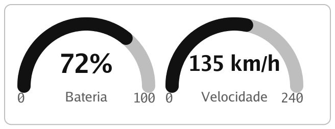

A semicircular meter (speedometer) with the value in the middle, the limits at the ends and a label.

| | |
|---|---|
| Create | `widget.NewGauge(min, max, value, unit)` |
| Properties | `Value`, `Min`, `Max`, `Unit`, `Label`, `Thickness` |

```go
// examples/components.go#GaugeExample
// GaugeExample is a semicircular meter.
func GaugeExample() widget.Widget {
	speed := widget.NewGauge(0, 240, 135, " km/h")
	speed.Label = "Speed"
	return speed
}
```

## Slider (slide button)

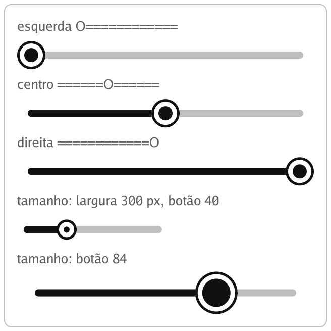

A **bar with a knob that slides**. Tap anywhere or drag the knob; `OnInput` fires while dragging and
`OnChange` when the finger is released. `Step` makes the knob **snap**: with `Step 50` from 0 to 100 it only
stops at the left, the center and the right (`O============`, `======O======`, `============O`).
The **size is configurable**: the box (`Style.Width` / `Height`) and the knob (`ThumbSize`). The touch area is
never smaller than 64 px, even with a small knob.

| | |
|---|---|
| Create | `widget.NewSlider(min, max, step, value)` |
| Properties | `Min`, `Max`, `Step`, `Value`, `ThumbSize`; `SetValue(v)` (clamps and snaps) |
| Events | `OnInput` (dragging), `OnChange` (released) |

A plain slider:

```go
// examples/components.go#SliderExample
// SliderExample is a bar with a knob you can drag; Step makes it snap.
func SliderExample() widget.Widget {
	volume := widget.NewSlider(0, 100, 5, 40)
	volume.OnInput = func(e *widget.Event) { fmt.Println("dragging:", volume.Value) }
	volume.OnChange = func(e *widget.Event) { fmt.Println("released:", volume.Value) }
	return volume
}
```

A three-position slide button with a custom size:

```go
// examples/components.go#SlideButtonExample
// SlideButtonExample is a slider with three resting places: left, center, right.
func SlideButtonExample() widget.Widget {
	position := widget.NewSlider(0, 100, 50, 50) // step 50: 0, 50 or 100
	position.Style.Width = widget.Px(420)        // configurable size...
	position.ThumbSize = 72                      // ...and knob
	position.OnChange = func(e *widget.Event) {
		names := map[float64]string{0: "left", 50: "center", 100: "right"}
		fmt.Println("position:", names[position.Value])
	}
	return position
}
```

## Chips

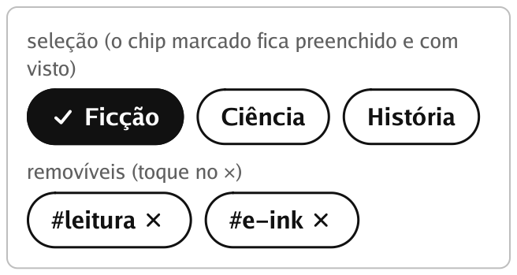

Compact capsules. In a `ChipGroup` (wraps onto several lines) the selection can be **multiple** or
**exclusive** (`NewChipGroup(true, ...)`: one at a time, like radio buttons). With `Closable` a **×** removes
the chip (or calls `OnClose`).

| | |
|---|---|
| Create | `widget.NewChip(label)`, `widget.NewChipGroup(exclusive, chips...)` |
| Chip | `Label`, `Selected`, `Closable`, `OnChange`, `OnClose` |
| Group | `Exclusive`, `SelectedLabels()` |

```go
// examples/components.go#ChipsExample
// ChipsExample has selectable chips and removable chips.
func ChipsExample() widget.Widget {
	topics := widget.NewChipGroup(false) // true = only one selected at a time
	for _, name := range []string{"Fiction", "Science", "History"} {
		chip := widget.NewChip(name)
		chip.OnChange = func(e *widget.Event) { fmt.Println("topics:", topics.SelectedLabels()) }
		topics.AppendChild(chip)
	}

	tags := widget.NewChipGroup(false)
	for _, name := range []string{"#reading", "#e-ink"} {
		chip := widget.NewChip(name)
		chip.Closable = true // the × removes the chip
		tags.AppendChild(chip)
	}
	return widget.NewColumn(16, topics, tags)
}
```

## Calendar

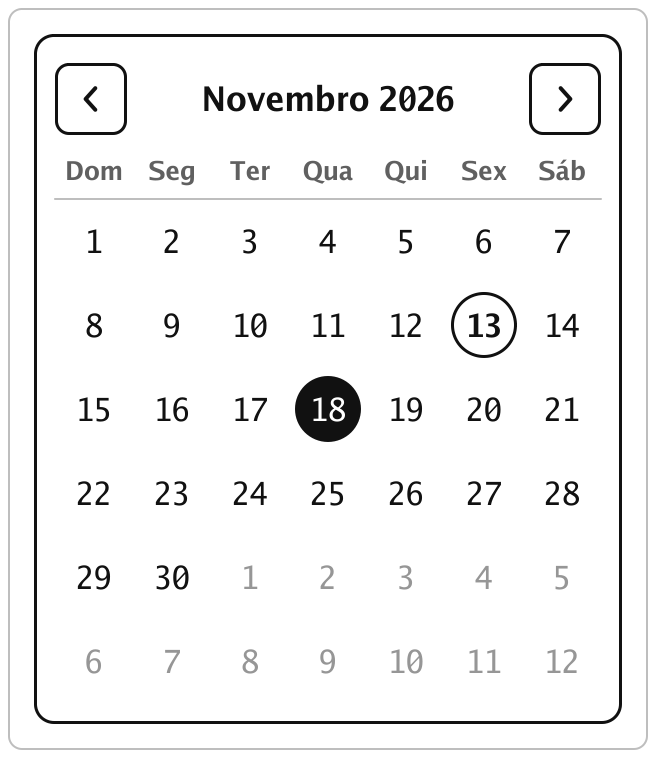

One month at a time. The arrows change the month, tapping a day selects it (drawn filled) and tapping a gray
day of a neighboring month also goes there. Today gets a ring. Names come from `Locale`.

| | |
|---|---|
| Create | `widget.NewCalendar(selected)` (a zero `time.Time` shows today's month with nothing selected) |
| Properties | `Selected`, `Today`, `Year`, `Month`, `Locale` (`widget.LocaleEN`, `widget.LocalePTBR`) |
| Methods | `ShiftMonth(delta)` |
| Events | `OnChange` |

```go
// examples/components.go#CalendarExample
// CalendarExample picks a day.
func CalendarExample() widget.Widget {
	calendar := widget.NewCalendar(time.Now())
	calendar.Locale = widget.LocalePTBR
	calendar.OnChange = func(e *widget.Event) { fmt.Println("date:", calendar.Selected.Format("2006-01-02")) }
	return calendar
}
```

## Card

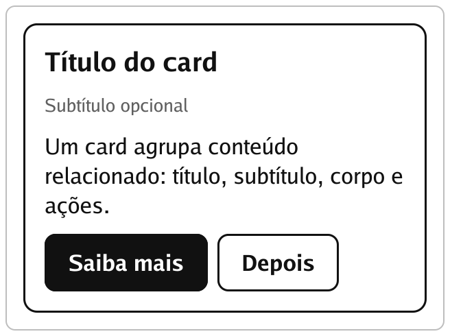

A bordered, rounded surface that groups related content: a title, an optional subtitle and whatever else you
add (text, fields, buttons, tables…). It is a column `Panel`, so all the layout properties apply.

| | |
|---|---|
| Create | `widget.NewCard(title, subtitle, children...)` |

```go
// examples/components.go#CardExample
// CardExample groups a title, a subtitle, text and actions.
func CardExample() widget.Widget {
	ok := widget.NewButton("Learn more")
	ok.SetVariant(widget.VariantPrimary)
	later := widget.NewButton("Later")
	return widget.NewCard("Card title", "Optional subtitle",
		widget.NewLabel("A card groups related content."),
		widget.NewRow(14, ok, later))
}
```

Next: [Events and state →](07-events-and-state.md)
