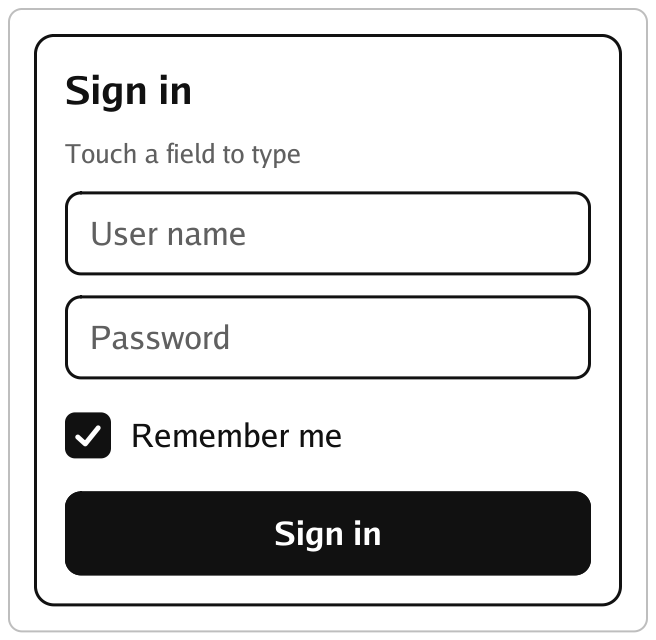
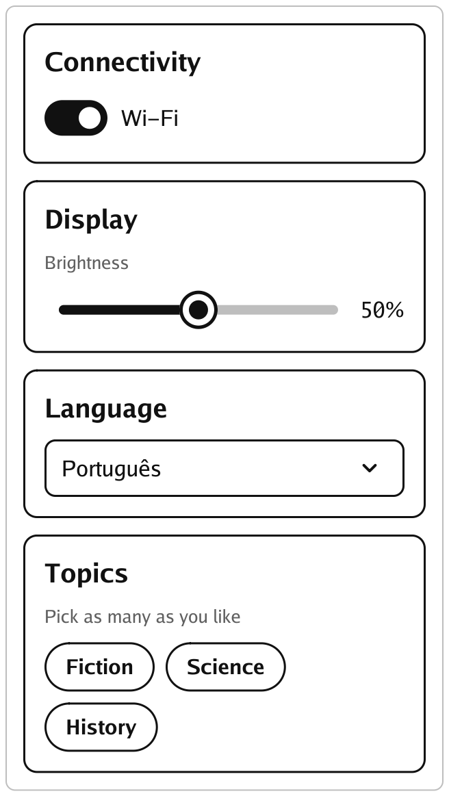
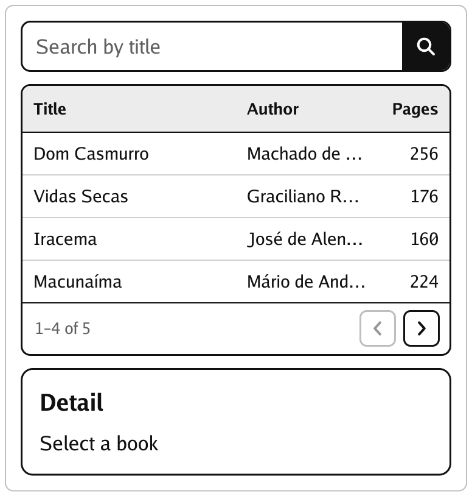
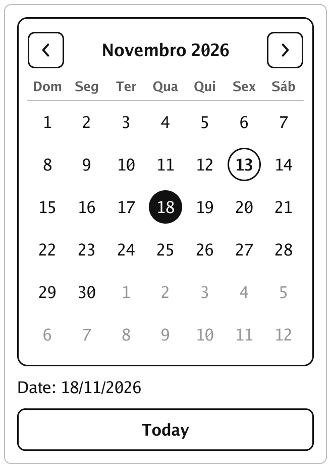
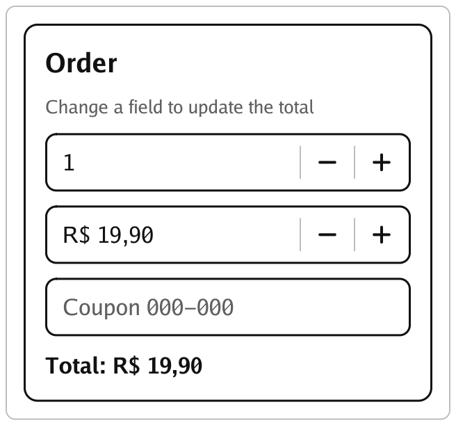

# 8. Recipes

[← Events and state](07-events-and-state.md) · [Index](README.md) · [Next: Custom components →](09-custom-components.md)

Complete screens you can copy and adapt. Each one is a real file in [`examples/`](../../examples), with tests,
and is built with the same pieces you saw in the previous pages.

> **How to use a recipe.** Create the screen, put it in a document and give the document a keyboard:
>
> ```go
> login := examples.NewLoginForm(func(user string, remember bool) { /* signed in */ })
> doc := examples.Screen(1404, 1872, deviceKeyboard{}, login.Root)
> ```
>
> On the reader `Screen` and the keyboard come from your `main` (see `examples/newapp`); in tests and
> previews use `&widget.FakeKeyboard{}`.

## Login form with validation



Two fields (one is a password), a check-box and a button. The error message is a label that starts **hidden**
and is shown by the button's handler when the data is wrong. `onLogin` is called only with valid data.

What to notice: the fields are plain `*widget.Input` values stored in the struct, so the handler reads
`f.User.Value`; `Hidden` is toggled instead of adding and removing elements; the card puts everything in a
column that stretches to the width.

```go
// examples/login.go
package examples

import "go-pocketbook-base/internal/widget"

// LoginForm is a sign-in screen with validation.
type LoginForm struct {
	Root     widget.Widget
	User     *widget.Input
	Password *widget.Input
	Remember *widget.Toggle
	Message  *widget.Label
}

// NewLoginForm builds the form. onLogin runs only when the data is valid.
func NewLoginForm(onLogin func(user string, remember bool)) *LoginForm {
	f := &LoginForm{
		User:     widget.NewInput("User name"),
		Password: widget.NewInput("Password"),
		Remember: widget.NewCheckbox("Remember me", true),
		Message:  widget.NewLabel(""),
	}
	f.Password.Type = widget.TypePassword
	f.Message.Hidden = true // shown only when there is an error
	f.Message.Style.Bold = true

	submit := widget.NewButton("Sign in")
	submit.SetVariant(widget.VariantPrimary)
	submit.OnClick = func(e *widget.Event) {
		switch {
		case f.User.Value == "":
			f.fail("Type your user name")
		case len(f.Password.Value) < 4:
			f.fail("The password needs at least 4 characters")
		default:
			f.Message.Hidden = true
			onLogin(f.User.Value, f.Remember.Checked)
		}
	}

	f.Root = widget.NewCard("Sign in", "Touch a field to type",
		f.User, f.Password, f.Remember, f.Message, submit)
	return f
}

func (f *LoginForm) fail(text string) {
	f.Message.Text = text
	f.Message.Hidden = false
}
```

## Settings screen



A preferences page mixing a **switch**, a **slider** (with its value written beside it), a **combo-box** and
**chips**. Each control sits in its own card.

What to notice: the slider has `FlexGrow = 1`, so it takes the width the value label leaves free; `OnInput`
updates the label while the knob moves; `SetValue("pt")` chooses the combo's initial option by value.

```go
// examples/settings.go
package examples

import (
	"fmt"

	"go-pocketbook-base/internal/widget"
)

// Settings is a preferences screen that mixes a switch, a slider, a
// combo-box and chips.
type Settings struct {
	Root       widget.Widget
	WiFi       *widget.Toggle
	Brightness *widget.Slider
	Language   *widget.ComboBox
	Topics     *widget.ChipGroup
}

// NewSettings builds the screen with sensible defaults.
func NewSettings() *Settings {
	s := &Settings{
		WiFi:       widget.NewSwitch("Wi-Fi", true),
		Brightness: widget.NewSlider(0, 100, 5, 50),
		Language: widget.NewComboBox("Language",
			widget.Option{Label: "Português", Value: "pt"},
			widget.Option{Label: "English", Value: "en"},
			widget.Option{Label: "Español", Value: "es"}),
		Topics: widget.NewChipGroup(false),
	}
	s.Language.SetValue("pt")

	// The slider grows to fill the row; its value is shown at the right.
	level := widget.NewLabel("50%")
	s.Brightness.Style.FlexGrow = 1
	s.Brightness.OnInput = func(e *widget.Event) {
		level.Text = fmt.Sprintf("%.0f%%", s.Brightness.Value)
	}

	for _, topic := range []string{"Fiction", "Science", "History"} {
		s.Topics.AppendChild(widget.NewChip(topic))
	}

	s.Root = widget.NewColumn(24,
		widget.NewCard("Connectivity", "", s.WiFi),
		widget.NewCard("Display", "Brightness", widget.NewRow(12, s.Brightness, level)),
		widget.NewCard("Language", "", s.Language),
		widget.NewCard("Topics", "Pick as many as you like", s.Topics))
	return s
}
```

## Searchable catalog



A search field above a **sortable, paged table**, with a detail card for the selected row.

What to notice: the table is fed with `Rows`, and searching only replaces `Rows` (and resets `Page` and
`Selected`); the search field's `OnSubmit` runs on the magnifier or the keyboard's OK, and `OnChange` also
fires when the clear (×) button empties the field, which restores the full list; `Table.Selected` indexes
the **displayed** `Rows`.

```go
// examples/catalog.go
package examples

import (
	"strings"

	"go-pocketbook-base/internal/gfx"
	"go-pocketbook-base/internal/widget"
)

// Catalog is a searchable, sortable table with a detail card.
type Catalog struct {
	Root   widget.Widget
	Search *widget.Input
	Table  *widget.Table
	Detail *widget.Label

	all [][]string // every row; the table shows the filtered ones
}

// NewCatalog builds the screen; each row is {title, author, pages}.
func NewCatalog(rows [][]string) *Catalog {
	c := &Catalog{
		all:    rows,
		Search: widget.NewSearchInput("Search by title"),
		Detail: widget.NewLabel("Select a book"),
		Table: widget.NewTable(4,
			widget.TableColumn{Title: "Title", Flex: 3, Sortable: true},
			widget.TableColumn{Title: "Author", Flex: 2, Sortable: true},
			widget.TableColumn{Title: "Pages", Flex: 1, Align: gfx.AlignEnd, Sortable: true}),
	}
	c.Search.OnSubmit = func(e *widget.Event) { c.filter(c.Search.Value) }
	c.Search.OnChange = func(e *widget.Event) {
		if c.Search.Value == "" { // the clear (×) button
			c.filter("")
		}
	}
	c.Table.OnSelect = func(e *widget.Event) {
		row := c.Table.Rows[c.Table.Selected]
		c.Detail.Text = row[0] + " — " + row[1] + " (" + row[2] + " pages)"
	}
	c.filter("")

	c.Root = widget.NewColumn(20, c.Search, c.Table, widget.NewCard("Detail", "", c.Detail))
	return c
}

// filter keeps the rows whose title contains query (case-insensitive).
func (c *Catalog) filter(query string) {
	var rows [][]string
	for _, r := range c.all {
		if strings.Contains(strings.ToLower(r[0]), strings.ToLower(query)) {
			rows = append(rows, r)
		}
	}
	c.Table.Rows, c.Table.Page, c.Table.Selected = rows, 0, -1
}
```

## Date picker



A calendar, the chosen date written below it and a **Today** shortcut. The callback receives every chosen
`time.Time`.

What to notice: moving the calendar to another month needs `Year` and `Month` to be set together with
`Selected`; a zero `time.Time` means "no date" and the label says so.

```go
// examples/datepicker.go
package examples

import (
	"time"

	"go-pocketbook-base/internal/widget"
)

// DatePicker is a calendar with the chosen date written below it and a
// "Today" shortcut.
type DatePicker struct {
	Root     widget.Widget
	Calendar *widget.Calendar

	chosen *widget.Label
}

// NewDatePicker builds the picker. onPick receives every chosen date.
func NewDatePicker(initial time.Time, onPick func(time.Time)) *DatePicker {
	p := &DatePicker{Calendar: widget.NewCalendar(initial), chosen: widget.NewLabel("")}
	p.Calendar.Locale = widget.LocalePTBR

	pick := func(t time.Time) {
		p.Calendar.Selected = t
		p.Calendar.Year, p.Calendar.Month = t.Year(), t.Month()
		p.show()
		onPick(t)
	}
	p.Calendar.OnChange = func(e *widget.Event) { pick(p.Calendar.Selected) }

	today := widget.NewButton("Today")
	today.OnClick = func(e *widget.Event) { pick(time.Now()) }

	p.show()
	p.Root = widget.NewColumn(20, p.Calendar, p.chosen, today)
	return p
}

func (p *DatePicker) show() {
	if p.Calendar.Selected.IsZero() {
		p.chosen.Text = "No date chosen"
		return
	}
	p.chosen.Text = "Date: " + p.Calendar.Selected.Format("02/01/2006")
}
```

## Order form: numbers and masks



A quantity (− / +), a unit price with prefix and decimals, and a coupon with a **digit mask**. The **total is
recalculated** whenever any field changes; a complete coupon takes 10% off.

What to notice: three fields share one `OnChange`; `Number()` reads numeric fields and `MaskSlots` tells how
many digits the mask needs; `DecimalSeparator = ","` shows Brazilian prices while the value stays a normal
number.

```go
// examples/order.go
package examples

import (
	"fmt"
	"strings"

	"go-pocketbook-base/internal/widget"
)

// OrderForm shows numeric fields with − / + buttons, a digit mask and a total
// that is recalculated whenever a field changes.
type OrderForm struct {
	Root      widget.Widget
	Quantity  *widget.Input
	UnitPrice *widget.Input
	Coupon    *widget.Input

	total *widget.Label
}

// NewOrderForm builds the form with 1 item of R$ 19,90.
func NewOrderForm() *OrderForm {
	f := &OrderForm{total: widget.NewLabel("")}

	f.Quantity = widget.NewNumberInput(1, 0)
	f.Quantity.Min, f.Quantity.Max = 1, 20

	f.UnitPrice = widget.NewNumberInput(19.9, 2)
	f.UnitPrice.Prefix, f.UnitPrice.DecimalSeparator, f.UnitPrice.Step = "R$ ", ",", 0.5

	f.Coupon = widget.NewMaskedInput("000-000", "") // 6 digits: 123-456
	f.Coupon.NoSteppers, f.Coupon.Placeholder = true, "Coupon 000-000"

	for _, in := range []*widget.Input{f.Quantity, f.UnitPrice, f.Coupon} {
		in.OnChange = func(e *widget.Event) { f.recalculate() }
	}
	f.recalculate()

	f.total.Style.Bold = true
	f.Root = widget.NewCard("Order", "Change a field to update the total",
		f.Quantity, f.UnitPrice, f.Coupon, f.total)
	return f
}

// Total is quantity × price, with 10% off when the coupon is complete.
func (f *OrderForm) Total() float64 {
	total := f.Quantity.Number() * f.UnitPrice.Number()
	if len(f.Coupon.Value) == widget.MaskSlots(f.Coupon.Mask) {
		total *= 0.9
	}
	return total
}

func (f *OrderForm) recalculate() {
	f.total.Text = "Total: R$ " + strings.Replace(fmt.Sprintf("%.2f", f.Total()), ".", ",", 1)
}
```

## Navigation between pages with the menu bar

`widget.Tabs` is a menu bar on top and a body below that **swaps pages**. Only the current page is kept in memory;
what the user typed or chose is saved in the tabs' store and put back when the page is shown again, **for elements that
have an `ID`** (a tab can instead be `TabRebuild` — starts fresh — or `TabKeepAlive` — keeps the whole tree).

What to notice: `Tabs.Body` is where you set the padding (it already takes everything below the bar); passwords are never
remembered; this function returns a whole `Document`.

```go
// examples/navigation.go
package examples

import (
	"go-pocketbook-base/internal/geom"
	"go-pocketbook-base/internal/widget"
)

// NewPagedApp builds a whole application: tabs that switch between the Login,
// Settings and Catalog pages. Only the current page lives in memory; what the
// user typed or chose is kept in the Tabs store and put back when the page is
// shown again (every element that must be remembered has an ID).
func NewPagedApp(width, height int, kb widget.Keyboard) *widget.Document {
	books := [][]string{
		{"Dom Casmurro", "Machado de Assis", "256"},
		{"Vidas Secas", "Graciliano Ramos", "176"},
		{"Iracema", "José de Alencar", "160"},
	}
	tabs := widget.NewTabs(nil,
		&widget.Tab{Title: "Login", Build: func() widget.Widget {
			f := NewLoginForm(func(string, bool) {})
			f.User.ID, f.Remember.ID = "user", "remember" // the password is never remembered
			return f.Root
		}},
		&widget.Tab{Title: "Settings", Build: func() widget.Widget {
			s := NewSettings()
			s.WiFi.ID, s.Brightness.ID, s.Language.ID, s.Topics.ID = "wifi", "brightness", "language", "topics"
			return s.Root
		}},
		// TabKeepAlive keeps the whole page (and its data) in memory instead.
		&widget.Tab{Title: "Catalog", Mode: widget.TabKeepAlive, Build: func() widget.Widget { return NewCatalog(books).Root }})
	tabs.Body.Style.Padding = geom.All(28) // the body already takes everything below the bar

	doc := widget.NewDocument(width, height)
	doc.Keyboard = kb
	doc.SetRoot(tabs)
	return doc
}
```

## A whole app on the reader

`examples/newapp` is the template to start a real app: it connects the reader's events to the document
(`Init`, `Draw`, `Key`, `Pointer`) and the system keyboard. Copy it to `cmd/<name>`, replace the line marked
`your screen goes here` and build with `.\build.ps1 -App <name>`.

```go
// examples/newapp/main.go
// Command newapp is a starting point for a new PocketBook application:
// copy this folder to cmd/<name>, change the screen and run `make dist APP=<name>`.
package main

import (
	"log"

	"go-pocketbook-base/examples"
	"go-pocketbook-base/internal/inkview"
	"go-pocketbook-base/internal/widget"
)

type app struct {
	doc     *widget.Document
	pending bool // a repaint is already queued
}

// Init runs once, when the app starts.
func (a *app) Init() {
	inkview.DisablePanel() // the app gets the whole screen
	w, h := inkview.ScreenSize()
	a.doc = examples.NewPagedApp(w, h, deviceKeyboard{}) // <- your screen goes here
	a.doc.OnInvalidate = a.requestRepaint
}

// requestRepaint queues at most one repaint, however many changes happen.
func (a *app) requestRepaint() {
	if !a.pending {
		a.pending = true
		inkview.Repaint()
	}
}

// Draw renders the document and shows it on the e-ink screen.
func (a *app) Draw() {
	a.pending = false
	img := a.doc.Render()
	b := img.Bounds()
	inkview.Blit(img.Pix, b.Dx(), b.Dy(), img.Stride)
}

// Key handles hardware keys: Back closes a popup, then leaves the app.
func (a *app) Key(code int) bool {
	if code != inkview.KeyBack {
		return false
	}
	if a.doc.HasPopup() {
		a.doc.ClosePopups()
	} else {
		inkview.Exit()
	}
	return true
}

// Pointer forwards touches (device pixels) to the document.
func (a *app) Pointer(kind inkview.PointerKind, x, y int) bool {
	if kind == inkview.PointerMove && a.pending {
		return true // the screen is still catching up: skip intermediate positions
	}
	phase := map[inkview.PointerKind]widget.PointerType{
		inkview.PointerDown: widget.PointerDown,
		inkview.PointerMove: widget.PointerMove,
		inkview.PointerUp:   widget.PointerUp,
	}[kind]
	a.doc.HandlePointer(phase, float64(x), float64(y))
	return true
}

// deviceKeyboard opens the reader's on-screen keyboard.
type deviceKeyboard struct{}

func (deviceKeyboard) Request(r widget.KeyboardRequest) {
	flags := inkview.KeyboardNormal
	if r.Kind == widget.KeyboardNumeric {
		flags = inkview.KeyboardNumeric
	}
	inkview.OpenKeyboard(r.Title, r.Initial, r.MaxLen, flags, r.Done)
}

func main() {
	if err := inkview.Run(&app{}); err != nil {
		log.Fatal(err)
	}
}
```

## Small patterns

| You want to | Do |
|---|---|
| show an error only when needed | create a `Label`, set `Hidden = true`, flip it in the handler |
| derive a value from several fields | give them one `OnChange` that recomputes and writes a label |
| filter a list | keep the full data in your struct and assign the filtered slice to `Table.Rows` |
| run code when a page opens | do it in the function that swaps the page (`show(i)`) |
| one handler for many controls | loop over them and use `e.Target` |
| enable a button only when the form is valid | set `button.Disabled = !valid` inside the fields' `OnChange` |

Next: [Custom components →](09-custom-components.md)
