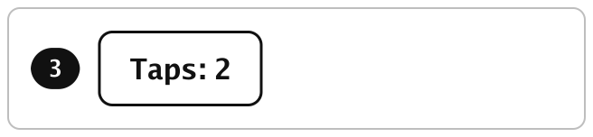

# 9. Custom components

[← Recipes](08-recipes.md) · [Index](README.md) · [Next: Testing →](10-testing.md)

When the ready-made components are not enough, you create your own **element**. It is a normal Go struct
that embeds `widget.Base`, and it takes part in layout, painting and touch exactly like the built-in ones.

## The recipe

1. **Embed `widget.Base`** in your struct.
2. In the constructor call **`Init(self)`** — this links the element to itself (needed for parents, touch
   and document lookups). Then set default `Style` values.
3. Implement **`Measure(avail)`**: the natural size of your *content* (without padding or border).
4. Implement **`Paint(canvas)`**: draw your content inside `ContentRect()`.
5. For touch, implement **`HandlePointer(*widget.PointerEvent)`** and use **`widget.Fire`** to run the user's
   callbacks.

That is all. The background, the border, `Hidden`, `Disabled`, layout (flex/grid, margins, `FlexGrow`) and
`OnClick` come from `Base` and the layout engine.

## Example: a display-only badge and a tap counter



`Badge` only draws; `TapCounter` also reacts to touch.

```go
// examples/custom/customwidget.go
package custom

import (
	"strconv"

	"go-pocketbook-base/internal/kernel/geom"
	"go-pocketbook-base/internal/toolkit/gfx"
	"go-pocketbook-base/internal/toolkit/widget"
)

// Badge is a custom element: a dark pill showing a number. It only draws.
type Badge struct {
	widget.Base
	Count int
}

// NewBadge creates a badge. Every custom element calls Init with itself.
func NewBadge(count int) *Badge {
	b := &Badge{Count: count}
	b.Init(b)
	b.Style.Background = widget.Ink
	b.Style.BorderRadius = 24
	b.Style.Padding = geom.XY(6, 20)
	return b
}

// Measure reports the natural size of the content (the number).
func (b *Badge) Measure(avail float64) geom.Size {
	return geom.Size{W: gfx.TextWidth(strconv.Itoa(b.Count), widget.FontSmall, true), H: widget.FontSmall * 1.3}
}

// Paint draws the number; the pill itself comes from Style.Background.
func (b *Badge) Paint(c *gfx.Canvas) {
	c.Text(strconv.Itoa(b.Count), b.ContentRect(), gfx.TextStyle{
		Size: widget.FontSmall, Bold: true, Color: widget.Paper, Align: gfx.AlignCenter,
	})
}

// TapCounter is a custom interactive element: each tap adds one.
type TapCounter struct {
	widget.Base
	Count    int
	OnChange widget.Handler
}

// NewTapCounter creates a counter that looks like a button.
func NewTapCounter() *TapCounter {
	t := &TapCounter{}
	t.Init(t)
	t.Style.BorderColor, t.Style.BorderWidth, t.Style.BorderRadius = widget.Ink, widget.BorderThin, widget.Radius
	t.Style.Padding = geom.XY(0, 32)
	t.Style.MinHeight = widget.ControlHeight
	return t
}

func (t *TapCounter) label() string { return "Taps: " + strconv.Itoa(t.Count) }

// Measure implements widget.Widget.
func (t *TapCounter) Measure(avail float64) geom.Size {
	return geom.Size{W: gfx.TextWidth(t.label(), widget.FontBody, true), H: widget.FontBody * 1.3}
}

// Paint implements widget.Widget.
func (t *TapCounter) Paint(c *gfx.Canvas) {
	c.Text(t.label(), t.ContentRect(), gfx.TextStyle{
		Size: widget.FontBody, Bold: true, Color: widget.Ink, Align: gfx.AlignCenter,
	})
}

// HandlePointer makes the element a touch target (widget.PointerHandler).
func (t *TapCounter) HandlePointer(e *widget.PointerEvent) {
	if e.Type != widget.PointerClick {
		return
	}
	t.Count++
	widget.Fire(t.OnChange, t) // run the user's OnChange callback
}
```

Use them like any other element:

```go
counter := custom.NewTapCounter()
counter.OnChange = func(e *widget.Event) { fmt.Println("taps:", counter.Count) }

row := widget.NewRow(16, custom.NewBadge(3), counter)
```

## Rules of thumb

| Topic | What to do |
|---|---|
| Sizes | design pixels (the screen is 1404 wide); keep touch targets ≥ 64 px — set `Style.MinHeight`/`MinWidth` |
| Content size | `Measure` returns the content only; `Padding` and `BorderWidth` are added for you |
| Drawing area | draw inside `b.ContentRect()`; the box (`Background`, border) is already drawn |
| Disabled | `Base.Disabled` blocks touch for you; draw a washed-out look (`widget.Disabled`, `widget.Mid`) yourself |
| Callbacks | declare `OnChange widget.Handler` and call `widget.Fire(t.OnChange, t)` |
| Touch | only `PointerClick` (finger released over the element) is a tap; `PointerDown/Move/Up` are for drags |
| Repaint | a click repaints automatically; after other changes call `b.Invalidate()` |
| Containers | an element with children needs no `Measure`/`Paint`; just use `Style.Display` |
| Interactive vs display-only | an element is a touch target only if it has `HandlePointer` or an `OnClick` |

## Drawing API (`gfx.Canvas`)

All coordinates are design pixels (`geom.Rect`, `geom.Point`).

| Call | Draws |
|---|---|
| `c.Text(s, rect, gfx.TextStyle{Size, Bold, Color, Align, Ellipsis})` | one line of text centered vertically in `rect` |
| `c.FillRoundRect(rect, radius, color)` / `c.StrokeRoundRect(rect, radius, width, color)` | filled / outlined rounded rectangle |
| `c.Line(a, b, width, color)` / `c.Polyline(points, width, color)` | lines with round ends |
| `c.FillCircle(center, r, color)` / `c.StrokeCircle(center, r, width, color)` | disc / ring |
| `c.Arc(center, r, a1, a2, width, color)` | an arc (radians) |
| `c.Icon(kind, rect, width, color)` | one of the built-in icons |
| `c.Clip(rect, radius)` … `c.ResetClip()` | restrict drawing to a rectangle |
| `gfx.TextWidth(s, size, bold)` | width of a text, for `Measure` |

Colors are `widget.Ink`, `Paper`, `Soft`, `Mid`, `Muted`, `Disabled` or your own (`gfx.Gray(v)`).

> **Fonts.** The built-in fonts (Go Regular and Bold) cover Latin letters with accents. Symbols such as
> "✓" are missing and show as a box: draw an icon with `c.Icon` instead.

## Test it

```go
func TestTapCounter(t *testing.T) {
	counter := NewTapCounter()
	doc, _ := newDoc(counter)
	tap(doc, counter)
	if counter.Count != 1 {
		t.Fatal("a tap must count")
	}
}
```

See [Testing](10-testing.md) for the helpers.

Next: [Testing →](10-testing.md)
