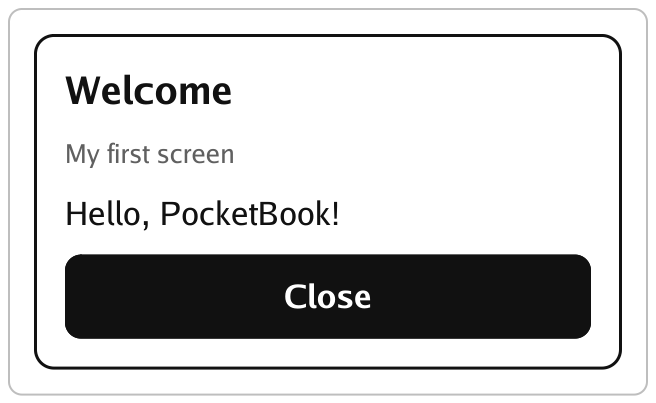

# go-pocketbook-base — Documentation

🇬🇧 English · [🇧🇷 Português](../pt-br/README.md)

**go-pocketbook-base** is a base for writing **PocketBook (Linux ARM e-reader) apps in Go**. It brings:

- a **widget library drawn from scratch with vector graphics** (buttons, inputs, tables, calendar…), laid
  out with a CSS-like **flex/grid** engine and designed for e-ink;
- a small binding to the reader (touch, system keyboard, screen);
- an app that **installs itself** (launcher icon) the first time it runs;
- a reproducible **Docker build** with the PocketBook SDK, and automatic **versioning**;
- everything testable on your PC, without a device.

> Every code sample in this documentation comes from the [`examples/`](../../examples) folder: it
> compiles, it is covered by tests, and `go run ./tools/docsync` keeps the pages identical to it.

## Read in this order

| # | Page | What you will find |
|---|---|---|
| 1 | [Getting started](01-getting-started.md) | From zero to your first screen in minutes |
| 2 | [Installation](02-installation.md) | Requirements, installing on the reader, first run, uninstalling |
| 3 | [Build and versioning](03-build-and-versioning.md) | Docker, `build.ps1`/`make`, `.version`, tests, Sonar |
| 4 | [Concepts](04-concepts.md) | How it works: document, widgets, coordinates, rendering, touch |
| 5 | [Layout](05-layout.md) | `Style`, flex, grid, sizes, colors |
| 6 | [Components](06-components.md) | **Every component**: drawing, properties, code |
| 7 | [Events and state](07-events-and-state.md) | Callbacks, reading values, changing the screen |
| 8 | [Recipes](08-recipes.md) | Complete screens: login, settings, catalog, date, order, navigation |
| 9 | [Custom components](09-custom-components.md) | Create your own element |
| 10 | [Testing](10-testing.md) | Test screens and touch without a device |
| 11 | [Troubleshooting](11-troubleshooting.md) | Device quirks and common problems |
| 12 | [Internationalization](12-internationalization.md) | pt-BR first, English fallback, JSON translations |
| 13 | [Apps and the contract](13-apps-and-the-contract.md) | `apps/<id>`, the manifest, the lifecycle, `apps/hello` as the blueprint |

## Quick look

```go
// examples/hello.go
package examples

import (
	"fmt"

	"go-pocketbook-base/internal/widget"
)

// Hello is the smallest useful screen: a card with a message and a button.
func Hello(onClose func()) widget.Widget {
	message := widget.NewLabel("Hello, PocketBook!")

	closeButton := widget.NewButton("Close")
	closeButton.SetVariant(widget.VariantPrimary)
	closeButton.OnClick = func(e *widget.Event) {
		fmt.Println("button tapped at", e.X, e.Y)
		onClose()
	}

	return widget.NewCard("Welcome", "My first screen", message, closeButton)
}
```



## Project map

```
apps/hello         the blueprint app: a component showcase that follows the contract
internal/appkit    what every app shares: lifecycle, first-run registration, manifest
cmd/preview        renders the demo pages to PNG
examples/          tested code used by this documentation (and an app template)
internal/widget    components, layout and touch  ← the library
internal/gfx       vector drawing (canvas, text, icons)
internal/inkview   binding to the reader (cgo)
internal/install   first-run self-install
tools/             bumpversion, docgen, docsync
docs/              this documentation (en, pt-br) and the component pictures
```
