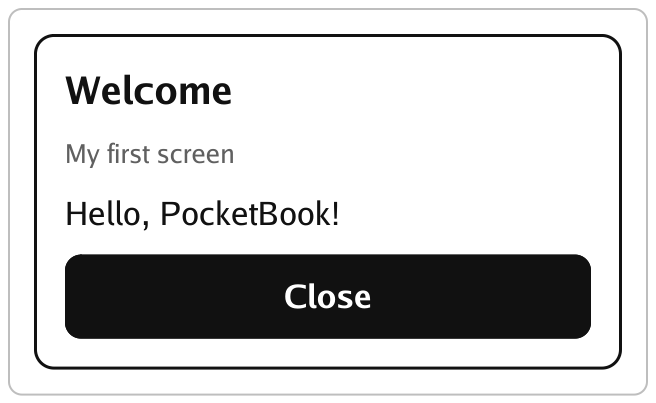

# 1. Primeiros passos

[← Índice](README.md) · [Próxima: Instalação →](02-instalacao.md)

Em poucos minutos você vai rodar os testes, ver a demo como imagem, desenhar a sua primeira tela e saber como
colocá-la no leitor.

## O que você precisa

| Para… | Você precisa de |
|---|---|
| escrever e testar código no PC | **Go 1.17 ou mais novo** e **Git** |
| compilar o app para o leitor | **Docker** (a imagem traz o SDK do PocketBook) |
| rodar no aparelho | um PocketBook com firmware 6.x (desenvolvido em um **PB741**, 1404×1872) |

Os passos 1 a 4 funcionam sem aparelho e sem Docker.

## Passo 1 — Obter o código

```sh
git clone <seu fork ou este repositório> go-pocketbook-base
cd go-pocketbook-base
```

O seu app vive **dentro deste módulo** (é assim que ele consegue usar os pacotes `internal/…`), então faça um
fork do repositório em vez de importá-lo de outro projeto.

## Passo 2 — Rodar os testes

```sh
go test ./...
```

Tudo deve passar. Os testes cobrem o motor de layout, cada componente, o comportamento do toque e todos os
exemplos desta documentação.

## Passo 3 — Ver a demo como imagem

```sh
go run ./cmd/preview
```

Ele gera `preview-0.png` … `preview-3.png`, uma por página da demo (Entradas, Escolhas, Dados, Calendário), no
tamanho da tela do PB741. Use `-page 2` para uma página só e `-w 758 -h 1024` para outra resolução.

## Passo 4 — Desenhar a sua primeira tela

Uma tela é uma árvore de elementos. Esta é a menor que já serve para algo:

```go
// examples/hello.go
package examples

import (
	"fmt"

	"go-pocketbook-base/internal/widget"
)

// Hello is the smallest useful screen: a card with a message and a button.
func Hello(onClose func()) widget.Widget {
	message := widget.NewLabel("Hello, PocketBook!")

	closeButton := widget.NewButton("Close")
	closeButton.SetVariant(widget.VariantPrimary)
	closeButton.OnClick = func(e *widget.Event) {
		fmt.Println("button tapped at", e.X, e.Y)
		onClose()
	}

	return widget.NewCard("Welcome", "My first screen", message, closeButton)
}
```

O `Screen` coloca a tela numa página com margem e devolve um `Document`, que sabe organizar, desenhar e receber
toque:

```go
// examples/screen.go
package examples

import (
	"go-pocketbook-base/internal/geom"
	"go-pocketbook-base/internal/widget"
)

// Screen puts content inside a padded page and returns a ready-to-render
// document for a width x height screen. kb is the keyboard used by input
// fields: on the device pass the InkView keyboard, in tests a FakeKeyboard.
func Screen(width, height int, kb widget.Keyboard, content widget.Widget) *widget.Document {
	doc := widget.NewDocument(width, height)
	doc.Keyboard = kb

	page := widget.NewColumn(0, content)
	page.Style.Padding = geom.All(28)
	page.Style.Background = widget.Paper

	doc.SetRoot(page)
	return doc
}
```

Gere um PNG sem precisar de aparelho:

```go
doc := examples.Screen(1404, 1872, nil, examples.Hello(func() {}))
if err := examples.SavePNG(doc, "hello.png"); err != nil {
	log.Fatal(err)
}
```

```go
// examples/preview.go
package examples

import (
	"image/png"
	"os"

	"go-pocketbook-base/internal/widget"
)

// SavePNG renders the document and writes it to a PNG file: the quickest way
// to see a screen without a device.
func SavePNG(doc *widget.Document, path string) error {
	f, err := os.Create(path)
	if err != nil {
		return err
	}
	if err := png.Encode(f, doc.Render()); err != nil {
		f.Close()
		return err
	}
	return f.Close()
}
```



> O `nil` é o teclado. Os campos precisam de um para digitar (veja [Testes](10-testes.md) para um teclado falso);
> esta tela não tem campos.

## Passo 5 — Rodar no leitor

1. Copie o app modelo e troque a tela que ele mostra:

   ```sh
   cp -r examples/newapp cmd/meuapp
   ```

   Abra `cmd/meuapp/main.go` e troque `examples.NewPagedApp(...)` pela sua tela. O modelo já encaminha o
   toque, as teclas físicas e o teclado do sistema para o documento.

2. Compile (precisa de Docker, veja [Build e versionamento](03-build-e-versionamento.md)):

   ```powershell
   .\build.ps1 -App meuapp      # Windows
   ```
   ```sh
   make dist APP=meuapp         # Linux / macOS / WSL
   ```

3. Conecte o leitor por USB e copie `dist/applications/meuapp.app` para a pasta `applications/` dele (ou rode
   `.\scripts\install.ps1 -Drive F: -App meuapp`). Abra pela lista de **Aplicativos**.

4. Na primeira execução o app instala o próprio ícone. **Desconecte o cabo USB** e o ícone aparece na tela
   inicial. Detalhes em [Instalação](02-instalacao.md).

## Para onde ir depois

- Veja todos os componentes com o desenho de cada um: [Componentes](06-componentes.md).
- Copie uma tela completa e adapte: [Receitas](08-receitas.md).
- Entenda o que acontece por baixo: [Conceitos](04-conceitos.md).

[← Índice](README.md) · [Próxima: Instalação →](02-instalacao.md)
