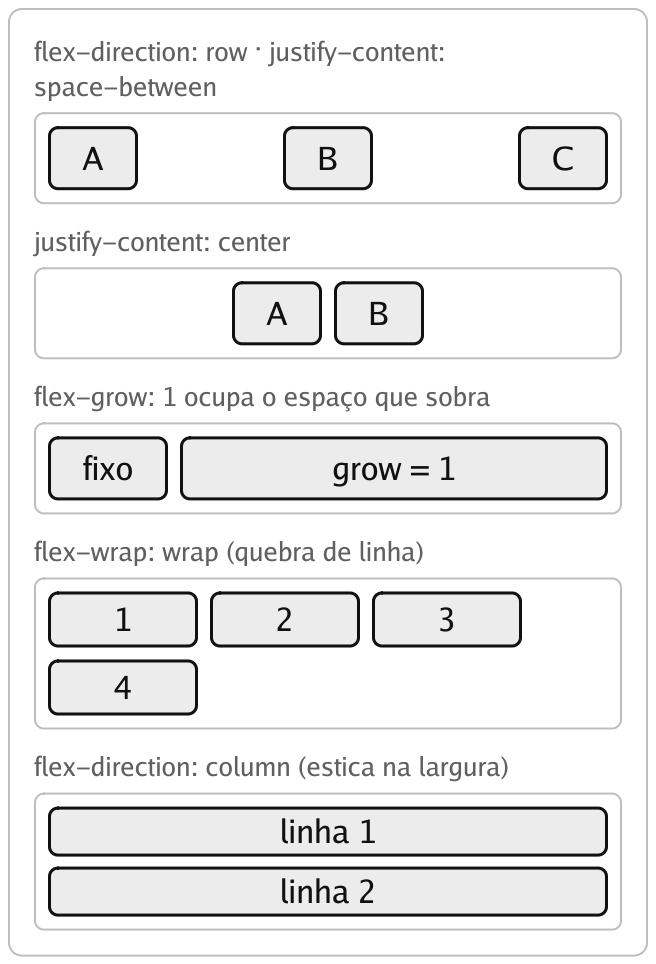
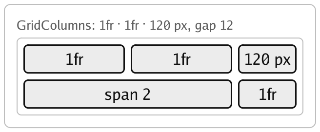

# 5. Layout

[← Conceitos](04-conceitos.md) · [Índice](README.md) · [Próxima: Componentes →](06-componentes.md)

O layout funciona como o CSS: você descreve os contêineres com um `Style` e o motor posiciona os filhos. Ele
suporta **flexbox** e **grid**, com o modelo de caixa *border-box* do CSS (`Width`/`Height` incluem padding e borda).

## Referência do Style

Todo elemento tem `Style` (um `widget.Style`). Os nomes são os do CSS.

| Campo | Valores | Equivalente no CSS |
|---|---|---|
| `Display` | `DisplayBlock` (padrão), `DisplayFlex`, `DisplayGrid`, `DisplayNone` | `display` |
| `FlexDirection` | `Row`, `Column` | `flex-direction` |
| `FlexWrap` | `true` / `false` | `flex-wrap` |
| `JustifyContent` | `JustifyStart`, `JustifyCenter`, `JustifyEnd`, `JustifySpaceBetween`, `JustifySpaceAround` | `justify-content` |
| `AlignItems` | `AlignStretch` (padrão), `AlignStart`, `AlignCenter`, `AlignEnd` | `align-items` |
| `Gap` | pixels | `gap` |
| `FlexGrow` | número (no **filho**) | `flex-grow` |
| `GridColumns` | `[]Track` com `FrTrack(n)` e `PxTrack(n)` | `grid-template-columns` |
| `GridColumnSpan` | número de colunas (no **filho**) | `grid-column: span n` |
| `Width`, `Height` | `Px(n)`, `Pct(n)` (só largura) ou vazio = automático | `width`, `height` |
| `MinWidth`, `MinHeight` | pixels | `min-width`, `min-height` |
| `Padding`, `Margin` | `geom.All(n)`, `geom.XY(vertical, horizontal)` ou `geom.Insets{Top, Right, Bottom, Left}` | `padding`, `margin` |
| `Background`, `Color`, `BorderColor` | `widget.Ink`, `Paper`, `Soft`, `Mid`, `Muted`, `Disabled`, `gfx.Gray(v)`, `gfx.RGB(r, g, b)`, `gfx.Hex("#222")` | `background`, `color`, `border-color` |
| `BackgroundImage`, `BackgroundSize` | um `image.Image`, `gfx.FitCover/FitContain/FitFill` | `background-image`, `background-size` |
| `BorderWidth`, `BorderRadius` | pixels | `border-width`, `border-radius` |
| `FontSize`, `Bold`, `TextAlign` | pixels, bool, `gfx.AlignStart/Center/End` | `font-size`, `font-weight`, `text-align` |

Tamanhos do tema que você pode reutilizar: `widget.FontBody` (32), `FontSmall` (26), `FontTitle` (44), `Space` (20),
`ControlHeight` (84), `Radius` (16), `BorderThin` (3).

As cores são em tons de cinza no e-ink; um valor colorido é convertido para cinza ao desenhar.

## Contêineres

Você cria contêineres com quatro ajudantes. Eles só diferem no `Style` que já vem preenchido:

| Ajudante | Resultado |
|---|---|
| `widget.NewPanel(filhos...)` | bloco: filhos empilhados na vertical, esticados na largura |
| `widget.NewRow(gap, filhos...)` | flex em linha, filhos centralizados na vertical |
| `widget.NewColumn(gap, filhos...)` | flex em coluna, filhos esticados na largura |
| `widget.NewGrid(gap, colunas, filhos...)` | grid com as colunas indicadas |
| `widget.NewCard(título, subtítulo, filhos...)` | coluna com borda e cantos arredondados e um título (é um painel) |

Como são elementos comuns, você pode alterar qualquer campo do `Style` depois.

## Flexbox



Um contêiner flex coloca os filhos ao longo do **eixo principal** (a linha ou a coluna) e os alinha no **eixo
transversal**. O espaço livre no eixo principal vai para os filhos com `FlexGrow`; se ninguém cresce, o
`JustifyContent` decide onde os filhos ficam.

Distribuir os itens com o espaço livre entre eles:

```go
// examples/components.go#FlexRow
// FlexRow spreads three items along a row with the free space between them.
func FlexRow() widget.Widget {
	row := widget.NewRow(12, widget.NewButton("A"), widget.NewButton("B"), widget.NewButton("C"))
	row.Style.JustifyContent = widget.JustifySpaceBetween
	return row
}
```

Deixar um filho ocupar o que sobra:

```go
// examples/components.go#FlexGrow
// FlexGrow gives the leftover width to one child.
func FlexGrow() widget.Widget {
	fixed := widget.NewButton("Fixed")
	fill := widget.NewButton("Grows")
	fill.Style.FlexGrow = 1
	return widget.NewRow(12, fixed, fill)
}
```

Quebrar em várias linhas quando os filhos não cabem:

```go
// examples/components.go#FlexWrap
// FlexWrap breaks the children into several lines when they do not fit.
func FlexWrap() widget.Widget {
	panel := widget.NewRow(12)
	panel.Style.FlexWrap = true
	panel.Style.AlignItems = widget.AlignStart
	for _, name := range []string{"one", "two", "three", "four", "five", "six"} {
		panel.AppendChild(widget.NewButton(name))
	}
	return panel
}
```

Empilhar na vertical (os filhos esticam na largura da coluna, a não ser que você defina `AlignItems`):

```go
// examples/components.go#FlexColumn
// FlexColumn stacks the children; they stretch to the width of the column.
func FlexColumn() widget.Widget {
	return widget.NewColumn(12, widget.NewButton("First"), widget.NewButton("Second"))
}
```

Lembre-se: `FlexGrow` vai no **filho**; `JustifyContent`, `AlignItems`, `Gap` e `FlexWrap` vão no **contêiner**.

## Grid



As colunas são fixas (`PxTrack`) ou flexíveis (`FrTrack`, como `1fr`). As linhas são criadas automaticamente e
ficam com a altura da célula mais alta; cada filho preenche a sua célula (a não ser que tenha `Width`/`Height`
próprios).

```go
// examples/components.go#GridLayout
// GridLayout uses three columns (1fr, 1fr and 120 px); one child spans two.
func GridLayout() widget.Widget {
	wide := widget.NewButton("spans two columns")
	wide.Style.GridColumnSpan = 2
	columns := []widget.Track{widget.FrTrack(1), widget.FrTrack(1), widget.PxTrack(120)}
	return widget.NewGrid(12, columns,
		widget.NewButton("1fr"), widget.NewButton("1fr"), widget.NewButton("120 px"), wide)
}
```

## Regras de tamanho

- **Automático** (`Width`/`Height` vazios): um elemento folha toma o tamanho do conteúdo (um texto quebra na largura
  disponível); um contêiner toma o tamanho dos filhos.
- **`Px(n)`** é exato. **`Pct(n)`** é uma porcentagem da largura disponível (não vale para altura).
- Numa **coluna** os filhos esticam até a largura total (`AlignStretch`); numa **linha** eles esticam até a altura do
  mais alto.
- `Padding` fica dentro da borda e `Margin` fora; os dois diminuem ou aumentam a caixa de acordo.
- `Hidden: true` ou `Display: DisplayNone` tira o elemento do layout e do toque.
- Um controle desenhado menor que 64 px ainda tem uma área de toque de 64 px (o slider faz isso).

## Dicas

- Coloque o **espaçamento da tela num contêiner de página** (`Style.Padding`), não em cada filho.
- Prefira `FlexGrow` a larguras fixas, para a tela se adaptar a outras resoluções.
- Cards num grid com `GridColumnSpan = 2` fazem painéis de duas colunas com facilidade.
- Mantenha cada página dentro da altura da tela: a biblioteca ainda não tem rolagem (veja o backlog no README). O
  teste da demo falha se uma página estourar.

Próxima: [Componentes →](06-componentes.md)
