# 6. Componentes

[← Layout](05-layout.md) · [Índice](README.md) · [Próxima: Eventos e estado →](07-eventos-e-estado.md)

Cada componente abaixo mostra o seu **desenho real** (gerado pela própria biblioteca com
`go run ./tools/docgen`), para que serve, as propriedades, como reage ao toque e um exemplo que funciona.

**Índice rápido:** [Painel, Row, Column, Grid](05-layout.md) · [Label](#label-texto) · [Botão](#botão) ·
[Check-box, radio e switch](#check-box-radio-button-e-switch) · [Combo-box](#combo-box) · [Dropdown](#dropdown) ·
[Menu bar](#menu-bar) · [Campo de texto](#campo-de-texto-e-senha) · [Campo numérico](#campo-numérico) ·
[Campo com máscara](#campo-com-máscara) · [Campo de busca](#campo-de-busca) · [Text-area](#text-area) ·
[Tabela de dados](#tabela-de-dados) · [Barra de progresso](#barra-de-progresso) · [Gauge](#gauge) ·
[Slider](#slider-slide-button) · [Chips](#chips) · [Calendário](#calendário) · [Card](#card)

> **Propriedades comuns a todos** (vindas da `Base`): `ID`, `ClassName`, `Style`, `Hidden`, `Disabled`, `OnClick`,
> `AppendChild/RemoveChild`. Um elemento **desabilitado** é desenhado apagado e ignora o toque. Os callbacks recebem
> um `*widget.Event` com `Target`, `X`, `Y` e `StopPropagation()`.

---

## Label (texto)

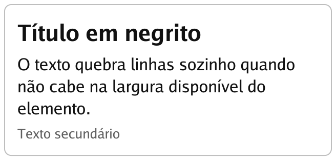

Texto estático (como `<span>` / `<p>`). Ele **quebra linhas sozinho** na largura que tem e respeita `\n`.

| | |
|---|---|
| Criar | `widget.NewLabel(texto)` |
| Propriedades | `Text`; `Style.FontSize`, `Bold`, `Color`, `TextAlign` |
| Toque | nenhum (adicione `OnClick` se quiser que reaja) |

```go
// examples/components.go#LabelExample
// LabelExample shows a bold title and a muted paragraph that wraps by itself.
func LabelExample() widget.Widget {
	title := widget.NewLabel("A bold title")
	title.Style.FontSize, title.Style.Bold = widget.FontTitle, true
	note := widget.NewLabel("Long text wraps by itself inside the width it has available.")
	note.Style.Color = widget.Muted
	return widget.NewColumn(8, title, note)
}
```

## Botão

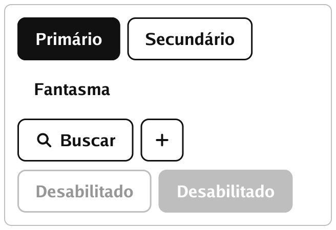

Um botão que se toca. Três pesos visuais: **primário** (preenchido), **secundário** (contorno, o padrão) e
**fantasma** (só texto). Pode ter um ícone ou ser um botão quadrado só com ícone. Tem pelo menos 84 px de altura.

| | |
|---|---|
| Criar | `widget.NewButton(texto)`, `widget.NewIconButton(ícone)` |
| Propriedades | `Text`, `Icon` (`gfx.IconSearch`, `IconPlus`, `IconClose`, `IconCheck`, `IconMenu`, `IconCalendar`, setas…), `SetVariant(VariantPrimary / VariantSecondary / VariantGhost)`, `Disabled` |
| Eventos | `OnClick` |
| Toque | o toque executa o `OnClick` |

```go
// examples/components.go#ButtonExample
// ButtonExample shows the variants, an icon, an icon-only and a disabled button.
func ButtonExample() widget.Widget {
	save := widget.NewButton("Save")
	save.SetVariant(widget.VariantPrimary)
	save.OnClick = func(e *widget.Event) { fmt.Println("saved") }

	search := widget.NewButton("Search")
	search.Icon = gfx.IconSearch

	add := widget.NewIconButton(gfx.IconPlus)

	off := widget.NewButton("Unavailable")
	off.Disabled = true // greyed out, ignores touch

	return widget.NewRow(12, save, search, add, off)
}
```

## Check-box, radio-button e switch

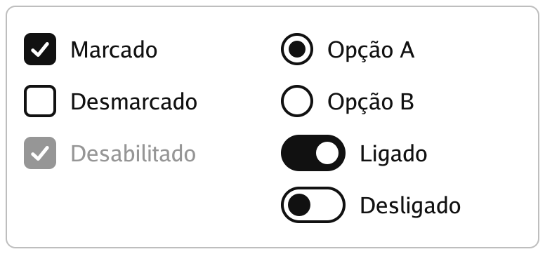

Controles de liga/desliga com rótulo. **A linha inteira é a área de toque**, não só o quadradinho.

- **Check-box** — independente; cada toque inverte o `Checked`.
- **Radio-button** — radios com o mesmo `Name` formam um grupo: escolher um desmarca os outros. Tocar no que já está
  escolhido não faz nada.
- **Switch** — um interruptor liga/desliga.

| | |
|---|---|
| Criar | `widget.NewCheckbox(rótulo, marcado)`, `widget.NewRadio(rótulo, grupo, valor)`, `widget.NewSwitch(rótulo, ligado)` |
| Propriedades | `Label`, `Checked`, `Name` (grupo do radio), `Value`, `Kind` |
| Eventos | `OnChange` (`e.Target.(*widget.Toggle)` dá o controle) |

```go
// examples/components.go#ToggleExample
// ToggleExample shows a check-box, two radio buttons of one group and a switch.
func ToggleExample() widget.Widget {
	news := widget.NewCheckbox("Send me the news", true)
	news.OnChange = func(e *widget.Event) { fmt.Println("news:", news.Checked) }

	free := widget.NewRadio("Free", "plan", "free") // same name = same group
	pro := widget.NewRadio("Pro", "plan", "pro")
	pro.Checked = true
	for _, r := range []*widget.Toggle{free, pro} {
		r.OnChange = func(e *widget.Event) {
			t := e.Target.(*widget.Toggle)
			fmt.Println("plan:", t.Value)
		}
	}

	wifi := widget.NewSwitch("Wi-Fi", true)
	return widget.NewColumn(4, news, free, pro, wifi)
}
```

## Combo-box

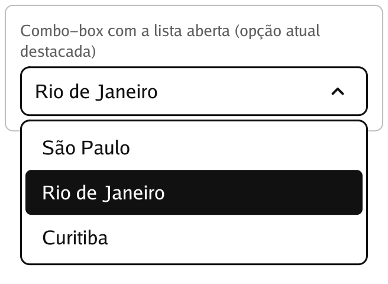

Um campo que guarda **uma opção** de uma lista (como o `<select>`). Ao tocar, abre a lista embaixo (ou em cima, se não
houver espaço) com a opção atual destacada; tocar numa opção a escolhe e fecha a lista. Um toque fora só fecha a lista.

| | |
|---|---|
| Criar | `widget.NewComboBox(placeholder, opções...)` com `widget.Option{Label, Value}` |
| Propriedades | `Options`, `Index` (-1 = nenhuma), `Placeholder`; `Value()`, `SetValue(v)` |
| Eventos | `OnChange` |

```go
// examples/components.go#ComboBoxExample
// ComboBoxExample keeps one option from a list.
func ComboBoxExample() widget.Widget {
	city := widget.NewComboBox("Choose a city",
		widget.Option{Label: "São Paulo", Value: "sp"},
		widget.Option{Label: "Rio de Janeiro", Value: "rj"},
		widget.Option{Label: "Curitiba", Value: "cwb"})
	city.OnChange = func(e *widget.Event) { fmt.Println("city:", city.Value()) }
	return city
}
```

## Dropdown

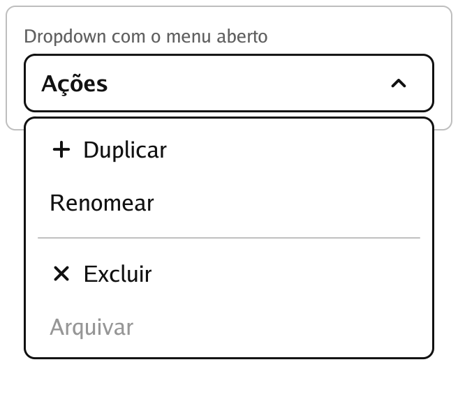

Um botão que abre um **menu de ações**. Ao contrário do combo-box, ele não guarda valor: cada item executa o seu
próprio `OnSelect`. Os itens podem ter ícone, estar desabilitados ou ser uma linha separadora.

| | |
|---|---|
| Criar | `widget.NewDropdown(texto, itens...)` com `widget.MenuItem` |
| `MenuItem` | `Label`, `Icon`, `Disabled`, `Separator`, `OnSelect func()` |
| Propriedades | `Text`, `Items`, `Chosen` (o último escolhido) |
| Eventos | `OnSelect` no dropdown (depois do do item) |

```go
// examples/components.go#DropdownExample
// DropdownExample opens a menu of actions.
func DropdownExample() widget.Widget {
	return widget.NewDropdown("Actions",
		widget.MenuItem{Label: "Duplicate", Icon: gfx.IconPlus, OnSelect: func() { fmt.Println("duplicate") }},
		widget.MenuItem{Label: "Rename", OnSelect: func() { fmt.Println("rename") }},
		widget.MenuItem{Separator: true},
		widget.MenuItem{Label: "Delete", Icon: gfx.IconClose, OnSelect: func() { fmt.Println("delete") }},
		widget.MenuItem{Label: "Archive", Disabled: true})
}
```

## Menu bar

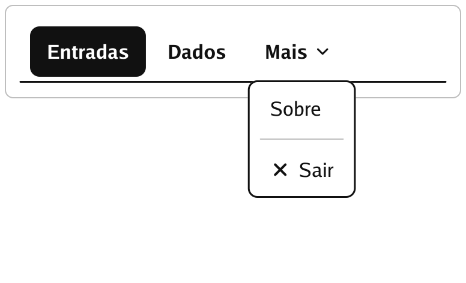

A barra de menus no topo da tela. Cada `Menu` ou executa `OnSelect` direto (por exemplo, para trocar de página) ou abre um
submenu com `Items`. `Selected` desenha o item atual preenchido.

| | |
|---|---|
| Criar | `widget.NewMenuBar(menus...)` com `&widget.Menu{...}` |
| `Menu` | `Label`, `Items []MenuItem`, `OnSelect func()`, `Selected bool` |
| Métodos | `MenuRect(i)` — o retângulo de toque do menu `i` |

```go
// examples/components.go#MenuBarExample
// MenuBarExample has a direct item and a menu with a sub-menu.
func MenuBarExample() widget.Widget {
	return widget.NewMenuBar(
		&widget.Menu{Label: "Home", Selected: true, OnSelect: func() { fmt.Println("home") }},
		&widget.Menu{Label: "More", Items: []widget.MenuItem{
			{Label: "About", OnSelect: func() { fmt.Println("about") }},
			{Separator: true},
			{Label: "Quit", Icon: gfx.IconClose, OnSelect: func() { fmt.Println("quit") }},
		}})
}
```

## Campo de texto e senha

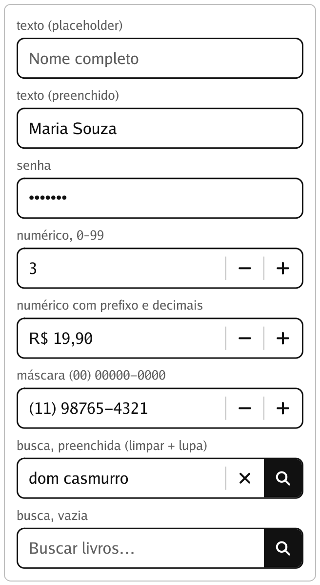

Um campo de uma linha. **Tocar nele abre o teclado do sistema.** Com `Type = TypePassword` aparecem bolinhas. O texto é
cortado com "…" quando é longo demais para caber.

| | |
|---|---|
| Criar | `widget.NewInput(placeholder)` |
| Propriedades | `Value`, `Placeholder`, `MaxLength`, `ReadOnly`, `Type` (`TypeText`, `TypePassword`) |
| Eventos | `OnChange` (depois que o teclado confirma) |
| Toque | abre o teclado (nada se for `ReadOnly`) |

```go
// examples/components.go#TextInputExample
// TextInputExample has a text field and a password field.
func TextInputExample() widget.Widget {
	name := widget.NewInput("Full name")
	name.MaxLength = 40
	name.OnChange = func(e *widget.Event) { fmt.Println("name:", name.Value) }

	password := widget.NewInput("Password")
	password.Type = widget.TypePassword // shown as bullets
	return widget.NewColumn(12, name, password)
}
```

## Campo numérico

O mesmo `Input` criado com `NewNumberInput`: teclado numérico e botões **− / +** à direita que mudam o valor sem abrir
o teclado. O número fica entre `Min` e `Max`, arredondado em `Decimals` casas.

| | |
|---|---|
| Criar | `widget.NewNumberInput(valor, casasDecimais)` |
| Propriedades | `Min`, `Max` (vale quando `Max > Min`), `Step`, `Decimals`, `Prefix`, `Suffix`, `DecimalSeparator`, `NoSteppers` |
| Métodos | `StepUp()`, `StepDown()`, `Number()`, `SetNumber(v)` (como `stepUp()`/`valueAsNumber` da web) |
| Eventos | `OnChange` (teclado, − e +) |

```go
// examples/components.go#NumberInputExample
// NumberInputExample has − / + buttons, a range, decimals and a prefix.
func NumberInputExample() widget.Widget {
	quantity := widget.NewNumberInput(3, 0)
	quantity.Min, quantity.Max = 0, 99
	quantity.OnChange = func(e *widget.Event) { fmt.Println("quantity:", quantity.Number()) }

	price := widget.NewNumberInput(19.9, 2)
	price.Prefix, price.DecimalSeparator, price.Step = "R$ ", ",", 0.5
	return widget.NewColumn(12, quantity, price)
}
```

## Campo com máscara

Um campo numérico que formata os dígitos com uma **máscara**: `0` e `#` valem um dígito; qualquer outro caractere é um
literal inserido para você. O `Value` guarda só os dígitos; `Display()` é o texto formatado.

| Máscara | Dígitos | Exibido |
|---|---|---|
| `(00) 00000-0000` | `11987654321` | `(11) 98765-4321` |
| `000.000.000-00` | `12345678901` | `123.456.789-01` |
| `00:00` | `0930` | `09:30` |

| | |
|---|---|
| Criar | `widget.NewMaskedInput(máscara, dígitos)` |
| Ajudantes | `widget.ApplyMask(máscara, dígitos)`, `widget.OnlyDigits(s)`, `widget.MaskSlots(máscara)`, `widget.TrimToMask(máscara, dígitos)` |

```go
// examples/components.go#MaskedInputExample
// MaskedInputExample formats the typed digits with a mask.
func MaskedInputExample() widget.Widget {
	phone := widget.NewMaskedInput("(00) 00000-0000", "11987654321")
	phone.OnChange = func(e *widget.Event) {
		fmt.Println("shown:", phone.Display(), "digits:", phone.Value)
	}
	return phone
}
```

## Campo de busca

Um campo de texto com um botão de **lupa** (um quadrado preenchido à direita) e um botão de **limpar (×)** que aparece
quando há texto. A lupa, e o **OK do teclado**, disparam o `OnSubmit`.

| | |
|---|---|
| Criar | `widget.NewSearchInput(placeholder)` |
| Eventos | `OnSubmit` (buscar), `OnChange` (digitado ou limpo) |

```go
// examples/components.go#SearchInputExample
// SearchInputExample has the magnifier and clear buttons.
func SearchInputExample() widget.Widget {
	search := widget.NewSearchInput("Search books…")
	search.OnSubmit = func(e *widget.Event) { fmt.Println("searching:", search.Value) }
	return search
}
```

## Text-area

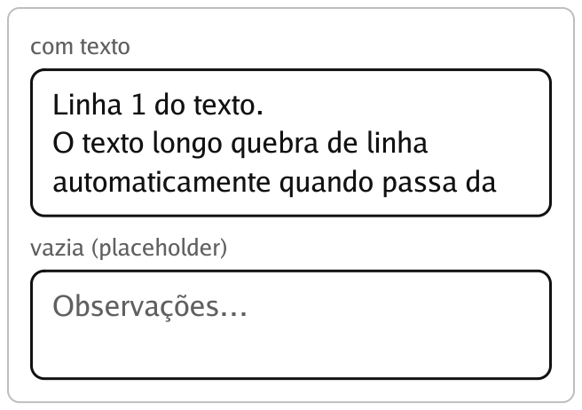

Um campo de várias linhas (`<textarea>`) com `Rows` linhas de altura. O texto quebra linha e mantém as quebras. Tocar abre
o teclado do sistema.

| | |
|---|---|
| Criar | `widget.NewTextArea(placeholder, linhas)` |
| Propriedades | `Value`, `Placeholder`, `Rows`, `MaxLength`, `ReadOnly` |
| Eventos | `OnChange` |

```go
// examples/components.go#TextAreaExample
// TextAreaExample is a multi-line field.
func TextAreaExample() widget.Widget {
	notes := widget.NewTextArea("Notes…", 4)
	notes.OnChange = func(e *widget.Event) { fmt.Println(len(notes.Value), "characters") }
	return notes
}
```

## Tabela de dados

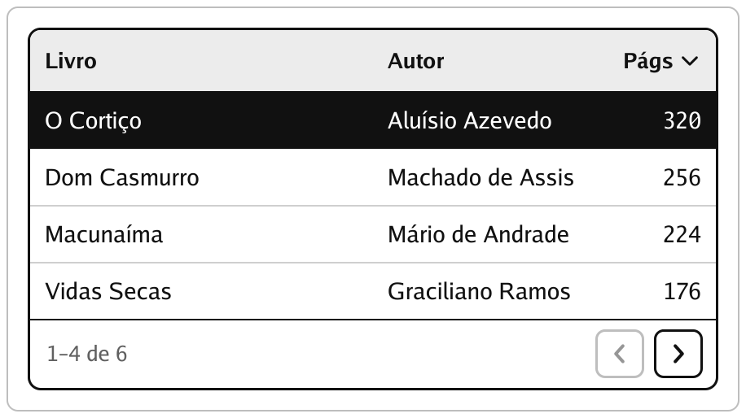

Uma tabela **paginada**. Toque no cabeçalho de uma coluna `Sortable` para ordenar (de novo, inverte; números ordenam como
números). Toque numa linha para selecioná-la (ela fica preenchida). O rodapé mostra "de–até de total" e as setas trocam de
página. `Selected` é sempre o índice em `Rows`, mesmo com a tabela ordenada.

| | |
|---|---|
| Criar | `widget.NewTable(linhasPorPágina, colunas...)` |
| `TableColumn` | `Title`, `Flex` (parte da largura), `Align`, `Sortable` |
| Propriedades | `Rows [][]string`, `PageSize`, `Page`, `Selected` (-1 = nenhuma), `SortCol`, `SortDesc`, `Summary func(de, até, total int) string` |
| Métodos | `PageCount()` |
| Eventos | `OnSelect` |

```go
// examples/components.go#TableExample
// TableExample is a sortable, selectable, paged table.
func TableExample() widget.Widget {
	table := widget.NewTable(4,
		widget.TableColumn{Title: "Book", Flex: 3, Sortable: true},
		widget.TableColumn{Title: "Pages", Flex: 1, Align: gfx.AlignEnd, Sortable: true})
	table.Rows = [][]string{
		{"Dom Casmurro", "256"}, {"Vidas Secas", "176"}, {"Iracema", "160"},
		{"Macunaíma", "224"}, {"O Cortiço", "320"}, {"A Hora da Estrela", "88"},
	}
	table.OnSelect = func(e *widget.Event) {
		fmt.Println("selected:", table.Rows[table.Selected][0]) // Selected indexes Rows
	}
	return table
}
```

## Barra de progresso

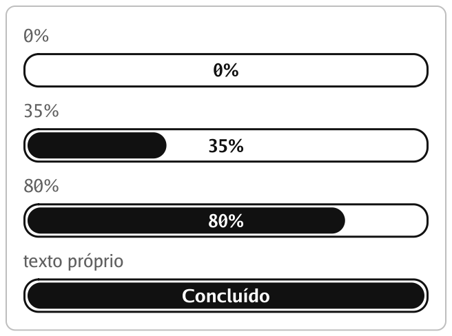

Uma barra de progresso com o percentual escrito dentro; o texto **inverte a cor** onde o preenchimento passa por baixo
dele. Defina `Text` para mostrar as suas próprias palavras.

| | |
|---|---|
| Criar | `widget.NewProgress(valor)` |
| Propriedades | `Value`, `Min`, `Max` (0–100 por padrão), `Text` |

```go
// examples/components.go#ProgressExample
// ProgressExample is a progress bar; change Value and the bar follows.
func ProgressExample() widget.Widget {
	bar := widget.NewProgress(35)
	bar.Value = 60 // 0..100
	return bar
}
```

## Gauge

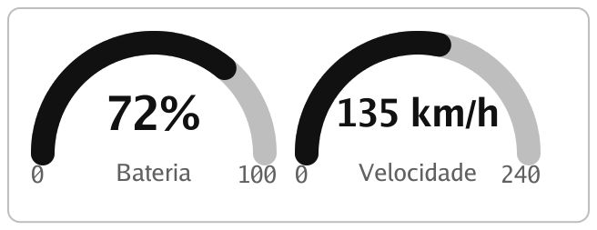

Um medidor semicircular (velocímetro) com o valor no meio, os limites nas pontas e um rótulo.

| | |
|---|---|
| Criar | `widget.NewGauge(mín, máx, valor, unidade)` |
| Propriedades | `Value`, `Min`, `Max`, `Unit`, `Label`, `Thickness` |

```go
// examples/components.go#GaugeExample
// GaugeExample is a semicircular meter.
func GaugeExample() widget.Widget {
	speed := widget.NewGauge(0, 240, 135, " km/h")
	speed.Label = "Speed"
	return speed
}
```

## Slider (slide button)

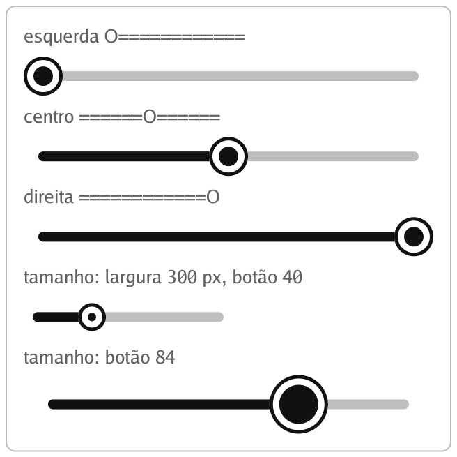

Uma **barra com um botão que desliza**. Toque em qualquer ponto ou arraste o botão; o `OnInput` dispara enquanto arrasta
e o `OnChange` quando o dedo é solto. O `Step` faz o botão **encaixar**: com `Step 50` de 0 a 100 ele só para na
esquerda, no centro e na direita (`O============`, `======O======`, `============O`). O **tamanho é configurável**: a caixa
(`Style.Width` / `Height`) e o botão (`ThumbSize`). A área de toque nunca é menor que 64 px, mesmo com o botão pequeno.

| | |
|---|---|
| Criar | `widget.NewSlider(mín, máx, passo, valor)` |
| Propriedades | `Min`, `Max`, `Step`, `Value`, `ThumbSize`; `SetValue(v)` (limita e encaixa) |
| Eventos | `OnInput` (arrastando), `OnChange` (solto) |

Um slider comum:

```go
// examples/components.go#SliderExample
// SliderExample is a bar with a knob you can drag; Step makes it snap.
func SliderExample() widget.Widget {
	volume := widget.NewSlider(0, 100, 5, 40)
	volume.OnInput = func(e *widget.Event) { fmt.Println("dragging:", volume.Value) }
	volume.OnChange = func(e *widget.Event) { fmt.Println("released:", volume.Value) }
	return volume
}
```

Um slide button de três posições com tamanho personalizado:

```go
// examples/components.go#SlideButtonExample
// SlideButtonExample is a slider with three resting places: left, center, right.
func SlideButtonExample() widget.Widget {
	position := widget.NewSlider(0, 100, 50, 50) // step 50: 0, 50 or 100
	position.Style.Width = widget.Px(420)        // configurable size...
	position.ThumbSize = 72                      // ...and knob
	position.OnChange = func(e *widget.Event) {
		names := map[float64]string{0: "left", 50: "center", 100: "right"}
		fmt.Println("position:", names[position.Value])
	}
	return position
}
```

## Chips

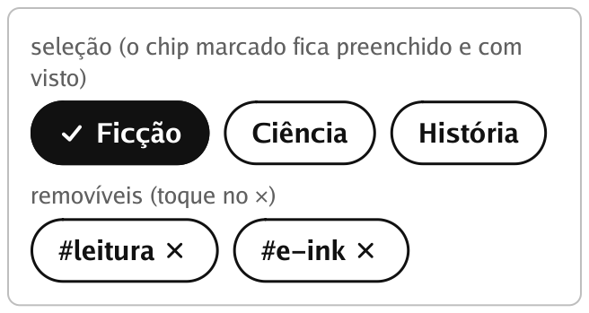

Cápsulas compactas. Num `ChipGroup` (quebra em várias linhas) a seleção pode ser **múltipla** ou **exclusiva**
(`NewChipGroup(true, ...)`: um por vez, como radio buttons). Com `Closable`, o **×** remove o chip (ou chama `OnClose`).

| | |
|---|---|
| Criar | `widget.NewChip(rótulo)`, `widget.NewChipGroup(exclusivo, chips...)` |
| Chip | `Label`, `Selected`, `Closable`, `OnChange`, `OnClose` |
| Grupo | `Exclusive`, `SelectedLabels()` |

```go
// examples/components.go#ChipsExample
// ChipsExample has selectable chips and removable chips.
func ChipsExample() widget.Widget {
	topics := widget.NewChipGroup(false) // true = only one selected at a time
	for _, name := range []string{"Fiction", "Science", "History"} {
		chip := widget.NewChip(name)
		chip.OnChange = func(e *widget.Event) { fmt.Println("topics:", topics.SelectedLabels()) }
		topics.AppendChild(chip)
	}

	tags := widget.NewChipGroup(false)
	for _, name := range []string{"#reading", "#e-ink"} {
		chip := widget.NewChip(name)
		chip.Closable = true // the × removes the chip
		tags.AppendChild(chip)
	}
	return widget.NewColumn(16, topics, tags)
}
```

## Calendário

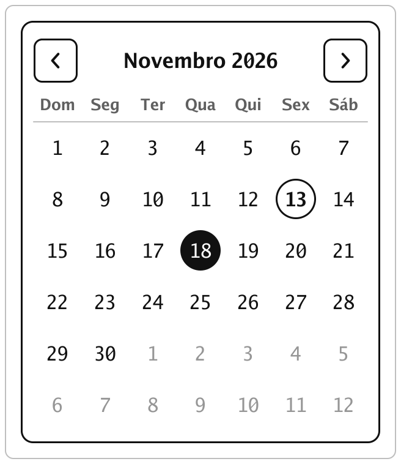

Um mês por vez. As setas trocam o mês, tocar num dia o seleciona (preenchido) e tocar num dia cinza de um mês vizinho
também vai até ele. O dia de hoje ganha um anel. Os nomes vêm do `Locale`.

| | |
|---|---|
| Criar | `widget.NewCalendar(selecionada)` (um `time.Time` zero mostra o mês de hoje sem nada selecionado) |
| Propriedades | `Selected`, `Today`, `Year`, `Month`, `Locale` (`widget.LocaleEN`, `widget.LocalePTBR`) |
| Métodos | `ShiftMonth(delta)` |
| Eventos | `OnChange` |

```go
// examples/components.go#CalendarExample
// CalendarExample picks a day.
func CalendarExample() widget.Widget {
	calendar := widget.NewCalendar(time.Now())
	calendar.Locale = widget.LocalePTBR
	calendar.OnChange = func(e *widget.Event) { fmt.Println("date:", calendar.Selected.Format("2006-01-02")) }
	return calendar
}
```

## Card

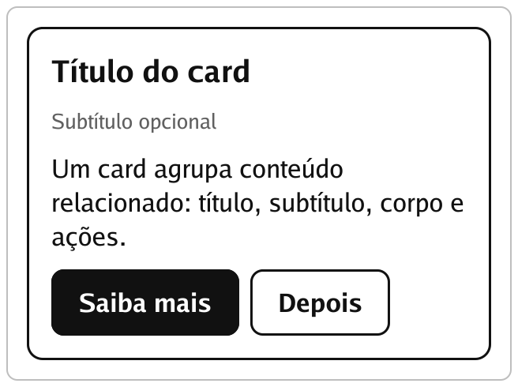

Uma superfície com borda e cantos arredondados que agrupa conteúdo relacionado: um título, um subtítulo opcional e o que
mais você adicionar (texto, campos, botões, tabelas…). É um `Panel` em coluna, então todas as propriedades de layout
valem.

| | |
|---|---|
| Criar | `widget.NewCard(título, subtítulo, filhos...)` |

```go
// examples/components.go#CardExample
// CardExample groups a title, a subtitle, text and actions.
func CardExample() widget.Widget {
	ok := widget.NewButton("Learn more")
	ok.SetVariant(widget.VariantPrimary)
	later := widget.NewButton("Later")
	return widget.NewCard("Card title", "Optional subtitle",
		widget.NewLabel("A card groups related content."),
		widget.NewRow(14, ok, later))
}
```

Próxima: [Eventos e estado →](07-eventos-e-estado.md)
