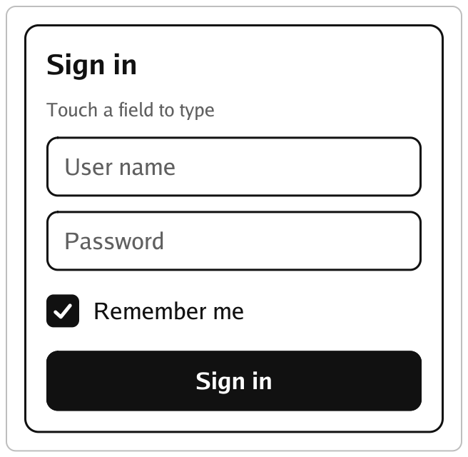
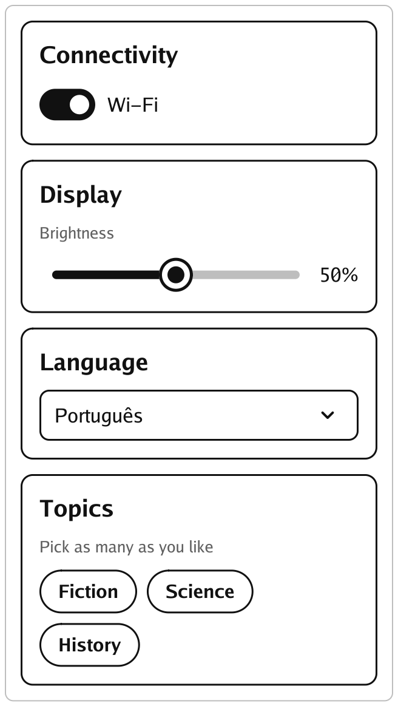
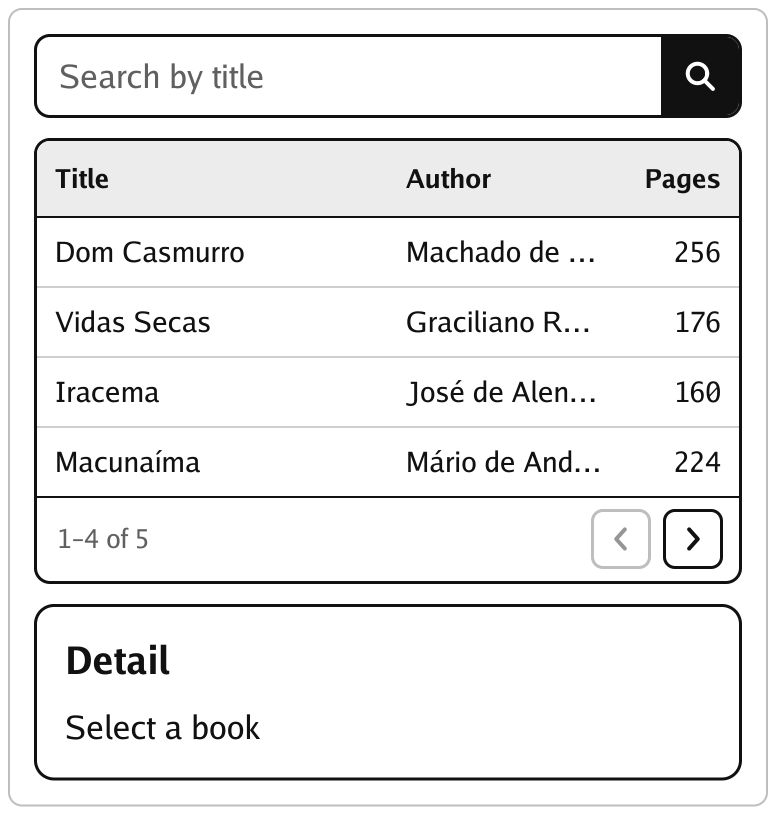
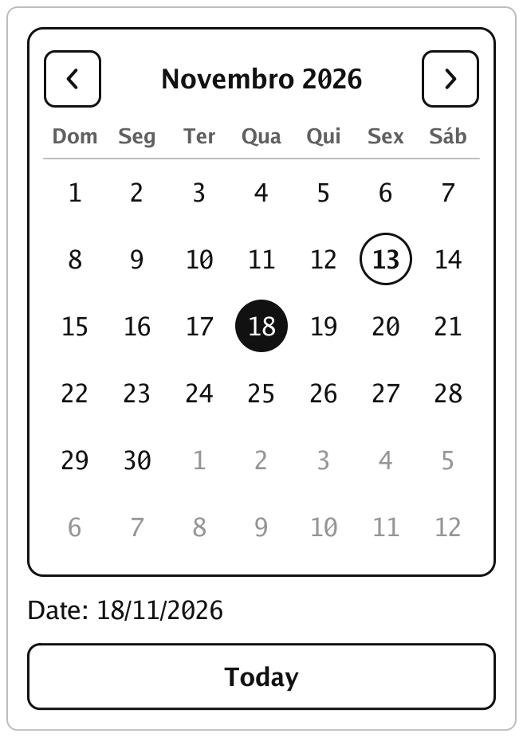
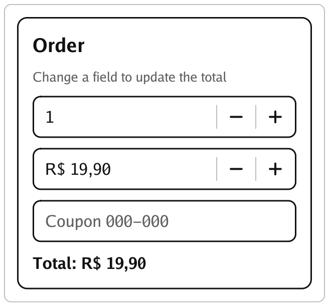

# 8. Receitas

[← Eventos e estado](07-eventos-e-estado.md) · [Índice](README.md) · [Próxima: Componentes próprios →](09-componentes-proprios.md)

Telas completas que você pode copiar e adaptar. Cada uma é um arquivo real em [`examples/`](../../examples), com testes, e
é montada com as mesmas peças das páginas anteriores.

> **Como usar uma receita.** Crie a tela, coloque-a num documento e dê um teclado ao documento:
>
> ```go
> login := recipes.NewLoginForm(func(user string, remember bool) { /* entrou */ })
> doc := harness.Screen(1404, 1872, deviceKeyboard{}, login.Root)
> ```
>
> No leitor, o `Screen` e o teclado vêm do seu `main` (veja `apps/hello`); em testes e previews use
> `&widget.FakeKeyboard{}`.

## Formulário de login com validação



Dois campos (um deles de senha), um check-box e um botão. A mensagem de erro é um label que começa **oculto** e é mostrado
pelo handler do botão quando os dados estão errados. O `onLogin` só é chamado com dados válidos.

O que observar: os campos são `*widget.Input` comuns guardados na struct, então o handler lê `f.User.Value`; alterna-se o
`Hidden` em vez de adicionar e remover elementos; o card põe tudo numa coluna que estica na largura.

```go
// examples/recipes/login.go
package recipes

import "go-pocketbook-base/internal/toolkit/widget"

// LoginForm is a sign-in screen with validation.
type LoginForm struct {
	Root     widget.Widget
	User     *widget.Input
	Password *widget.Input
	Remember *widget.Toggle
	Message  *widget.Label
}

// NewLoginForm builds the form. onLogin runs only when the data is valid.
func NewLoginForm(onLogin func(user string, remember bool)) *LoginForm {
	f := &LoginForm{
		User:     widget.NewInput("User name"),
		Password: widget.NewInput("Password"),
		Remember: widget.NewCheckbox("Remember me", true),
		Message:  widget.NewLabel(""),
	}
	f.Password.Type = widget.TypePassword
	f.Message.Hidden = true // shown only when there is an error
	f.Message.Style.Bold = true

	submit := widget.NewButton("Sign in")
	submit.SetVariant(widget.VariantPrimary)
	submit.OnClick = func(e *widget.Event) {
		switch {
		case f.User.Value == "":
			f.fail("Type your user name")
		case len(f.Password.Value) < 4:
			f.fail("The password needs at least 4 characters")
		default:
			f.Message.Hidden = true
			onLogin(f.User.Value, f.Remember.Checked)
		}
	}

	f.Root = widget.NewCard("Sign in", "Touch a field to type",
		f.User, f.Password, f.Remember, f.Message, submit)
	return f
}

func (f *LoginForm) fail(text string) {
	f.Message.Text = text
	f.Message.Hidden = false
}
```

## Tela de configurações



Uma página de preferências que mistura um **switch**, um **slider** (com o valor escrito ao lado), um **combo-box** e
**chips**. Cada controle fica no seu card.

O que observar: o slider tem `FlexGrow = 1`, então ocupa a largura que o rótulo do valor deixa livre; o `OnInput` atualiza o
rótulo enquanto o botão se move; `SetValue("pt")` escolhe a opção inicial do combo pelo valor.

```go
// examples/recipes/settings.go
package recipes

import (
	"fmt"

	"go-pocketbook-base/internal/toolkit/widget"
)

// Settings is a preferences screen that mixes a switch, a slider, a
// combo-box and chips.
type Settings struct {
	Root       widget.Widget
	WiFi       *widget.Toggle
	Brightness *widget.Slider
	Language   *widget.ComboBox
	Topics     *widget.ChipGroup
}

// NewSettings builds the screen with sensible defaults.
func NewSettings() *Settings {
	s := &Settings{
		WiFi:       widget.NewSwitch("Wi-Fi", true),
		Brightness: widget.NewSlider(0, 100, 5, 50),
		Language: widget.NewComboBox("Language",
			widget.Option{Label: "Português", Value: "pt"},
			widget.Option{Label: "English", Value: "en"},
			widget.Option{Label: "Español", Value: "es"}),
		Topics: widget.NewChipGroup(false),
	}
	s.Language.SetValue("pt")

	// The slider grows to fill the row; its value is shown at the right.
	level := widget.NewLabel("50%")
	s.Brightness.Style.FlexGrow = 1
	s.Brightness.OnInput = func(e *widget.Event) {
		level.Text = fmt.Sprintf("%.0f%%", s.Brightness.Value)
	}

	for _, topic := range []string{"Fiction", "Science", "History"} {
		s.Topics.AppendChild(widget.NewChip(topic))
	}

	s.Root = widget.NewColumn(24,
		widget.NewCard("Connectivity", "", s.WiFi),
		widget.NewCard("Display", "Brightness", widget.NewRow(12, s.Brightness, level)),
		widget.NewCard("Language", "", s.Language),
		widget.NewCard("Topics", "Pick as many as you like", s.Topics))
	return s
}
```

## Catálogo com busca



Um campo de busca acima de uma **tabela ordenável e paginada**, com um card de detalhe para a linha selecionada.

O que observar: a tabela é alimentada por `Rows` e a busca apenas troca `Rows` (e zera `Page` e `Selected`); o `OnSubmit` do
campo roda na lupa ou no OK do teclado, e o `OnChange` também dispara quando o botão limpar (×) esvazia o campo, o que
restaura a lista completa; `Table.Selected` indexa as `Rows` **exibidas**.

```go
// examples/recipes/catalog.go
package recipes

import (
	"strings"

	"go-pocketbook-base/internal/toolkit/gfx"
	"go-pocketbook-base/internal/toolkit/widget"
)

// Catalog is a searchable, sortable table with a detail card.
type Catalog struct {
	Root   widget.Widget
	Search *widget.Input
	Table  *widget.Table
	Detail *widget.Label

	all [][]string // every row; the table shows the filtered ones
}

// NewCatalog builds the screen; each row is {title, author, pages}.
func NewCatalog(rows [][]string) *Catalog {
	c := &Catalog{
		all:    rows,
		Search: widget.NewSearchInput("Search by title"),
		Detail: widget.NewLabel("Select a book"),
		Table: widget.NewTable(4,
			widget.TableColumn{Title: "Title", Flex: 3, Sortable: true},
			widget.TableColumn{Title: "Author", Flex: 2, Sortable: true},
			widget.TableColumn{Title: "Pages", Flex: 1, Align: gfx.AlignEnd, Sortable: true}),
	}
	c.Search.OnSubmit = func(e *widget.Event) { c.filter(c.Search.Value) }
	c.Search.OnChange = func(e *widget.Event) {
		if c.Search.Value == "" { // the clear (×) button
			c.filter("")
		}
	}
	c.Table.OnSelect = func(e *widget.Event) {
		row := c.Table.Rows[c.Table.Selected]
		c.Detail.Text = row[0] + " — " + row[1] + " (" + row[2] + " pages)"
	}
	c.filter("")

	c.Root = widget.NewColumn(20, c.Search, c.Table, widget.NewCard("Detail", "", c.Detail))
	return c
}

// filter keeps the rows whose title contains query (case-insensitive).
func (c *Catalog) filter(query string) {
	var rows [][]string
	for _, r := range c.all {
		if strings.Contains(strings.ToLower(r[0]), strings.ToLower(query)) {
			rows = append(rows, r)
		}
	}
	c.Table.Rows, c.Table.Page, c.Table.Selected = rows, 0, -1
}
```

## Seletor de data



Um calendário, a data escolhida escrita embaixo e um atalho **Today** (hoje). O callback recebe cada `time.Time` escolhido.

O que observar: levar o calendário a outro mês exige definir `Year` e `Month` junto com `Selected`; um `time.Time` zero
significa "sem data" e o rótulo avisa isso.

```go
// examples/recipes/datepicker.go
package recipes

import (
	"time"

	"go-pocketbook-base/internal/toolkit/widget"
)

// DatePicker is a calendar with the chosen date written below it and a
// "Today" shortcut.
type DatePicker struct {
	Root     widget.Widget
	Calendar *widget.Calendar

	chosen *widget.Label
}

// NewDatePicker builds the picker. onPick receives every chosen date.
func NewDatePicker(initial time.Time, onPick func(time.Time)) *DatePicker {
	p := &DatePicker{Calendar: widget.NewCalendar(initial), chosen: widget.NewLabel("")}
	p.Calendar.Locale = widget.LocalePTBR

	pick := func(t time.Time) {
		p.Calendar.Selected = t
		p.Calendar.Year, p.Calendar.Month = t.Year(), t.Month()
		p.show()
		onPick(t)
	}
	p.Calendar.OnChange = func(e *widget.Event) { pick(p.Calendar.Selected) }

	today := widget.NewButton("Today")
	today.OnClick = func(e *widget.Event) { pick(time.Now()) }

	p.show()
	p.Root = widget.NewColumn(20, p.Calendar, p.chosen, today)
	return p
}

func (p *DatePicker) show() {
	if p.Calendar.Selected.IsZero() {
		p.chosen.Text = "No date chosen"
		return
	}
	p.chosen.Text = "Date: " + p.Calendar.Selected.Format("02/01/2006")
}
```

## Pedido: números e máscaras



Uma quantidade (− / +), um preço unitário com prefixo e decimais e um cupom com **máscara de dígitos**. O **total é
recalculado** sempre que um campo muda; um cupom completo dá 10% de desconto.

O que observar: três campos compartilham um único `OnChange`; `Number()` lê os campos numéricos e `MaskSlots` diz quantos
dígitos a máscara pede; `DecimalSeparator = ","` mostra preços brasileiros enquanto o valor continua sendo um número normal.

```go
// examples/recipes/order.go
package recipes

import (
	"fmt"
	"strings"

	"go-pocketbook-base/internal/toolkit/widget"
)

// OrderForm shows numeric fields with − / + buttons, a digit mask and a total
// that is recalculated whenever a field changes.
type OrderForm struct {
	Root      widget.Widget
	Quantity  *widget.Input
	UnitPrice *widget.Input
	Coupon    *widget.Input

	total *widget.Label
}

// NewOrderForm builds the form with 1 item of R$ 19,90.
func NewOrderForm() *OrderForm {
	f := &OrderForm{total: widget.NewLabel("")}

	f.Quantity = widget.NewNumberInput(1, 0)
	f.Quantity.Min, f.Quantity.Max = 1, 20

	f.UnitPrice = widget.NewNumberInput(19.9, 2)
	f.UnitPrice.Prefix, f.UnitPrice.DecimalSeparator, f.UnitPrice.Step = "R$ ", ",", 0.5

	f.Coupon = widget.NewMaskedInput("000-000", "") // 6 digits: 123-456
	f.Coupon.NoSteppers, f.Coupon.Placeholder = true, "Coupon 000-000"

	for _, in := range []*widget.Input{f.Quantity, f.UnitPrice, f.Coupon} {
		in.OnChange = func(e *widget.Event) { f.recalculate() }
	}
	f.recalculate()

	f.total.Style.Bold = true
	f.Root = widget.NewCard("Order", "Change a field to update the total",
		f.Quantity, f.UnitPrice, f.Coupon, f.total)
	return f
}

// Total is quantity × price, with 10% off when the coupon is complete.
func (f *OrderForm) Total() float64 {
	total := f.Quantity.Number() * f.UnitPrice.Number()
	if len(f.Coupon.Value) == widget.MaskSlots(f.Coupon.Mask) {
		total *= 0.9
	}
	return total
}

func (f *OrderForm) recalculate() {
	f.total.Text = "Total: R$ " + strings.Replace(fmt.Sprintf("%.2f", f.Total()), ".", ",", 1)
}
```

## Navegação entre páginas com a menu bar

O `widget.Tabs` é uma menu bar no topo e um corpo embaixo que **troca de página**. Só a página atual fica na memória; o que
o usuário digitou ou escolheu é guardado na store das abas e devolvido quando a página volta, **para os elementos que têm
`ID`** (uma aba pode ser `TabRebuild` — começa do zero — ou `TabKeepAlive` — mantém a árvore inteira).

O que observar: `Tabs.Body` é onde se ajusta o padding (ele já ocupa tudo abaixo da barra); senhas nunca são lembradas; esta
função devolve um `Document` inteiro.

```go
// examples/recipes/navigation.go
package recipes

import (
	"go-pocketbook-base/internal/kernel/geom"
	"go-pocketbook-base/internal/toolkit/widget"
)

// NewPagedApp builds a whole application: tabs that switch between the Login,
// Settings and Catalog pages. Only the current page lives in memory; what the
// user typed or chose is kept in the Tabs store and put back when the page is
// shown again (every element that must be remembered has an ID).
func NewPagedApp(width, height int, kb widget.Keyboard) *widget.Document {
	books := [][]string{
		{"Dom Casmurro", "Machado de Assis", "256"},
		{"Vidas Secas", "Graciliano Ramos", "176"},
		{"Iracema", "José de Alencar", "160"},
	}
	tabs := widget.NewTabs(nil,
		&widget.Tab{Title: "Login", Build: func() widget.Widget {
			f := NewLoginForm(func(string, bool) {})
			f.User.ID, f.Remember.ID = "user", "remember" // the password is never remembered
			return f.Root
		}},
		&widget.Tab{Title: "Settings", Build: func() widget.Widget {
			s := NewSettings()
			s.WiFi.ID, s.Brightness.ID, s.Language.ID, s.Topics.ID = "wifi", "brightness", "language", "topics"
			return s.Root
		}},
		// TabKeepAlive keeps the whole page (and its data) in memory instead.
		&widget.Tab{Title: "Catalog", Mode: widget.TabKeepAlive, Build: func() widget.Widget { return NewCatalog(books).Root }})
	tabs.Body.Style.Padding = geom.All(28) // the body already takes everything below the bar

	doc := widget.NewDocument(width, height)
	doc.Keyboard = kb
	doc.SetRoot(tabs)
	return doc
}
```

## Um app inteiro no leitor

O `apps/hello` é o blueprint para começar um app de verdade. O `main` dele é só o manifesto, o ícone e uma chamada:

```go
// apps/hello/main.go#main
func main() {
	err := platform.Run(platform.Config{
		Manifest: manifest,
		// An app may draw its own launcher icon; without Icon the platform draws one
		// from the title (platform.DefaultIcon).
		Icon: func(size int, focused bool) image.Image { return showcase.RenderIcon(size, focused) },
	}, newHello)
	if err != nil {
		log.Fatal(err)
	}
}
```

e a tela é montada por uma fábrica que a plataforma chama quando já sabe o tamanho da tela:

```go
// apps/hello/hello.go#newHello
// newHello is the platform.Factory: the platform calls it once the screen size
// is known, with everything the app may need in env.
func newHello(env platform.Env) platform.App {
	return &hello{demo: showcase.New(env.Width, env.Height, showcase.Config{
		Version:  env.Version,
		Keyboard: env.Keyboard,
		Exit:     env.Exit,
		Notice:   env.Notice,
		Lang:     env.Lang,
		// The language chosen here becomes the language of every app.
		OnLangChange: func(lang string) { _ = env.Settings.Save(platform.Settings{Lang: lang}) },
	})}
}
```

O resto (toque, teclas, teclado do sistema, repintura parcial, registro na primeira execução) é o
`internal/platform`. Copie a pasta para `apps/<id>`, troque o `app.json` e a tela, e compile com
`.\build.ps1 -App <id>`. O contrato inteiro está em [Apps e o contrato](13-apps-e-o-contrato.md).

## Pequenos padrões

| Você quer | Faça |
|---|---|
| mostrar um erro só quando preciso | crie um `Label`, defina `Hidden = true` e alterne no handler |
| derivar um valor de vários campos | dê a eles um único `OnChange` que recalcula e escreve num label |
| filtrar uma lista | guarde os dados completos na sua struct e atribua a fatia filtrada a `Table.Rows` |
| executar código quando uma página abre | faça isso na função que troca a página (`show(i)`) |
| um handler para vários controles | percorra-os num laço e use `e.Target` |
| habilitar um botão só com o formulário válido | defina `button.Disabled = !valido` dentro dos `OnChange` dos campos |

Próxima: [Componentes próprios →](09-componentes-proprios.md)
