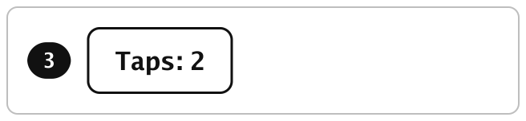

# 9. Componentes próprios

[← Receitas](08-receitas.md) · [Índice](README.md) · [Próxima: Testes →](10-testes.md)

Quando os componentes prontos não bastam, você cria o seu próprio **elemento**. Ele é uma struct Go comum que embute
`widget.Base` e participa do layout, do desenho e do toque exatamente como os componentes embutidos.

## A receita

1. **Embuta `widget.Base`** na sua struct.
2. No construtor chame **`Init(self)`** — isso liga o elemento a ele mesmo (necessário para os pais, o toque e as buscas
   no documento). Depois defina os valores padrão do `Style`.
3. Implemente **`Measure(avail)`**: o tamanho natural do seu *conteúdo* (sem padding nem borda).
4. Implemente **`Paint(canvas)`**: desenhe o conteúdo dentro de `ContentRect()`.
5. Para o toque, implemente **`HandlePointer(*widget.PointerEvent)`** e use **`widget.Fire`** para executar os callbacks do
   usuário.

Só isso. O fundo, a borda, `Hidden`, `Disabled`, o layout (flex/grid, margens, `FlexGrow`) e o `OnClick` vêm da `Base` e do motor
de layout.

## Exemplo: um badge só de exibição e um contador de toques



O `Badge` só desenha; o `TapCounter` também reage ao toque.

```go
// examples/customwidget.go
package examples

import (
	"strconv"

	"go-pocketbook-base/internal/geom"
	"go-pocketbook-base/internal/gfx"
	"go-pocketbook-base/internal/widget"
)

// Badge is a custom element: a dark pill showing a number. It only draws.
type Badge struct {
	widget.Base
	Count int
}

// NewBadge creates a badge. Every custom element calls Init with itself.
func NewBadge(count int) *Badge {
	b := &Badge{Count: count}
	b.Init(b)
	b.Style.Background = widget.Ink
	b.Style.BorderRadius = 24
	b.Style.Padding = geom.XY(6, 20)
	return b
}

// Measure reports the natural size of the content (the number).
func (b *Badge) Measure(avail float64) geom.Size {
	return geom.Size{W: gfx.TextWidth(strconv.Itoa(b.Count), widget.FontSmall, true), H: widget.FontSmall * 1.3}
}

// Paint draws the number; the pill itself comes from Style.Background.
func (b *Badge) Paint(c *gfx.Canvas) {
	c.Text(strconv.Itoa(b.Count), b.ContentRect(), gfx.TextStyle{
		Size: widget.FontSmall, Bold: true, Color: widget.Paper, Align: gfx.AlignCenter,
	})
}

// TapCounter is a custom interactive element: each tap adds one.
type TapCounter struct {
	widget.Base
	Count    int
	OnChange widget.Handler
}

// NewTapCounter creates a counter that looks like a button.
func NewTapCounter() *TapCounter {
	t := &TapCounter{}
	t.Init(t)
	t.Style.BorderColor, t.Style.BorderWidth, t.Style.BorderRadius = widget.Ink, widget.BorderThin, widget.Radius
	t.Style.Padding = geom.XY(0, 32)
	t.Style.MinHeight = widget.ControlHeight
	return t
}

func (t *TapCounter) label() string { return "Taps: " + strconv.Itoa(t.Count) }

// Measure implements widget.Widget.
func (t *TapCounter) Measure(avail float64) geom.Size {
	return geom.Size{W: gfx.TextWidth(t.label(), widget.FontBody, true), H: widget.FontBody * 1.3}
}

// Paint implements widget.Widget.
func (t *TapCounter) Paint(c *gfx.Canvas) {
	c.Text(t.label(), t.ContentRect(), gfx.TextStyle{
		Size: widget.FontBody, Bold: true, Color: widget.Ink, Align: gfx.AlignCenter,
	})
}

// HandlePointer makes the element a touch target (widget.PointerHandler).
func (t *TapCounter) HandlePointer(e *widget.PointerEvent) {
	if e.Type != widget.PointerClick {
		return
	}
	t.Count++
	widget.Fire(t.OnChange, t) // run the user's OnChange callback
}
```

Use-os como qualquer outro elemento:

```go
counter := examples.NewTapCounter()
counter.OnChange = func(e *widget.Event) { fmt.Println("toques:", counter.Count) }

row := widget.NewRow(16, examples.NewBadge(3), counter)
```

## Regras práticas

| Assunto | O que fazer |
|---|---|
| Tamanhos | pixels de design (a tela tem 1404 de largura); mantenha os alvos de toque ≥ 64 px — defina `Style.MinHeight`/`MinWidth` |
| Tamanho do conteúdo | o `Measure` devolve só o conteúdo; `Padding` e `BorderWidth` são somados por você |
| Área de desenho | desenhe dentro de `b.ContentRect()`; a caixa (`Background`, borda) já foi desenhada |
| Desabilitado | `Base.Disabled` bloqueia o toque por você; desenhe você mesmo o visual apagado (`widget.Disabled`, `widget.Mid`) |
| Callbacks | declare `OnChange widget.Handler` e chame `widget.Fire(t.OnChange, t)` |
| Toque | só o `PointerClick` (dedo solto sobre o elemento) é um toque; `PointerDown/Move/Up` servem para arrastar |
| Redesenho | um click redesenha sozinho; depois de outras mudanças chame `b.Invalidate()` |
| Contêineres | um elemento com filhos não precisa de `Measure`/`Paint`; basta usar `Style.Display` |
| Interativo × só exibição | um elemento só é alvo de toque se tiver `HandlePointer` ou um `OnClick` |

## API de desenho (`gfx.Canvas`)

Todas as coordenadas são pixels de design (`geom.Rect`, `geom.Point`).

| Chamada | Desenha |
|---|---|
| `c.Text(s, rect, gfx.TextStyle{Size, Bold, Color, Align, Ellipsis})` | uma linha de texto centralizada na vertical em `rect` |
| `c.FillRoundRect(rect, raio, cor)` / `c.StrokeRoundRect(rect, raio, largura, cor)` | retângulo arredondado preenchido / só contorno |
| `c.Line(a, b, largura, cor)` / `c.Polyline(pontos, largura, cor)` | linhas com pontas redondas |
| `c.FillCircle(centro, r, cor)` / `c.StrokeCircle(centro, r, largura, cor)` | disco / anel |
| `c.Arc(centro, r, a1, a2, largura, cor)` | um arco (radianos) |
| `c.Icon(tipo, rect, largura, cor)` | um dos ícones embutidos |
| `c.Clip(rect, raio)` … `c.ResetClip()` | restringe o desenho a um retângulo |
| `gfx.TextWidth(s, tamanho, negrito)` | largura de um texto, para usar no `Measure` |

As cores são `widget.Ink`, `Paper`, `Soft`, `Mid`, `Muted`, `Disabled` ou as suas (`gfx.Gray(v)`).

> **Fontes.** As fontes embutidas (Go Regular e Bold) cobrem as letras latinas com acento. Símbolos como "✓" não existem e
> aparecem como um quadrado: desenhe um ícone com `c.Icon`.

## Teste

```go
func TestTapCounter(t *testing.T) {
	counter := NewTapCounter()
	doc, _ := newDoc(counter)
	tap(doc, counter)
	if counter.Count != 1 {
		t.Fatal("um toque deve contar")
	}
}
```

Veja [Testes](10-testes.md) para os ajudantes.

Próxima: [Testes →](10-testes.md)
