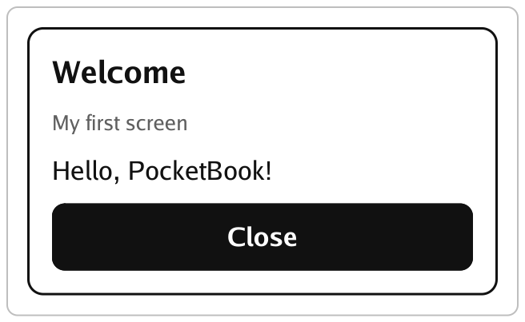

# go-pocketbook-base — Documentação

[🇬🇧 English](../en/README.md) · 🇧🇷 Português

O **go-pocketbook-base** é uma base para escrever **aplicativos para PocketBook (leitores Linux ARM) em Go**.
Ele traz:

- uma **biblioteca de componentes desenhada do zero com gráficos vetoriais** (botões, campos, tabelas,
  calendário…), organizada por um motor de **flex/grid** parecido com o CSS e pensada para e-ink;
- um binding enxuto para o leitor (toque, teclado do sistema, tela);
- um app que **se instala sozinho** (ícone de lançamento) na primeira execução;
- **build reproduzível em Docker** com o SDK do PocketBook e **versionamento** automático;
- tudo testável no seu PC, sem precisar do aparelho.

> Todo exemplo de código desta documentação vem da pasta [`examples/`](../../examples): ele compila, tem testes
> e o `go run ./tools/docsync` mantém as páginas idênticas a ele. Os comentários dentro do código ficam em
> inglês (o idioma do código-fonte); o texto ao redor é em português.

## Leia nesta ordem

| # | Página | O que você encontra |
|---|---|---|
| 1 | [Primeiros passos](01-primeiros-passos.md) | Do zero à sua primeira tela em minutos |
| 2 | [Instalação](02-instalacao.md) | Requisitos, instalar no leitor, primeira execução, desinstalar |
| 3 | [Build e versionamento](03-build-e-versionamento.md) | Docker, `build.ps1`/`make`, `.version`, testes, Sonar |
| 4 | [Conceitos](04-conceitos.md) | Como funciona: documento, componentes, coordenadas, desenho, toque |
| 5 | [Layout](05-layout.md) | `Style`, flex, grid, tamanhos, cores |
| 6 | [Componentes](06-componentes.md) | **Todos os componentes**: desenho, propriedades, código |
| 7 | [Eventos e estado](07-eventos-e-estado.md) | Callbacks, ler valores, mudar a tela |
| 8 | [Receitas](08-receitas.md) | Telas completas: login, configurações, catálogo, data, pedido, navegação |
| 9 | [Componentes próprios](09-componentes-proprios.md) | Criar o seu próprio elemento |
| 10 | [Testes](10-testes.md) | Testar telas e toque sem o aparelho |
| 11 | [Solução de problemas](11-solucao-de-problemas.md) | Particularidades do aparelho e problemas comuns |
| 12 | [Internacionalização](12-internacionalizacao.md) | pt-BR primeiro, fallback em inglês, traduções em JSON |
| 13 | [Apps e o contrato](13-apps-e-o-contrato.md) | `apps/<id>`, o manifesto, o ciclo de vida, o `apps/hello` como blueprint |

## Uma olhada rápida

```go
// examples/hello.go
package examples

import (
	"fmt"

	"go-pocketbook-base/internal/widget"
)

// Hello is the smallest useful screen: a card with a message and a button.
func Hello(onClose func()) widget.Widget {
	message := widget.NewLabel("Hello, PocketBook!")

	closeButton := widget.NewButton("Close")
	closeButton.SetVariant(widget.VariantPrimary)
	closeButton.OnClick = func(e *widget.Event) {
		fmt.Println("button tapped at", e.X, e.Y)
		onClose()
	}

	return widget.NewCard("Welcome", "My first screen", message, closeButton)
}
```



## Mapa do projeto

```
apps/hello         o app blueprint: uma vitrine de componentes que segue o contrato
internal/appkit    o que todo app compartilha: ciclo de vida, registro na primeira execução, manifesto
cmd/preview        gera as páginas da demo em PNG
examples/          código testado usado nesta documentação (e um modelo de app)
internal/widget    componentes, layout e toque  ← a biblioteca
internal/gfx       desenho vetorial (canvas, texto, ícones)
internal/inkview   binding do leitor (cgo)
internal/install   auto-instalação na primeira execução
tools/             bumpversion, docgen, docsync
docs/              esta documentação (en, pt-br) e as imagens dos componentes
```
